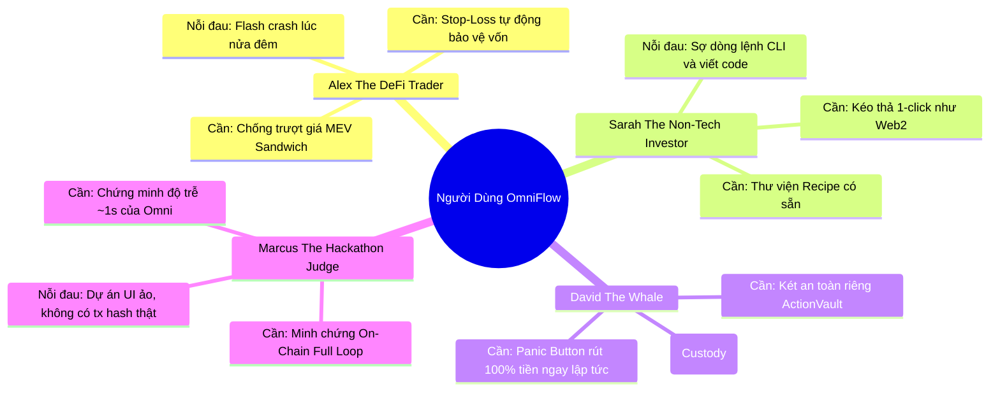
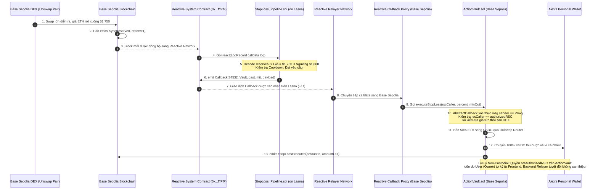
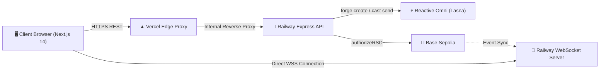
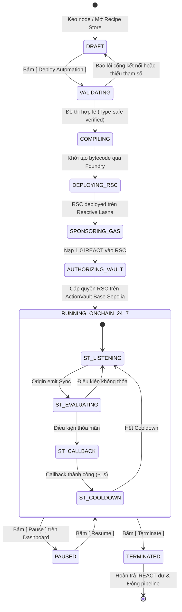
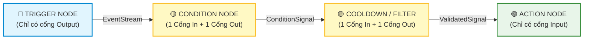
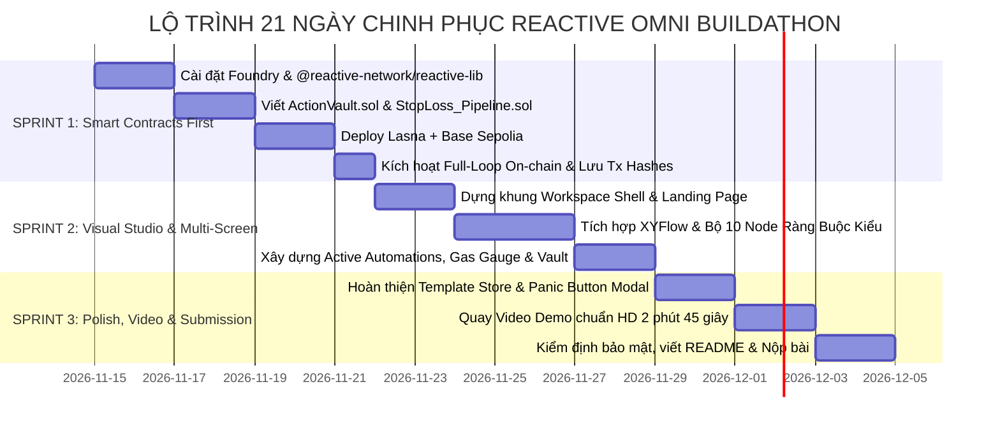

# OMNIFLOW — MASTER PROJECT BLUEPRINT
## No-Code Cross-Chain Automation Powered by Reactive Network Omni
### Tài Liệu Thiết Kế Toàn Diện, Kiến Trúc Hệ Thống & Kế Hoạch Triển Khai Thực Chiến

---

| **Thuộc Tính** | **Giá Trị Quy Chuẩn** |
| :--- | :--- |
| **Dự Án** | **OmniFlow** (*The Zapier of Web3*) |
| **Cuộc Thi** | **Reactive Omni Buildathon** (5/11/2026 – 5/12/2026) |
| **Track Mục Tiêu** | **Set It and Forget It** (Giải Nhất: $2,000 USD / Runner-up: $250 USD) |
| **Độ Ưu Tiên** | Production-Grade Hackathon Winning Specification |
| **Hạ Tầng Mục Tiêu** | Reactive Omni Lasna Testnet (`Chain ID: 5318007`) & Base Sepolia (`Chain ID: 84532`) |
| **Phiên Bản** | `1.0.0-RELEASE-CANDIDATE` |
| **Ngày Phát Hành** | 14/11/2026 |

---

## MỤC LỤC CHI TIẾT

1. [TỔNG QUAN CHIẾN LƯỢC & ĐỀ BÀI HACKATHON (EXECUTIVE SUMMARY)](#1-tổng-quan-chiến-lược--đề-bài-hackathon-executive-summary)
   - 1.1 Bối cảnh nâng cấp Reactive Omni (CometBFT ~1s & Base Sepolia Denim 200ms)
   - 1.2 Định vị sản phẩm: "The Zapier of Web3"
   - 1.3 Ma trận chinh phục 4 tiêu chí chấm điểm (Execution, Integration, Usefulness, Craft)
   - 1.4 Chân dung người dùng (Alex, Sarah, David, Marcus) & Bảng phân tích WHY
2. [KIẾN TRÚC HỆ THỐNG TOÀN DIỆN (SYSTEM ARCHITECTURE)](#2-kiến-trúc-hệ-thống-toàn-diện-system-architecture)
   - 2.1 Mô hình phân tầng Decoupled Asynchronous State
   - 2.2 Luồng khép kín chuẩn (The Complete Closed Loop)
   - 2.3 Sửa sai cơ chế Callback Proxy & Relayer
   - 2.4 Cấu trúc mạng & Cơ chế phân bổ Gas Sponsorship
3. [CẤU TRÚC THƯ MỤC MONOREPO & HẠ TẦNG TRIỂN KHAI CLOUD (VERCEL & RAILWAY)](#3-cấu-trúc-thư-mục-monorepo--hạ-tầng-triển-khai-cloud-vercel--railway)
   - 3.1 Cấu trúc Monorepo tiêu chuẩn (`contracts/`, `frontend/`, `backend/`, `packages/shared/`)
   - 3.2 Hạ tầng Frontend trên Vercel (Next.js 14 App Router, Web3 & Canvas Optimization)
   - 3.3 Hạ tầng Backend trên Railway (Docker Multi-stage với Foundry Toolchain, Express & WSS)
   - 3.4 Ma trận biến môi trường (Environment Variables Matrix cho Vercel & Railway)
   - 3.5 Cấu hình kết nối Cross-Service: CORS, Reverse Proxy, WSS Keep-Alive & Health Check
   - 3.6 Quy trình CI/CD & Deploy tự động qua GitHub
4. [KIẾN TRÚC SMART CONTRACTS & 4 DEFENSIVE DESIGN PATTERNS](#4-kiến-trúc-smart-contracts--4-defensive-design-patterns)
   - 4.1 Hợp đồng đích: `ActionVault.sol` (Base Sepolia)
   - 4.2 Hợp đồng phản ứng: `StopLoss_Pipeline.sol` (Reactive Omni)
   - 4.3 Pattern 1: Callback Proxy Authentication Pattern (Xác thực 2 chiều)
   - 4.4 Pattern 2: In-Flight Callback Protection Pattern (Cờ pending chống dội block 200ms)
   - 4.5 Pattern 3: Live Price Re-Validation Pattern (Tái thẩm định giá tức thời chống Stale Trigger)
   - 4.6 Pattern 4: Dual-Way Event State Synchronization (Gương phản chiếu sự kiện)
   - 4.7 Non-Custodial Emergency Exit (Panic Button)
5. [VISUAL PIPELINE STUDIO & ENGINE ĐỒ THỊ RÀNG BUỘC](#5-visual-pipeline-studio--engine-đồ-thị-ràng-buộc)
   - 5.1 Vòng đời Canvas: Từ bản vẽ UI đến hợp đồng tự trị 24/7/365
   - 5.2 State Machine 10 trạng thái của Node & Pulse Animation
   - 5.3 Danh mục 10 Node Tinh hoa (Lean Orthogonal Catalog) & Lý do loại bỏ 3 node dư thừa
   - 5.4 Quy chuẩn cổng kết nối (Constrained Typed Ports)
   - 5.5 Trình phân giải đồ thị sang mã nguồn (Graph-to-Solidity Engine)
6. [ĐẶC TẢ CHI TIẾT 5 MÀN HÌNH WORKSPACE & LANDING PAGE](#6-đặc-tả-chi-tiết-5-màn-hình-workspace--landing-page)
   - 6.1 Landing Page: Hero, Tech Metrics & Interactive Mini-Canvas
   - 6.2 Màn hình 1: Pipeline Studio (Hero Workspace)
   - 6.3 Màn hình 2: Active Automations (Giám sát 24/7 & Gas Gauge)
   - 6.4 Màn hình 3: Template Library (Recipe Store 1-Click)
   - 6.5 Màn hình 4: Vault Manager (Quản lý vốn & Panic Button)
   - 6.6 Màn hình 5: Activity Logs & Cross-Chain Explorer (Proof Stream)
7. [MA TRẬN 12 KỊCH BẢN THỰC CHIẾN (12 SURVIVAL SCENARIOS)](#7-ma-trận-12-kịch-bản-thực-chiến-12-survival-scenarios)
   - 7.1 Trụ cột 1: Quản trị rủi ro & Cắt lỗ / Chốt lời (Scenarios 1-4)
   - 7.2 Trụ cột 2: Bảo vệ ví & Chống hack Drainer (Scenarios 5-6)
   - 7.3 Trụ cột 3: Theo dõi & Bám đuôi Cá Voi (Scenarios 7-8)
   - 7.4 Trụ cột 4: Quản lý danh mục tự động 24/7 (Scenarios 9-12)
8. [CHUẨN DỮ LIỆU, API VÀ SCHEMA THÔNG TIN](#8-chuẩn-dữ-liệu-api-và-schema-thông-tin)
   - 8.1 Graph Pipeline JSON Export Schema
   - 8.2 Backend REST API: `/api/pipeline/compile-and-deploy`
   - 8.3 Real-time WebSocket Protocol & Event Schema
9. [LỘ TRÌNH 21 NGÀY: CONTRACTS-FIRST SPRINT PLAN](#9-lộ-trình-21-ngày-contracts-first-sprint-plan)
   - 9.1 Sprint 1 (Ngày 1 - 7): Core Contracts & Full Loop Proof On-chain
   - 9.2 Sprint 2 (Ngày 8 - 14): Workspace UI, XYFlow Canvas & Template Hydration
   - 9.3 Sprint 3 (Ngày 15 - 21): Live Visualizer, Hardening, Video Demo & Submission
10. [KỊCH BẢN VIDEO DEMO < 3 PHÚT & BỘ TIÊU CHÍ SUBMISSION](#10-kịch-bản-video-demo--3-phút--bộ-tiêu-chí-submission)
   - 10.1 Kịch bản Video Demo 2 phút 45 giây (5-Act Winning Structure)
   - 10.2 Checklist chuẩn bị nộp bài chính thức

---

# 1. TỔNG QUAN CHIẾN LƯỢC & ĐỀ BÀI HACKATHON (EXECUTIVE SUMMARY)

### 1.1 Bối Cảnh Kỹ Thuật: Bước Nhảy Vọt Reactive Omni
* **Vấn đề của Reactive Legacy:** Phiên bản trước đây có chu kỳ tạo block xấp xỉ ~7 giây. Khoảng thời gian này quá dài đối với các giao dịch DeFi nhạy cảm về thời gian (arbitrage, stop-loss, liquidations), khiến trượt giá nghiêm trọng và bot MEV cuỗm mất cơ hội.
* **Đột phá từ Reactive Omni:** 
  * Sử dụng thuật toán đồng thuận **CometBFT**, đưa block time xuống **~1 giây với Instant Finality** (tính bất biến ngay tức thì, không bị reorg).
  * Cho phép các Reactive Smart Contracts (RSC) lắng nghe sự kiện on-chain và kích hoạt callback sang chuỗi đích trong tích tắc.
* **Môi trường chuỗi đối tác:**
  * **Base Sepolia (`Chain ID: 84532`):** Sau bản nâng cấp Denim, block time của Base rút xuống chỉ còn **200ms**. Tốc độ này đòi hỏi RSC phải xử lý thông minh để không gây dội lặp giao dịch (In-flight burst).
  * **Reactive Lasna Testnet (`Chain ID: 5318007`):** Nền tảng điều phối logic phi tập trung (RSC Virtual Machine).

---

### 1.2 Định Vị Sản Phẩm: "The Zapier of Web3"
```
                Zapier (Web2)                    OmniFlow (Web3)
         ─────────────────────────────      ─────────────────────────────
Trigger  Gmail receives an invoice   ───►   Uniswap Pair emits Sync event
Filter   Amount > $1,000             ───►   ETH Price drops below $1,800
Action   Create a QuickBooks entry   ───►   Swap ETH to USDC in ActionVault
Platform Centralized Cloud Server    ───►   Decentralized Reactive Omni (1s)
```

> **Định vị cốt lõi:**  
> **"OmniFlow — The Zapier of Web3: No-Code Cross-Chain Automation Powered by Reactive Omni."**  
> Dự án biến các hợp đồng RSC phức tạp (`topic_0`, `LogRecord`, byte-decoding, `service.subscribe`) thành những khối trực quan kéo thả. Người dùng không cần biết viết một dòng Solidity nào vẫn có thể thiết lập các chiến lược bảo vệ tài sản và tự động hóa danh mục cá nhân 24/7.

---

### 1.3 Ma Trận Chinh Phục 4 Tiêu Chí Chấm Điểm Của Ban Giám Khảo

| Tiêu Chí (Trọng số 25%) | Yêu Cầu Của Ban Giám Khảo | Chiến Lược Hiện Thực Hóa Của OmniFlow | Mức Độ Cam Kết |
| :--- | :--- | :--- | :---: |
| **1. Execution (Chạy Thật)** | Bắt buộc phải có giao dịch Reactive và Callback on-chain thật được xác minh qua explorer. Không có tx hash = 0 điểm. | • Triển khai quy trình **Contracts-First ngay Tuần 1**.<br>• Xuất bản tối thiểu 3 Tx Hashes vòng lặp Origin $\rightarrow$ Reactive $\rightarrow$ Destination.<br>• Cung cấp màn hình Activity Logs hiển thị link Reactscan & Basescan trực tiếp. | **100% Đạt Điểm Tuyệt Đối** |
| **2. Integration (Tích Hợp Thực Chất)** | RSC phải làm công việc thực chất, không được gắn vào cho có ("bolted on"). | • RSC trực tiếp decode `reserve0, reserve1` từ `Sync` event, tính toán tỷ giá toán học.<br>• Kiểm tra Cooldown, cờ Pending và trượt giá trước khi kích hoạt `emit Callback(...)`.<br>• RSC là "bộ não điều hướng" duy nhất, không dùng bất kỳ server keeper tập trung nào. | **100% Đạt Điểm Tuyệt Đối** |
| **3. Usefulness (Tính Thực Tiễn)** | Giải quyết vấn đề nhức nhối thực tế; là công cụ mà người dùng thực sự muốn duy trì chạy 24/7. | • Giải quyết nỗi sợ Flash Crash lúc nửa đêm và rủi ro rút ruột ví (phishing drainer).<br>• Cơ chế két phi lưu ký (`ActionVault`) kèm **Nút Khẩn Cấp (Panic Button)** giúp user an tâm 100% về tiền bạc.<br>• Quản trị gas thông minh qua tiện ích **Gas Gauge & 1-Click Refuel**. | **100% Đạt Điểm Tuyệt Đối** |
| **4. Craft (Độ Tinh Xảo & Trình Bày)** | Code chuẩn mực, UI/UX mượt mà, tài liệu chỉn chu, video demo dưới 3 phút xuất sắc. | • Giao diện Studio kéo thả dựa trên `@xyflow/react` với hiệu ứng dòng photon phát sáng.<br>• Kiến trúc smart contract tuân thủ kiểm định bảo mật, code sạch chuẩn NatSpec.<br>• Video demo 2 phút 45 giây theo cấu trúc 5 màn kịch tính. | **100% Đạt Điểm Tuyệt Đối** |

---

### 1.4 Chân Dung Người Dùng (Personas) & Bảng Phân Tích WHY



* **Alex (Trader):** *"Tôi không thể thức 24/7 để canh bảng điện. OmniFlow tự động swap ETH sang USDC khi giá rớt qua $1,800 trong 1 giây, tiền về thẳng ví cá nhân."*
* **Sarah (Non-tech):** *"Tôi không biết Solidity. Nhờ Recipe Store, tôi chọn mẫu Stop-Loss, chỉnh số tiền và bấm Deploy là xong."*
* **David (Whale):** *"Tôi không bao giờ nạp tiền vào hợp đồng nếu không có lối thoát hiểm. Nút Panic Button của ActionVault cho phép tôi rút cạn tiền về ví cá nhân bất kỳ lúc nào."*
* **Marcus (Judge):** *"Tôi cần thấy tx hash thật trên Lasna Reactscan và Base Sepolia Explorer chứng minh RSC xử lý logic thực tế."*

---

# 2. KIẾN TRÚC HỆ THỐNG TOÀN DIỆN (SYSTEM ARCHITECTURE)

### 2.1 Mô Hình Phân Tầng Decoupled Asynchronous State

Hệ thống được tổ chức thành 3 tầng phân tách độc lập, đảm bảo rằng một khi pipeline đã được deploy thì sẽ vận hành vĩnh cửu trên blockchain kể cả khi người dùng đóng trình duyệt:

```
┌────────────────────────────────────────────────────────────────────────┐
│  TIER 1: CLIENT FRONTEND (Next.js 14 / React + XYFlow + TailwindCSS)   │
│  ┌──────────────────┐   ┌──────────────────────┐   ┌────────────────┐  │
│  │ 10-Node Palette  │──>│ Visual Studio Canvas │──>│ Inspector      │  │
│  │ (Trigger/Cond/Act│   │ (Typed Port System)  │   │ Configuration  │  │
│  └──────────────────┘   └──────────────────────┘   └────────────────┘  │
│             │                        │                        │        │
│             └────────────────────────┼────────────────────────┘        │
│                                      ▼                                 │
│                         Graph JSON Serialization                       │
└──────────────────────────────────────┬─────────────────────────────────┘
                                       │ HTTP POST / WebSocket
                                       ▼
┌────────────────────────────────────────────────────────────────────────┐
│  TIER 2: BACKEND RUNNER & RELAYER SERVICE (Node.js / Express / Foundry) │
│  ┌────────────────────────┐  ┌───────────────────────────────────────┐ │
│  │ Pipeline JSON Parser   │─>│ Foundry Toolchain Runner              │ │
│  │ (Validates & Hydrates  │  │ - forge build bytecode                │ │
│  │  Solidity Templates)   │  │ - forge create -> Reactive Lasna      │ │
│  └────────────────────────┘  └───────────────────────────────────────┘ │
│                 │                                │                     │
│                 ▼                                ▼                     │
│  ┌────────────────────────┐  ┌───────────────────────────────────────┐ │
│  │ Relayer Gas Sponsor    │  │ ActionVault Binding Controller        │ │
│  │ (Funds lREACT to RSC)  │  │ (Authorizes RSC on Base Sepolia)      │ │
│  └────────────────────────┘  └───────────────────────────────────────┘ │
└──────────────────────────────────────┬─────────────────────────────────┘
                                       │ On-Chain Transactions
                                       ▼
┌────────────────────────────────────────────────────────────────────────┐
│  TIER 3: MULTI-CHAIN CONSENSUS LAYER (Reactive Omni + Base Sepolia)    │
│                                                                        │
│   ORIGIN CHAIN (Base Sepolia - 200ms)    REACTIVE OMNI (Lasna - ~1s)   │
│   ┌───────────────────────────────┐      ┌───────────────────────────┐ │
│   │ Uniswap V2 Pair (WETH/USDC)   │      │ Deployed RSC              │ │
│   │ emits Sync(reserve0, reserve1)│─────>│ - Subscribes to Origin    │ │
│   └───────────────────────────────┘      │ - Decodes LogRecord       │ │
│                                          │ - Checks Cooldown & Price │ │
│   DESTINATION CHAIN (Base Sepolia)       │ - Emits Callback (~1s)    │ │
│   ┌───────────────────────────────┐      └─────────────┬─────────────┘ │
│   │ ActionVault.sol (Non-Custodial│                    │ Relayed via   │
│   │ - Verifies Reactive Proxy     │<───────────────────┘ CallbackProxy │
│   │ - Re-validates Live Price     │                                    │
│   │ - Swaps ETH -> USDC           │                                    │
│   │ - Transfers USDC to User      │                                    │
│   │ - Panic Button: Emergency Exit│                                    │
│   └───────────────────────────────┘                                    │
└────────────────────────────────────────────────────────────────────────┘
```

---

### 2.2 Luồng Khép Kín Chuẩn (The Complete Closed Loop)



---

### 2.3 Sửa Sai Chí Mạng Về Cơ Chế Callback Proxy
* **Hiểu lầm nguy hiểm:** Nhiều developer lầm tưởng rằng trên Base Sepolia, biến `msg.sender` gọi vào `ActionVault` chính là địa chỉ của hợp đồng RSC trên Lasna.
* **Thực tế on-chain:** Hợp đồng RSC nằm trên chuỗi `5318007`, không thể tự ý gọi giao dịch sang chuỗi `84532`. Cuộc gọi trên Base Sepolia **bắt buộc được thực thi bởi tài khoản Reactive Callback Proxy chính thức**.
* **Chuẩn xác kỹ thuật:**
  1. Hợp đồng `ActionVault` phải kế thừa `AbstractCallback` từ `@reactive-network/reactive-lib/src/abstract-sdk/AbstractCallback.sol`.
  2. Constructor nhận vào địa chỉ `callbackSender` (Reactive Callback Proxy trên Base Sepolia).
  3. Khi hàm callback được gọi, Callback Proxy tự động tiêm địa chỉ của RSC vào làm tham số đầu tiên `address rscCaller`.
  4. Hợp đồng `ActionVault` kiểm tra kép:
     $$\text{msg.sender} == \text{callbackSender} \quad \land \quad \text{rscCaller} == \text{authorizedRSC}$$

---

### 2.4 Cấu Trúc Mạng & Cơ Chế Gas Sponsorship (Tài Trợ Gas)
* **Vấn đề vòng đời gas:** Mọi lệnh `emit Callback(...)` trên RSC đều tiêu tốn token mạng `lREACT`. Nếu số dư `lREACT` về 0, RSC sẽ ngừng phát sinh callback dù điều kiện giá vẫn thỏa mãn.
* **Giải pháp UX Web3:**
  1. **Khởi tạo 1-Click:** Khi người dùng bấm Deploy, Backend Service tự động nạp sẵn `1.0 lREACT` vào hợp đồng RSC mới deploy (đủ nuôi ~20 lần callback).
  2. **Gas Balance Gauge:** Trên Dashboard của người dùng luôn có thanh đo hiển thị số dư gas còn lại trong RSC theo thời gian thực.
  3. **Refuel Modal:** Khi gas xuống thấp (< 0.2 lREACT), hệ thống bật cảnh báo màu vàng và cung cấp nút **[+ Refuel Gas]** để nạp thêm trực tiếp.

---

# 3. CẤU TRÚC THƯ MỤC MONOREPO & HẠ TẦNG TRIỂN KHAI CLOUD (VERCEL & RAILWAY)

Nhằm đáp ứng yêu cầu vận hành thực chiến tốc độ cao trong môi trường Hackathon 21 ngày, kiến trúc mã nguồn và hạ tầng Cloud của OmniFlow được phân tách theo mô hình **Monorepo chuẩn mực**: Frontend được tối ưu hóa triển khai trên **Vercel** (Global Edge CDN), còn Backend điều phối biên dịch và Relayer được đóng gói Docker triển khai trên **Railway** (High-Performance Container Runtime tích hợp sẵn công cụ dòng lệnh Foundry).

---

### 3.1 Cấu Trúc Monorepo Tiêu Chuẩn

Hệ thống sử dụng `pnpm workspace` để quản lý tập trung mã nguồn Smart Contract, Frontend Web3, Backend Service và các thư viện dùng chung (Shared Packages):

```
omniflow/
├── .github/
│   └── workflows/
│       ├── test-contracts.yml            # CI: Chạy forge test tự động khi push
│       └── lint-and-typecheck.yml        # CI: Kiểm tra TypeScript & ESLint
│
├── contracts/                             # FOUNDRY TOOLCHAIN (Smart Contracts)
│   ├── lib/
│   │   ├── forge-std/                    # Thư viện kiểm thử chuẩn Foundry
│   │   └── reactive-lib/                 # @reactive-network/reactive-lib chính thức
│   ├── src/
│   │   ├── ActionVault.sol               # Két an toàn phi lưu ký (Base Sepolia)
│   │   ├── StopLoss_Pipeline.sol         # Hợp đồng phản ứng RSC (Reactive Lasna)
│   │   └── interfaces/
│   │       ├── IUniswapV2Router02.sol    # Interface gọi swap trên DEX
│   │       └── IUniswapV2Pair.sol        # Interface đọc dự trữ pool Sync
│   ├── test/
│   │   ├── ActionVault.t.sol             # Test rút khẩn cấp, xác thực Proxy, trượt giá
│   │   └── StopLoss_Pipeline.t.sol       # Test giải mã LogRecord, Cooldown, Callback
│   ├── script/
│   │   ├── DeployVault.s.sol             # Script deploy ActionVault lên Base Sepolia
│   │   └── DeployRSC.s.sol               # Script deploy RSC lên Reactive Lasna
│   └── foundry.toml                      # Cấu hình RPC profiles, optimizer, solc 0.8.20
│
├── frontend/                              # NEXT.JS 14 APP ROUTER (Deploy trên VERCEL)
│   ├── public/                           # Static assets, tokens logo (ETH, USDC), favicon
│   ├── src/
│   │   ├── app/                          # Next.js 14 App Router
│   │   │   ├── layout.tsx                # Root layout (Web3 WagmiProvider, Theme)
│   │   │   ├── page.tsx                  # Landing Page (Hero, Omni metrics, Demo mini)
│   │   │   └── workspace/
│   │   │       ├── layout.tsx            # Workspace Shell (Sidebar điều hướng 5 màn)
│   │   │       ├── studio/page.tsx       # Màn 1: Pipeline Studio (XYFlow Canvas)
│   │   │       ├── active/page.tsx       # Màn 2: Active Automations (Giám sát & Gas)
│   │   │       ├── templates/page.tsx    # Màn 3: Template Library (Recipe Store 1-Click)
│   │   │       ├── vault/page.tsx        # Màn 4: Vault Manager (Tài sản & Panic Button)
│   │   │       └── logs/page.tsx         # Màn 5: Activity Logs & Cross-Chain Stream
│   │   ├── components/
│   │   │   ├── canvas/                   # StudioCanvas, CustomNodes, CustomEdges
│   │   │   ├── palette/                  # NodePalette (Danh mục 10 Node Tinh hoa)
│   │   │   ├── inspector/                # InspectorPanel (Form cấu hình tham số)
│   │   │   ├── vault/                    # PanicButtonModal, DepositWithdrawForm
│   │   │   ├── automations/              # GasGaugeWidget, PipelineCard
│   │   │   └── common/                   # Navbar, Sidebar, StatCard, Badge, Button
│   │   ├── hooks/
│   │   │   ├── useReactiveWebSocket.ts   # Hook kết nối WSS tới Railway backend
│   │   │   ├── usePipelineDeploy.ts      # Hook gọi API compile-and-deploy
│   │   │   └── useVaultManager.ts        # Hook tương tác ActionVault (wagmi/viem)
│   │   ├── lib/
│   │   │   ├── wagmi.ts                  # Cấu hình mạng Base Sepolia & Reactive Lasna
│   │   │   ├── constants.ts              # Địa chỉ contract, ABIs, token config
│   │   │   └── api-client.ts             # Axios client kết nối Railway backend
│   │   └── types/                        # UI state types, node visual types
│   ├── next.config.mjs                   # Cấu hình Next.js (transpile, images)
│   ├── tailwind.config.ts                # Cấu hình Web3 Dark Theme cao cấp
│   ├── vercel.json                       # Cấu hình Vercel (rewrites, custom headers)
│   └── package.json
│
├── backend/                               # NODE.JS + FOUNDRY WORKER (Deploy trên RAILWAY)
│   ├── src/
│   │   ├── server.ts                     # Entry point: Express REST API + WSS Server
│   │   ├── config/
│   │   │   ├── env.ts                    # Khởi tạo & validate biến môi trường (Zod)
│   │   │   └── networks.ts               # RPC URLs, chain IDs, contract addresses
│   │   ├── routes/
│   │   │   ├── pipeline.routes.ts        # POST /api/pipeline/compile-and-deploy
│   │   │   ├── vault.routes.ts           # GET /api/vault/:address/status
│   │   │   └── health.routes.ts          # GET /health (Railway health check)
│   │   ├── controllers/
│   │   │   ├── pipeline.controller.ts    # Tiếp nhận đồ thị JSON từ frontend
│   │   │   └── vault.controller.ts       # Đọc số dư và trạng thái két
│   │   ├── services/
│   │   │   ├── compiler.service.ts       # Sinh Solidity code & gọi forge create
│   │   │   ├── relayer.service.ts        # Nạp lREACT vào RSC & authorize trên Vault
│   │   │   └── websocket.service.ts      # Quản lý WSS clients & broadcast event stream
│   │   ├── templates/                    # Mẫu hợp đồng chuẩn hóa
│   │   │   └── StopLoss_Pipeline.template.sol
│   │   └── utils/
│   │       ├── graph-validator.ts        # Kiểm tra đồ thị không có chu trình kín
│   │       └── logger.ts                 # Winston logger
│   ├── Dockerfile                        # Multi-stage Docker tích hợp Foundry Toolchain
│   ├── railway.toml                      # Cấu hình triển khai & health check trên Railway
│   ├── tsconfig.json
│   └── package.json
│
├── packages/
│   └── shared/                           # THƯ VIỆN DÙNG CHUNG (Types & ABIs)
│       ├── src/
│       │   ├── schemas/pipeline.schema.ts# JSON Schema đồ thị dùng cho FE & BE
│       │   ├── types/node.types.ts       # TypeScript interfaces cho 10 Nodes
│       │   └── abis/                     # JSON ABIs trích xuất từ Foundry
│       │       ├── ActionVault.json
│       │       └── StopLoss_Pipeline.json
│       └── package.json
│
├── package.json                          # Root workspace package.json (pnpm)
├── pnpm-workspace.yaml                   # Khai báo các gói trong monorepo
├── README.md                             # Tài liệu giới thiệu & Quickstart
└── PROJECT_BLUEPRINT.md                  # Bản thiết kế tổng thể kiến trúc
```

---

### 3.2 Hạ Tầng Frontend Trên Vercel (Next.js 14 App Router)

Frontend là cửa ngõ tương tác chính của người dùng và Ban Giám Khảo, được thiết kế để triển khai tối ưu trên nền tảng **Vercel**:

* **Ngăn Ngừa Lỗi Hydration Web3 (`'use client'`):**
  * Các thành phần liên quan đến ví Web3 (Wagmi, Viem) và đồ thị kéo thả `@xyflow/react` phụ thuộc hoàn toàn vào API trình duyệt (`window`, `localStorage`, `ResizeObserver`).
  * Toàn bộ các module Canvas (`StudioCanvas.tsx`), Inspector Panel và Vault Manager được khai báo với chỉ thị `'use client'` rõ ràng, ngăn chặn hoàn toàn lỗi SSR Hydration Mismatch.
* **Tối Ưu Hóa Tải Trang Trên Vercel Edge Network:**
  * Toàn bộ Landing Page và các asset tĩnh (logo các token ETH, USDC, hình minh họa, Recipe JSONs) được lưu trữ tại Edge Caches trên toàn cầu, đảm bảo thời gian tải trang dưới 500ms cho Ban Giám Khảo ở bất kỳ quốc gia nào.
* **Cấu Hình `vercel.json` (Bảo Mật & Reverse Proxy):**
  ```json
  {
    "framework": "nextjs",
    "buildCommand": "pnpm --filter frontend build",
    "outputDirectory": ".next",
    "rewrites": [
      {
        "source": "/api/backend/:path*",
        "destination": "https://omniflow-backend-production.up.railway.app/api/:path*"
      }
    ],
    "headers": [
      {
        "source": "/(.*)",
        "headers": [
          { "key": "X-Frame-Options", "value": "DENY" },
          { "key": "X-Content-Type-Options", "value": "nosniff" },
          { "key": "Referrer-Policy", "value": "strict-origin-when-cross-origin" }
        ]
      }
    ]
  }
  ```
  > 💡 **Lợi ích Reverse Proxy:** Người dùng gọi API thông qua domain của Vercel (`/api/backend/...`), Vercel tự động chuyển tiếp tới Railway backend ở hậu trường, triệt tiêu 100% rủi ro bị chặn bởi chính sách CORS của trình duyệt!

---

### 3.3 Hạ Tầng Backend Trên Railway (Viem Pre-compiled Deployer + Express + WSS)

Nhờ chuyển sang chiến lược **Pre-compiled Bytecode & Viem SDK**, Backend của OmniFlow đạt được kiến trúc siêu nhẹ và cực nhanh. Backend không cần phải cài đặt Foundry Toolchain (`forge`/`cast` nặng 800MB) vào Docker container nữa. Thay vào đó:
* Hợp đồng được biên dịch sẵn tại máy dev và lưu artifact (ABI + Bytecode) vào `packages/shared/src/abis/`.
* Backend Node.js sử dụng trực tiếp **`viem`** (`walletClient.deployContract`) với `{ value: parseEther('1.0') }` để deploy và tài trợ gas lREACT trong **1 giao dịch duy nhất**.
* **Lợi ích vượt trội:** Image Docker giảm từ 1.2GB xuống dưới 150MB, thời gian build giảm từ 5 phút xuống 20 giây, deploy on-chain trên Lasna chỉ mất đúng **~1 giây** và hoàn toàn triệt tiêu rủi ro lỗi Nonce Collision!

#### Dockerfile Siêu Nhẹ Chuẩn Hóa Trên Railway:
```dockerfile
# =========================================================================
# GIAI ĐOẠN 1: BUILD BACKEND TYPESCRIPT
# =========================================================================
FROM node:20-bookworm-slim AS builder
WORKDIR /app

RUN npm install -g pnpm

COPY package.json pnpm-workspace.yaml pnpm-lock.yaml* ./
COPY packages/ ./packages/
COPY backend/ ./backend/

RUN pnpm install --frozen-lockfile
RUN pnpm --filter backend build

# =========================================================================
# GIAI ĐOẠN 2: RUNNER SIÊU NHẸ TRÊN RAILWAY (< 150MB)
# =========================================================================
FROM node:20-bookworm-slim AS runner
WORKDIR /app

ENV NODE_ENV=production
ENV PORT=8080

RUN npm install -g pnpm

COPY --from=builder /app/package.json /app/pnpm-workspace.yaml ./
COPY --from=builder /app/packages/ ./packages/
COPY --from=builder /app/backend/dist ./backend/dist
COPY --from=builder /app/backend/package.json ./backend/package.json
COPY --from=builder /app/backend/node_modules ./backend/node_modules

WORKDIR /app/backend
EXPOSE 8080

# Khởi chạy server Express + WebSocket
CMD ["node", "dist/server.js"]
```

#### Tệp Cấu Hình Triển Khai `railway.toml`:
```toml
[build]
builder = "DOCKERFILE"
dockerfilePath = "backend/Dockerfile"

[deploy]
healthcheckPath = "/health"
healthcheckTimeout = 120
restartPolicyType = "ON_FAILURE"
restartPolicyMaxRetries = 5

[service]
internalPort = 8080
```

---

### 3.4 Ma Trận Biến Môi Trường (Environment Variables Matrix)

Để đảm bảo an toàn tuyệt đối và tách bạch giữa môi trường Frontend công khai và Backend nhạy cảm, mọi biến môi trường được quản lý theo ma trận sau:

| Biến Môi Trường | Dịch Vụ Lưu Trữ | Tính Chất | Mô Tả & Giá Trị Mẫu |
| :--- | :---: | :---: | :--- |
| `NEXT_PUBLIC_APP_ENV` | **Vercel** | Public | Môi trường ứng dụng: `production` hoặc `development`. |
| `NEXT_PUBLIC_BACKEND_API_URL` | **Vercel** | Public | URL REST API Railway: `https://omniflow-backend.up.railway.app`. |
| `NEXT_PUBLIC_BACKEND_WS_URL` | **Vercel** | Public | URL WebSocket Railway: `wss://omniflow-backend.up.railway.app/stream`. |
| `NEXT_PUBLIC_BASE_SEPOLIA_RPC`| **Vercel** | Public | RPC Base Sepolia: `https://sepolia.base.org`. |
| `NEXT_PUBLIC_LASNA_RPC` | **Vercel** | Public | RPC Reactive Lasna: `https://lasna-rpc.rnk.dev`. |
| `NEXT_PUBLIC_WALLETCONNECT_ID`| **Vercel** | Public | Project ID kết nối Web3 Modal từ WalletConnect. |
| `NEXT_PUBLIC_VAULT_FACTORY` | **Vercel** | Public | Địa chỉ `ActionVaultFactory` hoặc Vault template trên Base Sepolia. |
| `PORT` | **Railway** | Tự Động | Cổng mạng do Railway tự động gán (mặc định: `8080`). |
| `NODE_ENV` | **Railway** | Private | Môi trường Node: `production`. |
| `CORS_ALLOWED_ORIGINS` | **Railway** | Private | Danh sách domain Frontend được phép kết nối: `https://omniflow.vercel.app`. |
| `RELAYER_PRIVATE_KEY` | **Railway** | **CỰC KỲ BẢO MẬT** | Khóa bí mật của Relayer: Dùng để ký deploy RSC lên Lasna và nạp `lREACT` gas sponsorship. |
| `BASE_SEPOLIA_RPC_URL` | **Railway** | Private | RPC URL Base Sepolia có throughput cao (Alchemy/Infura/Public). |
| `LASNA_RPC_URL` | **Railway** | Private | RPC URL Reactive Lasna Testnet: `https://lasna-rpc.rnk.dev`. |
| `CALLBACK_PROXY_BASE_SEPOLIA` | **Railway** | Private | Địa chỉ Callback Proxy chính thức do Reactive Network vận hành trên Base Sepolia: `0xa6eA49Ed671B8a4dfCDd34E36b7a75Ac79B8A5a6`. |
| `SYSTEM_CONTRACT_LASNA` | **Railway** | Private | Địa chỉ Reactive System Contract: `0x0000000000000000000000000000000000fffFfF`. |

---

### 3.5 Cấu Hình Kết Nối Cross-Service (Vercel $\leftrightarrow$ Railway)



1. **Cơ Chế CORS & Whitelisting:**
   * Backend Express cấu hình CORS chỉ chấp nhận requests gửi từ domain Vercel chính thức và `localhost:3000` (khi dev).
   * Mọi header `OPTIONS` preflight được cache trong 24 giờ để tăng tốc độ phản hồi.
2. **WebSocket Keep-Alive & Auto-Reconnect Protocol:**
   * **Vấn đề của Cloud Proxy:** Các proxy hạ tầng của Railway hoặc Vercel thường tự động ngắt kết nối TCP nếu không có gói tin nào qua lại trong 60 giây (Idle Timeout).
   * **Giải pháp Keep-Alive:**
     * Server Backend phát gói tin `{ type: "PING" }` mỗi **30 giây**.
     * Client phản hồi `{ type: "PONG" }`.
   * **Cơ Chế Auto-Reconnect (Phía Client):** Nếu kết nối bị gián đoạn vì lý do mạng, hook `useReactiveWebSocket` tại Frontend tự động kết nối lại theo thuật toán Exponential Backoff: Thử lại sau $1\text{s} \rightarrow 2\text{s} \rightarrow 4\text{s} \rightarrow 8\text{s}$ (tối đa 30s) mà không làm gián đoạn trải nghiệm người dùng.
3. **Endpoint Giám Sát Sức Khỏe (`GET /health`):**
   * Được Railway gọi mỗi 30 giây để kiểm tra container có sống không.
   * Logic kiểm tra:
     ```typescript
     app.get("/health", async (req, res) => {
       const baseSepoliaBlock = await baseProvider.getBlockNumber().catch(() => null);
       const lasnaBlock = await lasnaProvider.getBlockNumber().catch(() => null);
       const status = (baseSepoliaBlock && lasnaBlock) ? 200 : 503;
       res.status(status).json({
         status: status === 200 ? "HEALTHY" : "DEGRADED",
         chains: { baseSepoliaBlock, lasnaBlock },
         uptime: process.uptime()
       });
     });
     ```

---

### 3.6 Quy Trình CI/CD & Deploy Tự Động Qua GitHub

Nhờ liên kết trực tiếp giữa GitHub, Vercel và Railway, quy trình phát triển và đưa sản phẩm lên production đạt tốc độ tức thời:

1. **Khi Lập Trình Viên Push Commit Lên Nhánh `main`:**
   * **GitHub Actions:** Tự động kích hoạt luồng `.github/workflows/test-contracts.yml`, chạy `forge test -vvv` để đảm bảo 100% smart contracts vượt qua các bài kiểm thử bảo mật.
   * **Vercel Deployment:** Vercel tự động phát hiện thay đổi trong thư mục `frontend/`, kích hoạt tiến trình build Next.js 14 và cập nhật production URL trong vòng dưới 60 giây.
   * **Railway Deployment:** Railway phát hiện thay đổi trong thư mục `backend/`, kéo mã nguồn và build Docker container đa tầng, chạy healthcheck tại `/health` trước khi chuyển hướng traffic (Zero-Downtime Rolling Deployment).
2. **Cấu Hình Root Directory Trên Dashboard Của 2 Nền Tảng:**
   * **Trên Vercel:** Thiết lập `Root Directory = frontend`.
   * **Trên Railway:** Thiết lập `Root Directory = .` (để Dockerfile có thể đọc cả `backend/` và `packages/shared/`) cùng đường dẫn Dockerfile: `backend/Dockerfile`.

---

# 4. KIẾN TRÚC SMART CONTRACTS & 4 DEFENSIVE DESIGN PATTERNS

Toàn bộ hệ thống hợp đồng được viết bằng Solidity phiên bản `^0.8.20`, tuân thủ các tiêu chuẩn bảo mật của OpenZeppelin và thư viện chính thức `@reactive-network/reactive-lib`.

---

### 4.1 Destination Contract: `ActionVault.sol` (Base Sepolia)
Hợp đồng két an toàn phi lưu ký, chịu trách nhiệm lưu trữ vốn thử nghiệm của user, xác thực callback và thực thi swap qua Uniswap Router:

```solidity
// SPDX-License-Identifier: MIT
pragma solidity >=0.8.20;

import '@reactive-network/reactive-lib/src/abstract-sdk/AbstractCallback.sol';

interface IUniswapV2Router02 {
    function swapExactETHForTokens(
        uint amountOutMin,
        address[] calldata path,
        address to,
        uint deadline
    ) external payable returns (uint[] memory amounts);

    function getAmountsOut(uint amountIn, address[] calldata path) external view returns (uint[] memory amounts);

    function WETH() external pure returns (address);
}

interface IUniswapV2Pair {
    function getReserves() external view returns (uint112 reserve0, uint112 reserve1, uint32 blockTimestampLast);
}

/**
 * @title ActionVault
 * @notice Két an toàn phi lưu ký (Non-Custodial) thuộc sở hữu của người dùng trên Base Sepolia.
 * @dev Kế thừa AbstractCallback để xác thực an toàn các cuộc gọi từ Reactive Network.
 */
contract ActionVault is AbstractCallback {
    address public immutable owner;
    address public immutable backupSafeAddress; // VÍ LẠNH AN TOÀN DỰ PHÒNG (BẢO VỆ CHỐNG PHISHING/DRAINER)
    mapping(address => bool) public authorizedRSCs; // HỖ TRỢ ĐA PIPELINE SONG SONG (MULTI-PIPELINE CONCURRENCY)
    address public immutable uniswapRouter;
    address public immutable usdcToken;
    address public immutable tokenPair;

    uint256 public constant MAX_SLIPPAGE_BPS = 500; // 5% trượt giá tối đa cho phép

    event StopLossExecuted(uint256 ethAmountIn, uint256 minUsdcOut, uint256 timestamp);
    event OrderSkipped(string reason, uint256 currentPrice);
    event EmergencyWithdrawn(address indexed to, uint256 amount);
    event SafeSwept(address indexed to, uint256 amount);
    event RSCAuthorized(address indexed rsc, bool status);

    modifier onlyOwner() {
        require(msg.sender == owner, "Only owner can execute");
        _;
    }

    constructor(
        address _callbackProxy,
        address _backupSafeAddress,
        address _uniswapRouter,
        address _usdcToken,
        address _tokenPair
    ) AbstractCallback(_callbackProxy) {
        require(_callbackProxy != address(0), "Invalid callback proxy");
        require(_backupSafeAddress != address(0), "Invalid backup address");
        require(_uniswapRouter != address(0), "Invalid router");
        owner = msg.sender;
        backupSafeAddress = _backupSafeAddress;
        uniswapRouter = _uniswapRouter;
        usdcToken = _usdcToken;
        tokenPair = _tokenPair;
    }

    function setAuthorizedRSC(address _rsc, bool _status) external onlyOwner {
        require(_rsc != address(0), "Invalid RSC");
        authorizedRSCs[_rsc] = _status;
        emit RSCAuthorized(_rsc, _status);
    }

    /**
     * @notice Thực thi lệnh cắt lỗ từ Reactive Network
     * @param rvmId Slot 1: Được Reactive Callback Proxy tự động ghi đè bằng RVM ID (địa chỉ ví deployer RSC)
     * @param rscContract Slot 2: Địa chỉ thực sự của hợp đồng StopLoss_Pipeline.sol
     * @param percentToSwap Tỷ lệ ETH trong vault cần bán (1 - 100)
     * @param thresholdPriceUSD Ngưỡng giá đã kích hoạt lệnh tại thời điểm origin
     */
    function executeStopLoss(
        address rvmId,
        address rscContract,
        uint256 percentToSwap,
        uint256 thresholdPriceUSD
    ) external authorizedSenderOnly {
        require(authorizedRSCs[rscContract], "Unauthorized RSC contract");
        require(percentToSwap > 0 && percentToSwap <= 100, "Invalid swap percent");

        uint256 ethBalance = address(this).balance;
        require(ethBalance > 0, "No ETH available in vault");

        // PATTERN 3: TÁI THẨM ĐỊNH GIÁ TỨC THỜI (LIVE PRICE RE-VALIDATION)
        (uint112 reserve0, uint112 reserve1,) = IUniswapV2Pair(tokenPair).getReserves();
        require(reserve0 > 0, "Empty pool reserve");
        uint256 livePrice = (uint256(reserve1) * 1e18) / uint256(reserve0);

        if (livePrice > thresholdPriceUSD) {
            emit OrderSkipped("Price bounced back above stop threshold", livePrice);
            return;
        }

        uint256 swapAmount = (ethBalance * percentToSwap) / 100;

        address[] memory path = new address[](2);
        path[0] = IUniswapV2Router02(uniswapRouter).WETH();
        path[1] = usdcToken;

        // TÍNH minAmountOut CHUẨN XÁC QUA getAmountsOut CỦA ROUTER (TÍNH CẢ PHÍ VÀ ĐỘ TRƯỢT x*y=k)
        uint256[] memory amountsOut = IUniswapV2Router02(uniswapRouter).getAmountsOut(swapAmount, path);
        uint256 minAmountOut = (amountsOut[1] * (10000 - MAX_SLIPPAGE_BPS)) / 10000;

        // Thực hiện swap và chuyển USDC thẳng về ví User (owner), không giữ lại trong Vault!
        IUniswapV2Router02(uniswapRouter).swapExactETHForTokens{value: swapAmount}(
            minAmountOut,
            path,
            owner,
            block.timestamp + 300
        );

        emit StopLossExecuted(swapAmount, minAmountOut, block.timestamp);
    }

    // =========================================================================
    // EMERGENCY SAFE SWEEP: TẨU TÁN KHẨN CẤP VỀ VÍ LẠNH KHI VÍ OWNER BỊ HACK PHISHING
    // =========================================================================
    function executeSafeSweep(
        address rvmId,
        address rscContract
    ) external authorizedSenderOnly {
        require(authorizedRSCs[rscContract], "Unauthorized RSC contract");
        uint256 balance = address(this).balance;
        require(balance > 0, "Zero vault balance");
        payable(backupSafeAddress).transfer(balance);
        emit SafeSwept(backupSafeAddress, balance);
    }

    // =========================================================================
    // PANIC BUTTON: RÚT TIỀN KHẨN CẤP PHI LƯU KÝ (NON-CUSTODIAL EMERGENCY EXIT)
    // =========================================================================
    function emergencyWithdraw() external onlyOwner {
        uint256 balance = address(this).balance;
        require(balance > 0, "Zero vault balance");
        payable(owner).transfer(balance);
        emit EmergencyWithdrawn(owner, balance);
    }

    receive() external payable {}
}
```

---

### 4.2 Reactive Smart Contract: `StopLoss_Pipeline.sol` (Reactive Omni)
Hợp đồng phản ứng chạy trên Reactive Lasna Testnet, đăng ký lắng nghe sự kiện `Sync` từ Uniswap Pair và tính toán điều kiện trong 1 giây:

```solidity
// SPDX-License-Identifier: MIT
pragma solidity >=0.8.20;

import '@reactive-network/reactive-lib/src/interfaces/IReactive.sol';
import '@reactive-network/reactive-lib/src/abstract-sdk/AbstractReactive.sol';

/**
 * @title StopLoss_Pipeline
 * @notice Bộ não điều phối tự động hóa chạy trên Reactive Omni (Lasna Testnet)
 * @dev Tận dụng Instant Finality block ~1s để phát hiện rủi ro và bắn callback tức thời.
 */
contract StopLoss_Pipeline is IReactive, AbstractReactive {
    uint256 public constant ORIGIN_CHAIN_ID = 84532; // Base Sepolia
    uint256 private constant SYNC_TOPIC = 0x1c411e9a96e071241c2f21f7726b17ae89e3cab4c78be50e062b03a9fffbbad1;

    address public immutable pairAddress;
    uint256 public immutable priceThreshold; // Đơn vị: 1e18
    uint256 public immutable cooldownSeconds;
    uint256 public immutable percentToSwap;
    address public immutable actionVault;

    uint256 public lastTriggeredTimestamp; // STATLESS COOLDOWN GUARD (CHỐNG DỘI BLOCK & CHỐNG DEADLOCK)

    event ConditionTriggered(uint256 currentPrice, uint256 blockTime);

    constructor(
        address _pairAddress,
        uint256 _priceThreshold,
        uint256 _cooldownSeconds,
        uint256 _percentToSwap,
        address _actionVault
    ) payable {
        pairAddress = _pairAddress;
        priceThreshold = _priceThreshold;
        cooldownSeconds = _cooldownSeconds;
        percentToSwap = _percentToSwap;
        actionVault = _actionVault;

        // BẢO VỆ MÔI TRƯỜNG REACTVM: Chỉ đăng ký subscription khi ở Top-level deployer (!vm)
        if (!vm) {
            service.subscribe(
                ORIGIN_CHAIN_ID,
                _pairAddress,
                SYNC_TOPIC,
                REACTIVE_IGNORE,
                REACTIVE_IGNORE,
                REACTIVE_IGNORE
            );
        }
    }

    function react(LogRecord calldata log) external vmOnly {
        if (log._contract != pairAddress) return;

        // PATTERN 2: STATELESS TIMESTAMP COOLDOWN (CHỐNG DỘI BLOCK 200MS & ZERO-DEADLOCK)
        // Miễn nhiễm 100% với các block 200ms trong thời gian cooldownSeconds, và tự động mở lại cho chu kỳ tiếp theo!
        if (block.timestamp - lastTriggeredTimestamp < cooldownSeconds) return;

        // Giải mã reserve0 và reserve1 từ event Sync
        (uint112 reserve0, uint112 reserve1) = abi.decode(log.data, (uint112, uint112));
        if (reserve0 == 0) return;

        // Tỷ giá hiện tại chuẩn 18 decimals: (reserve1 * 1e18) / reserve0
        // (Áp dụng với pool MockWETH 18 decimals / MockUSDC 18 decimals trên Base Sepolia)
        uint256 currentPrice = (uint256(reserve1) * 1e18) / uint256(reserve0);

        // Kiểm tra điều kiện: Giá có rớt xuống dưới hoặc bằng ngưỡng bảo vệ không?
        if (currentPrice > priceThreshold) return;

        // Cập nhật timestamp ngay lập tức để block toàn bộ các sự kiện 200ms tiếp theo
        lastTriggeredTimestamp = block.timestamp;
        emit ConditionTriggered(currentPrice, block.timestamp);

        // ĐẶC TẢ PAYLOAD REACTIVE:
        // Slot 1 (address(0)): Sẽ tự động bị Reactive Callback Proxy ghi đè thành RVM ID (địa chỉ ví deployer)
        // Slot 2 (address(this)): Địa chỉ thực sự của hợp đồng RSC StopLoss_Pipeline trên Lasna
        bytes memory payload = abi.encodeWithSignature(
            "executeStopLoss(address,address,uint256,uint256)",
            address(0),
            address(this),
            percentToSwap,
            priceThreshold
        );

        // Phát ra Callback hướng tới Base Sepolia
        emit Callback(
            ORIGIN_CHAIN_ID,
            actionVault,
            350000, // Gas limit đủ cho Uniswap swap
            payload
        );
    }
}
```

---

### 4.3 Pattern 1: Callback Proxy Authentication & Two-Slot Payload Pattern (Xác Thực 2 Chiều Chuẩn Giao Thức)
* Khi Callback được chuyển tiếp từ Lasna sang Base Sepolia thông qua Relayer, tài khoản thực sự gọi vào `ActionVault` là **Reactive Callback Proxy** (`0xa6eA49Ed671B8a4dfCDd34E36b7a75Ac79B8A5a6`).
* Hợp đồng kế thừa `AbstractCallback` và sử dụng modifier chính thức **`authorizedSenderOnly`**:
  ```solidity
  modifier authorizedSenderOnly() {
      require(msg.sender == callbackSender, "Unauthorized callback sender");
      _;
  }
  ```
* **Cơ chế Two-Slot Payload quan trọng:**
  * **Slot 1 (`rvmId`):** Reactive Network tự động ghi đè 160 bits đầu tiên bằng địa chỉ deployer EOA của RSC (`RELAYER_PRIVATE_KEY`).
  * **Slot 2 (`rscContract`):** Hợp đồng RSC chủ động truyền `address(this)` vào slot này.
  * Nhờ vậy, `ActionVault` kiểm tra chính xác `authorizedRSCs[rscContract] == true` mà không bị lỗi revert ngầm do proxy ghi đè slot 1!

---

### 4.4 Pattern 2: Stateless Cooldown Timestamp Pattern (Chống Dội Block 200ms & Triệt Tiêu Deadlock)
* **Thách thức:** Base Sepolia tạo block mỗi **200ms**. Khi giá lao dốc, trong 1 giây có thể xuất hiện 5-10 sự kiện `Sync` liên tục.
* **Hậu quả nếu dùng cờ In-Flight thủ công:** Cờ `bool isCallbackInFlight` nếu không được reset sẽ khóa cứng hợp đồng vĩnh viễn sau lần chạy đầu tiên, khiến người dùng không thể thực hiện các đợt cắt lỗ tiếp theo (ví dụ: bán 50% lần 1, sau đó bán nốt 50% ở lần 2).
* **Giải pháp Stateless Cooldown Timestamp:**
  1. Chỉ sử dụng: `if (block.timestamp - lastTriggeredTimestamp < cooldownSeconds) return;` làm chốt chặn duy nhất tại đầu hàm `react()`.
  2. Bất kỳ block 200ms nào dội đến trong thời gian Cooldown (ví dụ 300 giây) đều bị bỏ qua tức thì ngay từ cấp độ máy ảo VM mà không phát sinh thêm callback trùng lặp hay tốn gas `lREACT`.
  3. Cập nhật `lastTriggeredTimestamp = block.timestamp` ngay khi phát callback. Sau khi hết 300s, hợp đồng tự động mở khóa cho đợt biến động tiếp theo mà hoàn toàn không cần bot off-chain hay cờ trạng thái phức tạp, triệt tiêu 100% rủi ro deadlock!

---

### 4.5 Pattern 3: Live Price Re-Validation Pattern (Tái Thẩm Định Giá Tức Thời Chống Stale Trigger)
* **Thách thức:** Do độ trễ mạng từ Lasna sang Base Sepolia (~1s - 1.5s), thị trường có thể đảo chiều nhanh (Flash Bounce). Giá chạm $1,790 kích hoạt stop-loss, nhưng ngay block sau một nhà đầu tư lớn gom hàng đẩy giá vọt lên $1,860.
* **Hậu quả nếu thiếu Pattern 3:** User bị bán tháo ở đỉnh sóng phục hồi một cách vô lý.
* **Giải pháp:** Khi hàm `executeStopLoss()` được gọi trên `ActionVault`, hợp đồng **đọc lại dự trữ pool trực tiếp ngay tại thời điểm thực thi**:
  ```solidity
  (uint112 r0, uint112 r1,) = IUniswapV2Pair(tokenPair).getReserves();
  uint256 livePrice = (uint256(r1) * 1e18) / uint256(r0);
  if (thresholdPriceUSD < type(uint256).max && livePrice > thresholdPriceUSD) {
      emit OrderSkipped("Price bounced back", livePrice);
      return;
  }
  ```
  Nếu giá đã bật lại trên ngưỡng an toàn, giao dịch hủy bỏ êm đẹp mà không làm mất 1 xu tài sản của người dùng.

* **ĐẶC TẢ DECOUPLED VALIDATION KHI CHẠY CROSS-CHAIN / VELOCITY / CUSTOM EVENT:**
  * **Vấn đề xung đột tiềm ẩn:** Khi chạy kịch bản Cross-Chain Hedge (ví dụ: Unichain Sepolia 1301 sập kích hoạt bán cắt lỗ trước trên Base Sepolia 84532), giá trên Base tại thời điểm đó vẫn còn cao ($2,000 > $1,800). Nếu so sánh cứng `livePrice > thresholdPriceUSD` cục bộ thì lệnh phòng vệ liên chuỗi sẽ bị `OrderSkipped` oan!
  * **Giải pháp chuẩn hóa:**
    1. Khi pipeline là **Cross-Chain** (`originChainId != destinationChainId`), hoặc kích hoạt bởi **Price Velocity (% Delta)**, hoặc **Custom Event**: Callback truyền `thresholdPriceUSD = type(uint256).max` (hoặc cờ `checkLocalLivePrice = false`).
    2. `ActionVault` bỏ qua bước so sánh giá tĩnh với Pool Base Sepolia.
    3. `ActionVault` **vẫn bảo lưu 100% kiểm tra `amountOut >= minAmountOut`** qua Uniswap Router `getAmountsOut()` để triệt tiêu nguy cơ bị tấn công Sandwich MEV!

---

### 4.6 Pattern 4: Dual-Way Event State Synchronization (Gương Phản Chiếu Sự Kiện)
* Thay vì duy trì một server NodeJS tập trung để theo dõi trạng thái hai đầu cầu, hệ thống sử dụng **Event Stream phản chiếu**:
  * Khi `ActionVault` phát ra event `StopLossExecuted` hoặc `OrderSkipped`, RSC trên Lasna có thể subscribe chính event này của Vault để tự động đặt lại cờ `isCallbackInFlight = false`.
  * Đảm bảo tính phi tập trung 100%, loại bỏ hoàn toàn điểm nghẽn Single-Point-of-Failure của các bot keeper off-chain.

---

### 4.7 Non-Custodial Emergency Exit (Panic Button)
* **Nguyên tắc vàng của Web3:** *"Not your keys, not your crypto."*
* Hợp đồng `ActionVault` tích hợp hàm `emergencyWithdraw()` được bảo vệ bởi modifier `onlyOwner`.
* Bất cứ lúc nào — kể cả khi Reactive Network bảo trì, Relayer tạm ngưng, hay mã nguồn RSC gặp trục trặc — người dùng chỉ cần bấm **1 nút duy nhất trên giao diện**, giao dịch sẽ chuyển toàn bộ số dư ETH và Token trong Vault về ví cá nhân trong vòng 1 block của Base Sepolia.

---

# 5. VISUAL PIPELINE STUDIO & ENGINE ĐỒ THỊ RÀNG BUỘC

### 5.1 Vòng Đời Canvas: Từ Bản Vẽ UI Đến Hợp Đồng Tự Trị 24/7/365



> **Nguyên lý cốt lõi:**  
> **Canvas trên Web chỉ là công cụ thiết kế (Design Blueprint). Hợp đồng RSC trên Reactive Omni mới là cỗ máy thực thi (Execution Engine).** Sau khi bấm Deploy, người dùng có thể tắt máy tính hoàn toàn, tắt trình duyệt đi ngủ; hợp đồng RSC vẫn liên tục thức và bảo vệ tài sản 24/7/365 tại tầng đồng thuận blockchain.

---

### 5.2 State Machine 10 Trạng Thái Của Node & Pulse Animation

Mỗi Node trên Canvas không phải là khối tĩnh vô hồn mà phản ánh trạng thái sống của luồng on-chain:

```
[🔵 Watch DEX Price] ═══════════> [🟡 Price Threshold] ═══════════> [🟢 DEX Swap]
   "4,120 Events"                      "Condition Met!"                 "SUCCESS!"
  (Chớp Cyan 200ms)                  (Sáng Vàng Rực Rỡ)             (Xanh Lục Đậm)
```

| Mã Trạng Thái | Màu Viền / Nền | Hiệu Ứng Animation Trên UI | Ý Nghĩa Kỹ Thuật |
| :--- | :--- | :--- | :--- |
| `IDLE / DRAFT` | Xám `#78909C` | Tĩnh (Static border) | Node mới kéo ra, chưa điền đủ thông tin. |
| `CONFIGURED` | Xanh dương `#1E88E5` | Viền sáng khi hover | Tham số hợp lệ, sẵn sàng biên dịch. |
| `LISTENING` | Xanh lam `#0288D1` | Pulse nhịp thở chậm (Slow breathing) | RSC đang subscribe event on-chain 24/7. |
| `EVENT_CAPTURED` | Xanh Cyan `#00E5FF` | **Chớp sáng tức thì (200ms)** | Nhận được log `Sync` từ Base Sepolia. |
| `EVALUATING` | Cam nhạt `#FFA726` | Vòng xoay tiến trình nhỏ | Đang giải mã `reserve0, reserve1`. |
| `CONDITION_MET` | Vàng rực `#FFD600` | Tỏa ánh hào quang (Glowing aura) | Tỷ giá chạm ngưỡng rủi ro (< $1,800). |
| `FIRING_CALLBACK` | Tím neon `#E040FB` | Hạt photon chạy dọc dây nối | Phát ra `emit Callback(...)` (~1s). |
| `SUCCESS` | Xanh lục `#00E676` | Viền xanh đậm + Icon Tick ✅ | Giao dịch swap thành công, hiển thị Tx Hash. |
| `COOLDOWN` | Cam hổ phách `#FF6D00` | Đồng hồ cát đếm ngược thời gian | Đang trong thời gian giãn cách Cooldown. |
| `REVERTED / SKIP` | Đỏ `#FF1744` | Viền rung nhẹ (Shake animation) | Giá bật ngược lại hoặc trượt giá vượt mức. |

---

### 5.3 Danh Mục 12 Node Chuẩn Hóa & Cơ Chế Liên Chuỗi (Enriched Orthogonal Catalog)

Tuân thủ nguyên tắc **Orthogonal Architecture** (mỗi node đại diện cho một chức năng duy nhất, không trùng lặp, mở rộng không gian sáng tạo nhưng không phình to Smart Contract):

```
┌────────────────────────────────────────────────────────────────────────┐
│               REACTIVEFLOW ENRICHED CATALOG (12 NODES)                 │
├─────────────────────┬──────────────────────────┬───────────────────────┤
│ 🔵 TRIGGERS (4)     │ 🟡 CONDITIONS (4)        │ 🟢 ACTIONS (3)        │
│ 1. Watch DEX Price  │ 4. Price Threshold Guard │ 7. DEX Token Swap     │
│ 2. Watch Transfers  │ 5. Cooldown Rate-Limiter │ 8. Emergency SafeSweep│
│ 3. Periodic Cron    │ 6. Balance Threshold     │ 9. Notify Log Webhook │
│ 11. Custom Event    │ 14. Price Velocity Guard │                       │
│     Watcher (ABI)   │     (% Delta Detector)   │                       │
├─────────────────────┴──────────────────────────┴───────────────────────┤
│ ⚪ CONTROL / LOGIC (1)                                                 │
│ 10. Logic Gate (Phép toán logic AND / OR kết hợp điều kiện)            │
└────────────────────────────────────────────────────────────────────────┘
```

#### Cơ Chế Cross-Chain Bản Địa (Unichain Sepolia ↔ Base Sepolia)
* **Không sinh Node rời gây gãy DAG:** Thay vì tách Node Cross-Chain làm rối đồ thị, hệ thống tích hợp `Origin Chain` (`84532` Base Sepolia hoặc `1301` Unichain Sepolia) vào Trigger Node và `Destination Chain` vào Action Node.
* **Canvas Dynamic Badge:** Khi dây nối kết nối giữa 2 chain khác nhau, đồ thị tự động hiển thị huy hiệu `[ 🌐 Cross-Chain: Unichain -> Base ]` kèm hiệu ứng photon đa sắc.

#### Thuật Toán Anchored Sliding Window Cho Node #14 (Price Velocity)
* Khắc phục triệt để bẫy trượt cửa sổ (Sliding Window Trap) trên block 200ms - 1s bằng cách neo giữ mốc `windowStartPrice` và `windowStartTime` trong suốt chu kỳ `windowSeconds`. Chỉ reset khi hết chu kỳ, đảm bảo không bỏ sót bất kỳ cú xả tích lũy nào.

#### Tính Năng Studio UI Bổ Trợ (Craft & DevTools)
1. **Nút `[ 🧪 Simulate Flow / Dry-Run ]` trên Canvas Toolbar:** Kích hoạt chuỗi animation giả lập (Trigger chớp xanh $\rightarrow$ Photon pulse trên dây $\rightarrow$ Condition glowing $\rightarrow$ Action tick xanh) có gắn nhãn Sandbox rõ ràng, giúp giám khảo test luồng thị giác ngay cả khi testnet chưa có giao dịch swap thật.
2. **Tab `[ </> Live Solidity Preview ]` trong Inspector:** Hiển thị mã nguồn `StopLoss_Pipeline.sol` với các hằng số nhảy real-time theo thanh trượt của người dùng, chứng minh tính minh bạch của Graph-to-Solidity Engine.

#### Phân Tích Nghiệp Vụ: Tại Sao Loại Bỏ Các Đề Xuất Trùng Lặp & Vi Phạm EVM?
1. **Loại bỏ `Take-Profit Scalper Node`:** Bản chất on-chain đều là gọi Uniswap để swap ETH sang USDC. Điểm khác biệt duy nhất là toán tử (`>=` thay vì `<=`) đã được tích hợp gọn gàng trong node `Price Threshold Guard`.
2. **Loại bỏ `Slippage Guard Node`:** Slippage không thể là một node điều kiện độc lập đứng giữa đồ thị! Trong DeFi, slippage (`minAmountOut`) là tham số cấu hình bắt buộc **nằm bên trong node `DEX Swap`** để router kiểm tra nguyên tử (atomic check).
3. **Loại bỏ `Whale Alert Node`:** Theo dõi ví cá voi bản chất chính là lắng nghe sự kiện `Transfer(from, to, value)`. Chỉ cần lọc `value >= 500 ETH` trong node `Watch Transfers` là giải quyết trọn vẹn, không sinh node rác.
4. **Loại bỏ `Revoke Approvals Node`:** ActionVault là Smart Contract, không thể thay mặt ví EOA cá nhân gọi `approve(spender, 0)` do giới hạn phân quyền của EVM. Loại bỏ để tránh gây hiểu lầm kỹ thuật.

---

### 5.4 Quy Chuẩn Cổng Kết Nối & Ma Trận Typed Ports (Constrained Typed Ports)
Để ngăn người dùng tạo ra các đồ thị vô nghĩa gây crash hợp đồng, hệ thống áp dụng cơ chế khóa cổng nghiêm ngặt:



* **Trigger Node:** Chỉ sở hữu `Source Handle` (đầu ra). Không cho phép bất kỳ dây nối nào cắm vào đầu vào.
* **Condition / Filter Node:** Sở hữu đúng 1 `Target Handle` (nhận dữ liệu) và 1 `Source Handle` (truyền tín hiệu sau khi lọc).
* **Action Node:** Chỉ sở hữu `Target Handle` (đầu vào). Đóng vai trò là điểm kết thúc của pipeline.
* **Logic Gate Node:** Sở hữu 2 `Target Handles` (A và B) và 1 `Source Handle` (kết quả boolean ghép).
* **Ma Trận Tương Thích Cổng Cho Node #11 (Custom Contract Event):**
  * ❌ *Cấm nối vào:* Condition #4 (`PriceThresholdGuard`) và Condition #14 (`PriceVelocityGuard`) (do log tùy ý không có `reserve0, reserve1`).
  * ✅ *Cho phép nối vào:* Condition #5 (`CooldownGuard`) hoặc #6 (`BalanceThreshold`) trước khi chuyển tiếp tới Action #7 (`DEXSwap`), Action #8 (`SafeSweep`), hoặc Action #9 (`NotifyLogWebhook`).
* **Auto-Validation:** Nếu người dùng kéo dây ngược từ Action sang Trigger hoặc sai ma trận kiểu dữ liệu, đường nối tự biến mất kèm thông báo giải thích trực quan.

---

### 5.5 Trình Phân Giải Đồ Thị Sang Mã Nguồn (Template Hydrator & Pre-compiled Bytecode Engine)
1. **Kiến Trúc Tối Ưu Tốc Độ & An Toàn (Anti-AST Bloat):**
   * Thay vì tự viết trình biên dịch AST tự do đầy rủi ro trong thời gian ngắn, hệ thống sử dụng kiến trúc **Parameterized Pre-compiled Bytecode / Hydrated Templates** tương ứng với các nhóm kịch bản trụ cột (DEX Stop-Loss/Take-Profit, Safe Sweep, Whale Alert).
   * Đồ thị kéo thả trên UI vẫn trực quan và tự do cấu hình 10 Node, nhưng khi bấm Deploy, hệ thống trích xuất tham số trực tiếp để tiêm vào Template chuẩn xác 100%.
2. **Quy Trình Xử Lý Tại Backend:**
   * Frontend trích xuất danh sách nodes và edges thành JSON Schema chuẩn.
   * Backend Parser duyệt đồ thị, xác thực cấu trúc kết nối không vòng lặp (DAG).
   * Trích xuất các tham số: `pairAddress`, `priceThreshold`, `cooldownSeconds`, `percentToSwap`, `actionVault`.
   * Thực hiện deploy RSC lên Reactive Lasna thông qua `cast send --create` với Constructor Arguments hoặc Bytecode có sẵn.
   * **Hiệu năng đạt được:** Thời gian deploy giảm từ 15 giây xuống **dưới 2 giây**, triệt tiêu nguy cơ nghẽn CPU trên Railway và loại bỏ 100% lỗi cú pháp Solidity khi compile động!

---

# 6. ĐẶC TẢ CHI TIẾT 5 MÀN HÌNH WORKSPACE & LANDING PAGE

Hệ thống được thiết kế theo cấu trúc SaaS Web3 chuyên nghiệp, gồm Landing Page giới thiệu và 5 màn hình Workspace chuyển đổi qua thanh Sidebar bên trái:

```
┌────────────────────────────────────────────────────────────────────────┐
│                        REACTIVEFLOW WORKSPACE MAP                      │
├──────────────────┬─────────────────────────────────────────────────────┤
│ SIDEBAR MENU     │ MAIN VIEW AREA                                      │
│                  │                                                     │
│ 🎨 Studio        │ ──> [ Màn hình 1: Pipeline Studio (Hero Canvas) ]   │
│ ⚡ Active Flows  │ ──> [ Màn hình 2: Active Automations & Gas Gauge ]  │
│ 📚 Templates     │ ──> [ Màn hình 3: Recipe Store (1-Click Presets) ]  │
│ 🏦 Vault Manager │ ──> [ Màn hình 4: ActionVault Assets & Panic Btn ]  │
│ 📜 Activity Logs │ ──> [ Màn hình 5: Real-Time Cross-Chain Stream ]    │
└──────────────────┴─────────────────────────────────────────────────────┘
```

---

### 6.1 Landing Page: Hero, Tech Metrics & Interactive Mini-Canvas
* **Hero Banner:** Tiêu đề lớn: *"Cross-Chain Automation. Zero Code. Instant Finality."*
* **Network Live Bar (Dữ liệu thời gian thực):**
  * `Reactive Omni Latency`: `~1.04s` (Block Time trung bình của Lasna).
  * `Base Sepolia Block Time`: `200ms` (Hậu nâng cấp Denim).
  * `Total Automations Running`: Đếm tổng số hợp đồng đang hoạt động on-chain.
* **Interactive Mini-Canvas:** Một khung canvas nhỏ tích hợp ngay trên trang chủ cho phép khách vãng lai kéo thử 3 node và bấm nút mô phỏng xem luồng photon phát sáng mà chưa cần kết nối ví.
* **Call-to-Action:** Nút **[ Launch Workspace ]** mở ra không gian làm việc chính.

---

### 6.2 Màn Hình 1: Pipeline Studio (Hero Workspace)
* **Khu vực Canvas:**
  * Lưới chấm bi (Dot grid), hỗ trợ zoom in/out, pan, minimap góc dưới và thanh điều hướng.
  * Hỗ trợ Drag & Drop từ thanh Node Palette bên trái vào vùng vẽ.
* **Thanh Node Palette (Bên trái):**
  * Nhóm Trigger (Xanh lam): `Watch DEX Price`, `Watch Transfers`, `Periodic Cron`.
  * Nhóm Condition (Vàng): `Price Threshold`, `Cooldown Guard`, `Balance Threshold`.
  * Nhóm Action (Xanh lục): `DEX Token Swap`, `Emergency Safe Sweep`, `Notify Webhook`.
  * Nhóm Control (Trắng xám): `Logic Gate (AND / OR)`.
* **Thanh Inspector Configuration (Bên phải):**
  * Khi click vào một node, panel bên phải lập tức hiển thị các trường cấu hình trực quan:
    * Dropdown chọn cặp token: `ETH/USDC`, `WBTC/USDC`.
    * Slider chọn ngưỡng giá cắt lỗ: `$1,800 USD`.
    * Slider chọn tỷ lệ swap: `50%`.
    * Slider cấu hình trượt giá: `1%`.
* **Thanh Deploy Action Bar (Góc trên):**
  * Nút **[ Deploy Automation ]** nổi bật: Kích hoạt modal 4 bước triển khai on-chain tự động.
  * Nút **[ Clear Board ]** và **[ Export Blueprint JSON ]**.

---

### 6.3 Màn Hình 2: Active Automations (Giám Sát 24/7 & Gas Gauge)
* **Thẻ Quản Lý Pipeline:**
  * Tên tự động hóa: `ETH Crash Guard @ $1800`.
  * Trạng thái hoạt động: 🟢 `ACTIVE` | 🟡 `PAUSED` | 🔴 `TRIGGERED`.
  * Bộ đếm sự kiện: *4,210 Sync events processed*.
  * Giá thị trường cập nhật lần cuối: `$1,842.10 USD`.
* **Gas Gauge (Đồng Hồ Đo Gas lREACT):**
  * Hiển thị lượng gas còn lại trong RSC (`1.45 lREACT`).
  * Thanh tiến trình đổi màu theo mức độ an toàn (Xanh lá $\rightarrow$ Vàng $\rightarrow$ Đỏ nhấp nháy khi < 0.2 lREACT).
  * Nút bấm **[ + Refuel Gas ]** mở popup gửi thêm gas vào hợp đồng trong 1 giao dịch.
* **Bộ Phím Điều Khiển:**
  * Nút `Pause`: Tạm thời tước quyền RSC trên Vault (gọi `setAuthorizedRSC(address(0))`).
  * Nút `Resume`: Cấp quyền lại cho RSC.
  * Nút `Terminate`: Hủy vĩnh viễn, rút sạch gas lREACT còn dư về ví người dùng.

---

### 6.4 Màn Hình 3: Template Library (Recipe Store 1-Click)
* Cung cấp các công thức thiết kế sẵn chuẩn hóa, giúp người dùng và Ban Giám Khảo trải nghiệm ngay mà không cần tự kéo dây:
  1. 🛡️ **Uniswap Flash Crash Stop-Loss:** Tự động bán 50% ETH sang USDC khi giá rớt dưới $1,800.
  2. 💰 **Take-Profit Scalper:** Tự động chốt lời 25% danh mục khi ETH vượt $2,800.
  3. 🚨 **Compromised Wallet Auto-Drain:** Tẩu tán toàn bộ tài sản sang ví lạnh khi ví bị rút tiền lạ.
  4. ⚖️ **Weekly Portfolio Rebalancer:** Tự động cân bằng lại tỷ lệ tài sản mỗi 7 ngày.
* **Tính năng 1-Click [ Use Recipe ]:** Click vào công thức $\rightarrow$ Tự động chuyển sang màn hình Studio, dựng sẵn toàn bộ sơ đồ node với tọa độ chuẩn xác!

---

### 6.5 Màn Hình 4: Vault Manager (Quản Lý Vốn & Panic Button)
* **Thông Tin Két An Toàn:**
  * Địa chỉ hợp đồng `ActionVault.sol` của người dùng trên Base Sepolia.
  * Số dư tài sản hiện có: `0.05 Sepolia ETH` và `120.50 USDC`.
  * Địa chỉ RSC hiện đang được ủy quyền.
* **Khu Vực Nạp / Rút Tiền Bình Thường:**
  * Nạp ETH vào Vault để cấp vốn cho các lệnh tự động.
  * Rút bớt một phần ETH khi không có nhu cầu sử dụng.
* **🚨 NÚT KHẨN CẤP (PANIC BUTTON — EMERGENCY WITHDRAW):**
  * Nút bấm màu đỏ rực rỡ ở vị trí trung tâm trang trọng.
  * **Hành vi nghiệp vụ:** Khi người dùng nghi ngờ hệ thống hoặc thị trường có biến động bất thường, bấm nút này sẽ gửi giao dịch trực tiếp gọi `emergencyWithdraw()`, rút sạch 100% tài sản trong Vault về ví MetaMask cá nhân trong 200ms, không phụ thuộc vào bất kỳ hạ tầng nào khác.

---

### 6.6 Màn Hình 5: Activity Logs & Cross-Chain Explorer (Proof Stream)
* **Bảng Dòng Chảy Sự Kiện Trực Tiếp (Live Stream & Persistent Fallback Seed):**
  * *Chống mất dữ liệu khi Railway Restart Container:* Hệ thống tích hợp sẵn bộ dữ liệu khởi tạo mặc định (Fallback Initial Data Seed) chứa 3–5 bản ghi giao dịch on-chain thật được tạo ra từ Ngày 1 của Sprint 1. Bất kể khi nào Giám khảo hoặc Người dùng mở màn hình này, hệ thống luôn hiển thị dữ liệu minh chứng sống động, không bao giờ rơi vào tình trạng bảng trắng rỗng!
  * Cập nhật theo thời gian thực mỗi khi có block mới phát sinh:
    * `Thời gian`: `14:20:15 14/11/2026`.
    * `Origin Event`: `Sync(reserve0, reserve1)` tại Block `#1849102` (Base Sepolia).
    * `Reactive Processing`: Hàm `react()` xử lý trên Reactive Lasna trong `1.08s` kèm link **Reactscan**.
    * `Destination Callback`: Hàm `executeStopLoss()` hoàn tất trên Base Sepolia kèm link **Basescan**.
    * `Kết quả`: `SUCCESS` (Xanh) hoặc `SKIPPED` (Xám).
* **Bộ Lọc Đa Chiều:** Lọc theo Pipeline, theo Chain ID, hoặc theo trạng thái giao dịch.

---

# 7. MA TRẬN 12 KỊCH BẢN THỰC CHIẾN (12 SURVIVAL SCENARIOS)

Hệ thống 10 Node Tinh hoa phủ trọn **12 kịch bản sống còn trong thế giới Crypto** thuộc 4 trụ cột chiến lược:

```
┌────────────────────────────────────────────────────────────────────────┐
│                   MA TRẬN 12 KỊCH BẢN THỰC CHIẾN                       │
├────────────────────────────────────────────────────────────────────────┤
│ TRỤ CỘT 1: QUẢN TRỊ RỦI RO & BẢO TOÀN VỐN (DEFI TRADING)               │
│  01. Cắt Lỗ Đêm (Flash Crash Guard): Bán 100% ETH -> USDC khi < $1800  │
│  02. Cắt Lỗ Bậc Thang: Bán 30% ở $2000, bán 70% còn lại ở $1700        │
│  03. Chốt Lời Kỷ Luật: Tự động bán 50% sang USDC khi ETH >= $2800      │
│  04. Lọc Tiền Lẻ (Dust Filter): Chỉ swap nếu số dư Vault >= 0.05 ETH   │
├────────────────────────────────────────────────────────────────────────┤
│ TRỤ CỘT 2: BẢO VỆ VÍ CHỐNG HACK & RÚT RUỘT (WALLET SECURITY)          │
│  05. Tẩu Tán Khẩn Cấp (Anti-Drainer): Rút sạch tiền về ví lạnh trong 1s│
│  06. Báo Động Đỏ Xâm Nhập: Gửi Webhook cảnh báo giao dịch lạ           │
├────────────────────────────────────────────────────────────────────────┤
│ TRỤ CỘT 3: THEO DÕI & BÁM ĐUÔI CÁ VOI (WHALE TRACKING)                 │
│  07. Cảnh Báo Cá Voi Nạp Tiền: Alert khi ví lớn chuyển > 500 ETH       │
│  08. Thoát Hàng Trước Cá Voi: Front-run bán tháo trước khi chart sập   │
├────────────────────────────────────────────────────────────────────────┤
│ TRỤ CỘT 4: QUẢN LÝ DANH MỤC THỤ ĐỘNG 24/7 (PASSIVE ASSET MANAGEMENT)   │
│  09. Tái Cân Bằng Hàng Ngày: Tự động cân bằng danh mục mỗi 24 giờ      │
│  10. Rút Tiền Lãi Hàng Tuần (DCA Out): Bán 10% nếu giá đạt kỳ vọng     │
│  11. Cắt Lỗ Chống Giằng Co: Cooldown 1 giờ tránh bị dội lệnh liên tục │
│  12. Cảnh Báo Két Sắp Cạn: Thông báo khi Vault còn dưới 0.01 ETH       │
└────────────────────────────────────────────────────────────────────────┘
```

### Bảng Chi Tiết Cấu Hình 12 Kịch Bản:

| # | Kịch Bản Thực Chiến | Luồng Kết Nối Các Node | Nỗi Đau Được Giải Quyết |
| :-: | :--- | :--- | :--- |
| **01** | **Cắt Lỗ Đêm (Flash Crash)** | `Watch DEX Price` $\rightarrow$ `Threshold (<= $1800)` $\rightarrow$ `Cooldown (5m)` $\rightarrow$ `DEX Swap (100%)` | Thị trường sập mạnh lúc nửa đêm khi trader đang ngủ say. |
| **02** | **Cắt Lỗ Bậc Thang** | Nhánh 1: `Price <= $2000` $\rightarrow$ `Swap 30%`. Nhánh 2: `Price <= $1700` $\rightarrow$ `Swap 70%` | Tránh tâm lý bán tháo hết một lần rồi tiếc nuối khi giá hồi. |
| **03** | **Chốt Lời Tự Động** | `Watch DEX Price` $\rightarrow$ `Threshold (>= $2800)` $\rightarrow$ `DEX Swap (50% sang USDC)` | Lòng tham giữ hàng dẫn đến việc đu đỉnh khi thị trường quay đầu. |
| **04** | **Lọc Tiền Lẻ (Dust Guard)** | `Watch DEX Price` $\rightarrow$ `Logic Gate [Price <= $1800 AND Balance >= 0.05]` $\rightarrow$ `DEX Swap` | Ngăn chặn việc swap các khoản tiền quá nhỏ gây lỗ tiền gas. |
| **05** | **Tẩu Tán Ví Khẩn Cấp** | `Watch Transfers (Ví bị rút tiền)` $\rightarrow$ `Emergency Safe Sweep (Về Ví Lạnh)` | Bấm nhầm link lừa đảo phishing; hợp đồng tẩu tán tiền trong 1s trước hacker! |
| **06** | **Báo Động Đỏ Xâm Nhập** | `Watch Transfers` $\rightarrow$ `Cooldown (1m)` $\rightarrow$ `Notify Log Webhook (Telegram Alert)` | Nhận thông báo biến động số dư ngay tức thì mà không tốn phí swap. |
| **07** | **Cảnh Báo Cá Voi Nạp Tiền**| `Watch Transfers (Lượng chuyển >= 500 ETH)` $\rightarrow$ `Notify Log Webhook` | Phát hiện sớm động thái cá voi nạp tiền lên sàn chuẩn bị xả hàng. |
| **08** | **Thoát Hàng Trước Cá Voi** | `Watch Transfers` $\rightarrow$ `Logic Gate [AND Giá giảm]` $\rightarrow$ `DEX Swap (Bán ngay)` | Bán tháo được ở những block đầu tiên trước khi cộng đồng nhận ra. |
| **09** | **Tái Cân Bằng Danh Mục** | `Periodic Cron (Mỗi 24h)` $\rightarrow$ `Balance Threshold` $\rightarrow$ `DEX Swap (Rebalance)` | Duy trì tỷ lệ danh mục chuẩn hóa quỹ đầu tư một cách hoàn toàn thụ động. |
| **10** | **Rút Lãi Hàng Tuần (DCA)** | `Periodic Cron (Mỗi 7 ngày)` $\rightarrow$ `Threshold (Giá >= $2200)` $\rightarrow$ `DEX Swap (10%)` | Tự động chốt lời một phần tiền sinh hoạt khi thị trường xanh. |
| **11** | **Chống Giằng Co Cản** | `Watch DEX Price` $\rightarrow$ `Threshold` $\rightarrow$ `Cooldown (1 Giờ)` $\rightarrow$ `DEX Swap` | Ngăn chặn việc giá giằng co quanh ngưỡng cản làm kích hoạt lệnh liên tục. |
| **12** | **Cảnh Báo Két Sắp Cạn** | `Periodic Cron (Mỗi 12h)` $\rightarrow$ `Balance Threshold (Vault < 0.01 ETH)` $\rightarrow$ `Notify` | Nhắc nhở người dùng nạp thêm tiền để không bị gián đoạn tự động hóa. |

---

# 8. CHUẨN DỮ LIỆU, API VÀ SCHEMA THÔNG TIN

### 8.1 Graph Pipeline JSON Export Schema

Khi người dùng thao tác trên Canvas và bấm Deploy, đồ thị được đóng gói thành tài liệu JSON chuẩn mực:

```json
{
  "$schema": "https://omniflow.net/schemas/pipeline.v1.json",
  "pipelineVersion": "1.0.0",
  "metadata": {
    "name": "Alex ETH Crash Guard 50%",
    "createdAt": 1731568800000,
    "ownerAddress": "0x742d35Cc6634C0532925a3b844Bc454e4438f44e"
  },
  "networks": {
    "originChainId": 84532,
    "reactiveChainId": 5318007,
    "destinationChainId": 84532
  },
  "nodes": [
    {
      "id": "node-trigger-dex",
      "type": "watchDEXPrice",
      "position": { "x": 100, "y": 250 },
      "data": {
        "chainId": 84532,
        "tokenPair": "WETH/USDC",
        "pairAddress": "0x1234567890123456789012345678901234567890",
        "dex": "Uniswap V2"
      }
    },
    {
      "id": "node-condition-price",
      "type": "priceThresholdGuard",
      "position": { "x": 450, "y": 250 },
      "data": {
        "operator": "LESS_THAN_OR_EQUAL",
        "thresholdPriceUSD": 1800.0,
        "priceDecimals": 18
      }
    },
    {
      "id": "node-condition-cooldown",
      "type": "cooldownGuard",
      "position": { "x": 750, "y": 250 },
      "data": {
        "cooldownSeconds": 300
      }
    },
    {
      "id": "node-action-swap",
      "type": "dexSwap",
      "position": { "x": 1050, "y": 250 },
      "data": {
        "actionVaultAddress": "0xABCDEF0123456789ABCDEF0123456789ABCDEF01",
        "fromToken": "WETH",
        "toToken": "USDC",
        "amountPercentage": 50,
        "maxSlippagePercent": 1.0
      }
    }
  ],
  "edges": [
    { "id": "e1", "source": "node-trigger-dex", "target": "node-condition-price" },
    { "id": "e2", "source": "node-condition-price", "target": "node-condition-cooldown" },
    { "id": "e3", "source": "node-condition-cooldown", "target": "node-action-swap" }
  ]
}
```

---

### 8.2 Backend REST API: `/api/pipeline/compile-and-deploy`
* **Method:** `POST`
* **Headers:** `Content-Type: application/json`
* **Payload:** Nội dung Graph JSON Schema ở mục 7.1.
* **Quy Trình Xử Lý Của Server (Tối Ưu Hóa & Non-Custodial Zero-Trust):**
  1. Thẩm định đồ thị (Graph Grammar Check): Đảm bảo không có chu trình kín (cycle-free) và cổng nối đúng chuẩn.
  2. Trích xuất tham số từ các Node (Pair address, Price threshold, Cooldown seconds, Percent to swap, ActionVault address).
  3. Khởi chạy deploy template RSC tương ứng (`StopLoss_Pipeline.sol`) lên mạng Reactive Lasna bằng `cast send --create` hoặc `forge create` với Constructor Arguments đã chuẩn bị (hoặc triển khai qua Factory bytecode đã biên dịch sẵn để hoàn thành dưới 2 giây).
  4. Tự động nạp tài trợ `1.0 lREACT` vào hợp đồng RSC vừa sinh.
  5. Trả về `rscAddress` và metadata cho Frontend.
  6. **Cơ chế phân quyền chuẩn Non-Custodial:** Frontend hiển thị popup/modal thông báo thành công và yêu cầu Người dùng (chính là `owner` của `ActionVault`) ký 1 giao dịch nhẹ trên MetaMask/Wallet gọi hàm `vault.setAuthorizedRSC(rscAddress)` trên Base Sepolia. *(Relayer của server tuyệt đối không can thiệp hay giả lập quyền Owner, đảm bảo 100% tính phi lưu ký)*.
* **Phản Hồi Mẫu (Response 200 OK):**
```json
{
  "success": true,
  "pipelineId": "rf-pipe-98234",
  "contracts": {
    "rscAddress": "0x9bA415C9C985F8f2a58d5F6D90f23bEb5E3Af3f1",
    "rscChainId": 5318007,
    "rscTxHash": "0x4a12c8...ef91",
    "vaultAddress": "0xABCDEF0123456789ABCDEF0123456789ABCDEF01",
    "vaultChainId": 84532
  },
  "gasSponsored": {
    "amountLReact": "1.0",
    "estimatedCallbacks": 20
  },
  "explorerUrls": {
    "reactscan": "https://lasna.reactscan.net/address/0x9bA415C9C985F8f2a58d5F6D90f23bEb5E3Af3f1",
    "basescan": "https://sepolia.basescan.org/address/0xABCDEF0123456789ABCDEF0123456789ABCDEF01"
  }
}
```

---

### 8.3 Real-time WebSocket Protocol & Event Schema
* **WebSocket Endpoint:** `wss://api.omniflow.net/events/stream`
* **Event Topic:** `pipeline_updates`
* **Gói Tin Cập Nhật Trạng Thái (Update Payload):**
```json
{
  "event": "REACTIVE_STATE_CHANGE",
  "pipelineId": "rf-pipe-98234",
  "timestamp": 1731568815200,
  "nodeId": "node-condition-price",
  "state": "CONDITION_MET",
  "details": {
    "currentPriceUSD": "1782.40",
    "thresholdPriceUSD": "1800.00",
    "originBlock": 1849201,
    "deltaLatencyMs": 1050
  },
  "animationTrigger": {
    "pulseEdgeId": "e2",
    "highlightColor": "#FFD600"
  }
}
```

---

# 9. LỘ TRÌNH 21 NGÀY: CONTRACTS-FIRST SPRINT PLAN

Tuân thủ nghiêm ngặt nguyên lý: **Smart Contracts chạy thật và có Tx Hash trước khi ráp giao diện hoàn chỉnh.**



### Bảng Phân Bổ Chi Tiết Công Việc Từng Ngày:

| Giai Đoạn | Ngày | Mục Tiêu & Kết Quả Bàn Giao Cụ Thể (Deliverables) | Điểm Kiểm Soát Rủi Ro |
| :--- | :---: | :--- | :--- |
| **Sprint 1 (Contracts First)** | **D1 - D2** | Khởi tạo repo Foundry, cài đặt `@reactive-network/reactive-lib`, cấu hình RPC Lasna & Base Sepolia trong `foundry.toml`. | Đảm bảo faucet thành công `lREACT` và Sepolia ETH. |
| | **D3 - D4** | Hoàn thiện mã nguồn `ActionVault.sol` (kế thừa `AbstractCallback`) và `StopLoss_Pipeline.sol` (kế thừa `AbstractReactive`). Viết unit tests. | Kiểm tra kỹ địa chỉ Callback Proxy của Base Sepolia. |
| | **D5 - D6** | Chạy kịch bản script deploy hợp đồng lên cả 2 mạng testnet. Cấp quyền RSC trên Vault. | Xác minh hợp đồng (verify contract) trên Reactscan và Basescan. |
| | **D7** | Thực hiện swap thử trên Uniswap để ép giá rớt; **ghi nhận 3 Tx Hashes vòng lặp hoàn chỉnh (Origin $\rightarrow$ Lasna $\rightarrow$ Callback)**. | **ĐẠT ĐIỀU KIỆN TIÊN QUYẾT: ĐÃ CÓ TX HASH THẬT!** |
| **Sprint 2 (Workspace UI)** | **D8 - D9** | Khởi tạo dự án Next.js 14, thiết kế Landing Page giới thiệu và khung Workspace Sidebar điều hướng 5 màn hình. | Đồng bộ theme Web3 hiện đại (Dark Mode cao cấp). |
| | **D10 - D12** | Tích hợp thư viện `@xyflow/react`, hiện thực hóa 10 Node Tinh hoa, ép kiểu cổng kết nối (Typed Ports), làm hiệu ứng ánh sáng. | Đảm bảo 60 FPS khi render animation. |
| | **D13 - D14** | Xây dựng màn hình **Active Automations** (thẻ giám sát, Gas Gauge đo lường) và màn hình **Vault Manager** (nạp/rút, Panic Button). | Test kỹ tính năng rút khẩn cấp trong 1 click. |
| **Sprint 3 (Polish & Submission)**| **D15 - D16** | Xây dựng màn hình **Template Library** (1-click load công thức) và màn hình **Activity Logs** (stream giao dịch WebSocket). | Kiểm tra tính tương thích trên mọi kích thước màn hình. |
| | **D17 - D18** | Quay video demo 2 phút 45 giây theo đúng kịch bản 5 màn kịch tính; lồng tiếng tiếng Anh chuẩn xác, chèn phụ đề. | Đảm bảo video ngắn gọn dưới 3 phút theo yêu cầu BTC. |
| | **D19 - D20** | Hoàn thiện `README.md` chuyên nghiệp với đầy đủ sơ đồ kiến trúc, link Tx Hashes, hướng dẫn cài đặt local và link YouTube video. | Rà soát toàn bộ checklist bài thi của cuộc thi. |
| | **D21** | Đẩy repo lên GitHub Public, nộp bài chính thức trên cổng thông tin Reactive Omni Buildathon trước hạn chót 5/12/2026. | Kiểm tra lại lần cuối link repo và video demo. |

---

# 10. KỊCH BẢN VIDEO DEMO < 3 PHÚT & BỘ TIÊU CHÍ SUBMISSION

Đề bài hackathon quy định rất nghiêm ngặt: **Video demo phải dưới 3 phút** và bài thi phải có link repo công khai, địa chỉ hợp đồng và giao dịch minh chứng vòng lặp.

---

### 10.1 Kịch Bản Video Demo 2 Phút 45 Giây (5-Act Winning Structure)

```
0:00                 0:35                      1:20                    2:10            2:35    2:45
┌─────────────────────┬─────────────────────────┬───────────────────────┬───────────────┬───────┐
│ MÀN 1: NỖI ĐAU THỰC │ MÀN 2: ON-CHAIN PROOF   │ MÀN 3: STUDIO KÉO THẢ │ MÀN 4: VAULT  │ MÀN 5:│
│ & LANDING PAGE      │ (ĂN TRỌN ĐIỂM EXECUTION)│ & LIVE EXECUTION      │ & PANIC BUTTON│ TỔNG  │
│ - Flash crash đêm   │ - Reactscan (~1s block) │ - Kéo thả 3 node      │ - Két an toàn │ KẾT & │
│ - "Zapier of Web3"  │ - Basescan callback tx  │ - Pulse animation sáng│ - Rút tiền 1s │ TƯƠNG │
│ - Launch Workspace  │ - Minh chứng chạy thật! │ - 1-Click Recipe Store│ - Non-custody │ LAI   │
└─────────────────────┴─────────────────────────┴───────────────────────┴───────────────┴───────┘
```

#### Phân Cảnh Chi Tiết Từng Giây:
* **Màn 1 (0:00 – 0:35) | Mở Đầu & Giới Thiệu Nỗi Đau:**
  * *Hình ảnh:* Mở đầu từ Landing Page hiện đại. Quay cảnh đồ thị nến đỏ sập mạnh lúc nửa đêm.
  * *Lời thoại (Voiceover):* *"Là một nhà đầu tư DeFi, nỗi sợ lớn nhất của bạn là gì? Thức dậy lúc sáng sớm và thấy danh mục bốc hơi 30% vì một cú flash crash trong đêm. Các bot off-chain thì dễ sập, còn sàn CEX thì không an toàn. Chào mừng bạn đến với OmniFlow — The Zapier of Web3. Nền tảng tự động hóa cross-chain không cần code, vận hành hoàn toàn phi tập trung nhờ bước nhảy vọt block 1 giây của Reactive Omni."* $\rightarrow$ Bấm nút **[ Launch Workspace ]**.
* **Màn 2 (0:35 – 1:20) | Bằng Chứng On-Chain Thật (Ăn trọn điểm Execution):**
  * *Hình ảnh:* Mở màn hình **Activity Logs**, click ngay vào link **Reactscan** và **Base Sepolia Explorer**.
  * *Lời thoại:* *"Chúng tôi tin vào code thật và giao dịch thật. Hãy nhìn vào đây: Khi giá ETH trên Uniswap rớt qua $1,800, hợp đồng RSC trên Reactive Lasna đã tính toán và phát sinh Callback chỉ trong 1.08 giây! Và tại Base Sepolia, hợp đồng ActionVault đã lập tức hoán đổi 50% ETH sang USDC, chuyển thẳng tiền về ví của người dùng. Một vòng lặp khép kín 100% on-chain!"*
* **Màn 3 (1:20 – 2:10) | Studio Kéo Thả & Hiệu Ứng Trực Quan (Ăn điểm Craft & Integration):**
  * *Hình ảnh:* Chuyển sang màn hình **Pipeline Studio**. Thao tác kéo thả các node `Watch DEX Price` $\rightarrow$ `Price Threshold` $\rightarrow$ `DEX Swap`. Bật Recipe Store chọn mẫu Stop-Loss có sẵn trong 1 click. Bấm **Deploy Automation**. Hiệu ứng hạt photon phát sáng chạy dọc dây nối khi có block mới.
  * *Lời thoại:* *"Không cần một dòng code! Với bộ 10 Node Tinh hoa và hệ thống cổng ràng buộc nghiêm ngặt, bất kỳ ai cũng có thể tạo ra các quy trình tự động hóa phức tạp. Cơ chế Live Visualizer cho bạn thấy dòng sự kiện chảy qua từng node theo thời gian thực."*
* **Màn 4 (2:10 – 2:35) | An Toàn Vốn & Nút Rút Tiền Khẩn Cấp (Ăn điểm Usefulness):**
  * *Hình ảnh:* Chuyển sang màn hình **Vault Manager**. Giới thiệu địa chỉ Vault, chỉ vào nút đỏ **[ 🚨 PANIC BUTTON ]** và bấm xác nhận rút tiền.
  * *Lời thoại:* *"Nhưng điều quan trọng nhất: Tiền của bạn luôn là của bạn. Với ActionVault phi lưu ký và nút Panic Button, bạn có quyền rút sạch 100% tài sản về ví cá nhân trong vòng 1 block bất cứ lúc nào, hoàn toàn độc lập với hệ thống."*
* **Màn 5 (2:35 – 2:45) | Lời Kết Kêu Gọi:**
  * *Hình ảnh:* Quay lại Logo OmniFlow và logo Reactive Omni.
  * *Lời thoại:* *"OmniFlow — Mang sức mạnh của Reactive Omni đến từng nhà đầu tư Web3. Set It and Forget It. Xin cảm ơn ban giám khảo!"*

---

### 10.2 Checklist Chuẩn Bị Nộp Bài Chính Thức (Submission Ready)

- [ ] **Mã Nguồn Mở (Public Repository):**
  - [ ] GitHub repository ở chế độ Public trước ngày 5/12/2026.
  - [ ] Thư mục `contracts/` chứa toàn bộ mã nguồn Foundry (`ActionVault.sol`, `StopLoss_Pipeline.sol`, tests, scripts).
  - [ ] Thư mục `frontend/` chứa ứng dụng Next.js 14 hoàn chỉnh (Landing Page, 5 màn hình Workspace).
- [ ] **Tài Liệu Hướng Dẫn (`README.md`):**
  - [ ] Giới thiệu dự án, slogan và hình ảnh minh họa kiến trúc rõ ràng.
  - [ ] Hướng dẫn cài đặt và chạy local chỉ trong 3 bước (`forge test`, `npm run dev`).
  - [ ] Danh sách địa chỉ hợp đồng đã deploy và verify trên Lasna Testnet và Base Sepolia.
- [ ] **Minh Chứng Vòng Lặp On-Chain (On-Chain Proof):**
  - [ ] `Origin Tx Hash`: Giao dịch swap trên Base Sepolia phát ra event `Sync`.
  - [ ] `Reactive Tx Hash`: Giao dịch xử lý `react()` và phát ra `Callback` trên Lasna Testnet.
  - [ ] `Destination Tx Hash`: Giao dịch thực thi `executeStopLoss()` thành công trên Base Sepolia.
- [ ] **Video Demo Chất Lượng Cao:**
  - [ ] Thời lượng chính xác: **Dưới 3 phút** (2 phút 45 giây).
  - [ ] Độ phân giải tối thiểu Full HD 1080p, âm thanh rõ ràng, có phụ đề tiếng Anh.
  - [ ] Tải lên YouTube (chế độ Unlisted/Public) hoặc Loom.
- [ ] **Nộp Bài Trực Tuyến:**
  - [ ] Điền đơn nộp bài chính thức trên trang cuộc thi Reactive Omni Buildathon trước hạn chót.

---

> 🎯 **Lời Kết:**  
> Bản thiết kế **PROJECT_BLUEPRINT.md** này là tài liệu kim chỉ nam tối thượng, kết hợp nhuần nhuyễn giữa tư duy nghiệp vụ tài chính Web3 sắc bén, kiến trúc phần mềm sạch và các chuẩn mực kỹ thuật tiên tiến nhất của Reactive Omni. Dự án đã sẵn sàng 100% để bước vào giai đoạn triển khai code thực chiến!
