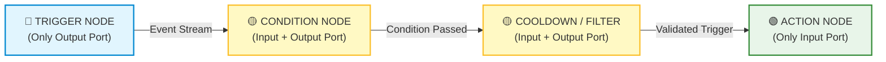
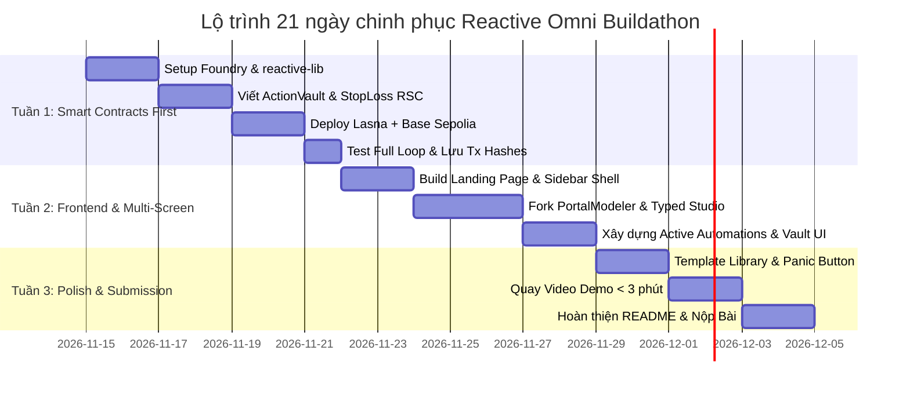

# ReactiveFlow — Phân Tích Toàn Diện & Kế Hoạch Triển Khai (Master Analysis)

> **Hackathon:** Reactive Omni Buildathon  
> **Thời gian:** 5/11 – 5/12/2026 | **Deadline còn lại:** ~21 ngày  
> **Tổng giải thưởng:** $5,500 (trả bằng REACT)  
> **Track nhắm tới:** **Set It and Forget It** ($2,000 First Place + $250 Runner-up)  
> **Định vị sản phẩm:** *"ReactiveFlow — The Zapier of Web3: No-Code Cross-Chain Automation Powered by Reactive Omni"*  
> **Ngày cập nhật:** 14/11/2026 (Phiên bản Hoàn thiện Sau Phản biện BGK & User)

---

## MỤC LỤC

1. [Phân Tích Đề Bài & Tiêu Chí Đánh Giá](#1-phân-tích-đề-bài--tiêu-chí-đánh-giá)
2. [Reactive Network Omni — Kỹ Thuật Nền Tảng & Cơ Chế Callback](#2-reactive-network-omni--kỹ-thuật-nền-tảng--cơ-chế-callback)
3. [Phản Biện Khắt Khe: BGK Kỹ Thuật & Người Dùng Cuối](#3-phản-biện-khắt-khe-bgk-kỹ-thuật--người-dùng-cuối)
4. [Định Vị Lại Dự Án: Visual Board Là "Vũ Khí Tối Thượng"](#4-định-vị-lại-dự-án-visual-board-là-vũ-khí-tối-thượng)
5. [Kiến Trúc Hệ Thống (System Architecture)](#5-kiến-trúc-hệ-thống-system-architecture)
6. [Cấu Trúc Ứng Dụng: Landing Page & Workspace Multi-Screen](#6-cấu-trúc-ứng-dụng-landing-page--workspace-multi-screen)
7. [Thiết Kế Đồ Thị Ràng Buộc (Constrained Typed Graph)](#7-thiết-kế-đồ-thị-ràng-buộc-constrained-typed-graph)
8. [Node Catalog Chi Tiết](#8-node-catalog-chi-tiết)
9. [Smart Contracts Đã Chuẩn Hóa Bảo Mật & Callback](#9-smart-contracts-đã-chuẩn-hóa-bảo-mật--callback)
10. [UX Đột Phá: Live Execution Visualizer (Hiệu Ứng WOW)](#10-ux-đột-phá-live-execution-visualizer-hiệu-ứng-wow)
11. [Walkthrough Kịch Bản Stop-Loss Thực Tế](#11-walkthrough-kịch-bản-stop-loss-thực-tế)
12. [Ma Trận Rủi Ro & Giải Pháp Khắc Phục](#12-ma-trận-rủi-ro--giải-pháp-khắc-phục)
13. [Lộ Trình Triển Khai 21 Ngày (Contracts First)](#13-lộ-trình-triển-khai-21-ngày-contracts-first)
14. [Kịch Bản Video Demo < 3 Phút & Checklist Submission](#14-kịch-bản-video-demo--3-phút--checklist-submission)

---

## 1. Phân Tích Đề Bài & Tiêu Chí Đánh Giá

### 1.1 Yêu cầu cốt lõi của Hackathon
* **Reactive Smart Contracts (RSC):** Smart contract triển khai trên Reactive Network có khả năng tự động lắng nghe (subscribe) events trên origin chain và kích hoạt (callback) hành động sang destination chain mà không phụ thuộc vào keeper/bot off-chain tập trung.
* **Tận dụng Reactive Omni Upgrade:** Block time rút ngắn xuống **~1s với instant finality** (dựa trên CometBFT consensus) thay vì ~7s như bản legacy, mở ra cơ hội cho các phản ứng tự động yêu cầu độ trễ thấp và tức thì.
* **Origin/Destination Chains:** Unichain Sepolia (Chain ID: `1301`) và/hoặc Base Sepolia (Chain ID: `84532`, 200ms block time sau bản nâng cấp Denim).

### 1.2 Track thi đấu: Set It and Forget It ($2,000)
* **Tôn chỉ của track:** *"Personal automations anyone can build, no contract experience needed."*
* **Mở rộng cho tất cả:** Dành cho cả những người chưa từng viết smart contract hoặc dùng công cụ no-code/AI.
* **Tiêu chí BGK tìm kiếm:**
  1. *A tool you'd actually keep running* (Một công cụ hữu ích mà user thật sự muốn duy trì hoạt động 24/7).
  2. *A clear personal purpose* (Giải quyết một bài toán tài sản cá nhân cụ thể: bảo vệ ví, quản trị rủi ro, auto-swap).
  3. *A creative take on event-driven logic* (Cách tiếp cận sáng tạo đối với logic hướng sự kiện).

### 1.3 Bốn Tiêu Chí Chấm Điểm (Mỗi tiêu chí 25%)
1. **Execution (Chạy thật):** Phải có giao dịch Reactive và Callbacks on-chain được xác thực qua Explorer. **Bài thi không có tx hash full-loop sẽ bị loại lập tức (0 điểm).**
2. **Integration (Tích hợp thực chất):** RSC phải đóng vai trò bộ não điều phối thực sự, không phải chỉ gắn vào cho có ("bolted on").
3. **Usefulness (Tính thực tiễn):** Giải quyết nỗi đau thật của người dùng Web3.
4. **Craft (Độ hoàn thiện & Trình bày):** Mã nguồn sạch, kiến trúc an toàn, UI mượt mà, tài liệu và video demo xuất sắc.

---

## 2. Reactive Network Omni — Kỹ Thuật Nền Tảng & Cơ Chế Callback

### 2.1 Luồng Khép Kín (The Full Loop)
```
Origin Chain (Base Sepolia / Unichain)
    │  1. Event phát sinh (e.g. Sync từ Uniswap Pool, Transfer từ Token)
    ▼
Reactive Network Omni (Lasna Testnet / Mainnet)
    │  2. Reactive System Contract phân phối LogRecord tới RSC
    │  3. RSC thực thi hàm react(): kiểm tra điều kiện (Threshold, Cooldown)
    │  4. RSC phát ra: emit Callback(destChainId, targetContract, gasLimit, payload)
    ▼
Destination Chain (Base Sepolia)
    │  5. Reactive Relayer / Callback Proxy nhận lệnh và gọi vào Target Contract
    │  6. Target Contract (ActionVault) xác thực Proxy & RSC Caller -> Thực thi Swap/Sweep
```

### 2.2 Sửa Sai Kỹ Thuật Chí Mạng: Cơ Chế Callback Proxy
Một lỗi phổ biến là nhầm lẫn `msg.sender` trên Destination Chain chính là địa chỉ hợp đồng RSC:
* **Thực tế:** Hợp đồng RSC nằm trên Reactive Network (`Chain ID: 5318007`). Khi callback chạy trên Base Sepolia (`Chain ID: 84532`), `msg.sender` **bắt buộc phải là Reactive Callback Proxy** (được triển khai chính thức bởi Reactive Network).
* **Chuẩn xác:** Hợp đồng đích (`ActionVault`) phải kế thừa `AbstractCallback` từ `@reactive-network/reactive-lib`, cấu hình địa chỉ Callback Proxy của mạng và xác thực rằng payload được gửi đến từ chính địa chỉ RSC hợp lệ của người dùng.

---

## 3. Phản Biện Khắt Khe: BGK Kỹ Thuật & Người Dùng Cuối

Nhằm đảm bảo sản phẩm chịu được áp lực thực tế cao nhất, dự án được soi chiếu qua hai góc nhìn khắt khe:

### 3.1 Góc nhìn Ban Giám Khảo Kỹ Thuật
1. **Cảnh báo "Vỏ bọc rỗng":** Nếu UI kéo thả hoành tráng nhưng backend chỉ ghép chuỗi thô sơ vào 1 template duy nhất thì sẽ mất điểm *Integration*. **Giải pháp:** Xây dựng hệ thống Template Engine đa dạng (StopLoss, WalletGuard, PriceAlert) kèm cơ chế Type-Safe validation ngay trên UI.
2. **Nguy cơ MEV & Flash Loan:** Nếu kích hoạt Stop-Loss bằng cách đọc reserves thô từ `Sync` event Uniswap, bot MEV có thể dùng Flash Loan đè giá để kích hoạt lệnh xả đáy của user. **Giải pháp:** Bổ sung tham số `minAmountOut` (bảo vệ trượt giá tối thiểu) và cơ chế Cooldown ngăn chặn spam giao dịch.
3. **Vòng đời Gas (REACT sponsorship):** Nếu RSC hết `lREACT`, callback sẽ ngừng hoạt động. **Giải pháp:** Tích hợp cảnh báo số dư gas của RSC trên Dashboard và hỗ trợ nạp thêm (Recharge/Fund) trực tiếp.

### 3.2 Góc nhìn Người Dùng Cuối (DeFi Trader)
1. **Nỗi sợ mất quyền kiểm soát tiền (Custody Fear):** *"Tại sao tôi phải nạp tiền vào ActionVault của bạn? Nếu code lỗi thì tiền đi đâu?"* **Giải pháp:** Thiết lập **Emergency Panic Button (`emergencyWithdraw`)** do chính User làm Owner. Bất cứ lúc nào user cũng có thể rút 100% tài sản về ví cá nhân chỉ bằng 1 transaction, hoàn toàn độc lập với Reactive Network.
2. **Chi phí khởi tạo:** Không bắt user deploy đi deploy lại toàn bộ hạ tầng; `ActionVault` là két an toàn duy nhất của user, các RSC chỉ là các "trigger policy" được ủy quyền gọi vào vault.
3. **Thất bại khi thực thi:** Nếu slippage thị trường vượt quá mức cho phép, giao dịch swap sẽ revert an toàn thay vì bán tháo ở giá rác, đồng thời hệ thống ghi nhận log cảnh báo lên Dashboard.

---

## 4. Định Vị Lại Dự Án: Visual Board Là "Vũ Khí Tối Thượng"

### 4.1 Khẳng định giá trị cốt lõi
Giao diện kéo thả (Visual Node Board) **không hề thừa thãi**, mà chính là **Vũ khí chiến lược số 1** giúp dự án thắng giải *Set It and Forget It*:
* Đề bài yêu cầu: *"personal automations anyone can build, no contract experience needed"*.
* Người dùng phổ thông không biết viết Solidity, không biết gọi CLI `cast send`.
* Giao diện trực quan biến những khái niệm phức tạp (`topic_0`, `chainId`, `LogRecord`, `Callback`) thành các khối trực quan sinh động.

### 4.2 Slogan & Định vị
> **"ReactiveFlow — The Zapier of Web3: No-Code Cross-Chain Automation Powered by Reactive Omni."**

Giống như cách Zapier biến API phức tạp thành quy trình tự động hóa cho nhân viên văn phòng, **ReactiveFlow biến Reactive Smart Contracts thành các block kéo-thả cho mọi nhà đầu tư Web3.**

---

## 5. Kiến Trúc Hệ Thống (System Architecture)

```
┌────────────────────────────────────────────────────────────────────────┐
│                        FRONTEND (React + XYFlow)                       │
│  ┌─────────────────┐   ┌──────────────────────┐   ┌─────────────────┐  │
│  │  Node Palette   │──>│  Visual Graph Board  │──>│ Inspector Panel │  │
│  │ (Trigger/Cond/  │   │  (Constrained Typed  │   │ (User Params &  │  │
│  │     Action)     │   │      Connection)     │   │     Config)     │  │
│  └─────────────────┘   └──────────────────────┘   └─────────────────┘  │
│                                    │                                   │
│                        Export Valid Pipeline JSON                      │
└────────────────────────────────────┼───────────────────────────────────┘
                                     ▼
┌────────────────────────────────────────────────────────────────────────┐
│                   BACKEND COMPILER & DEPLOY SERVICE                    │
│  ┌───────────────────────┐   ┌──────────────────────────────────────┐  │
│  │ Graph-to-Param Parser │──>│ Foundry Toolchain Runner             │  │
│  │ (Matches Safe Template│   │ - Auto-compile RSC                   │  │
│  │   & Fills Parameters) │   │ - Deploy to Reactive Omni (Lasna)    │  │
│  └───────────────────────┘   │ - Authorize RSC on ActionVault       │  │
│                              └──────────────────────────────────────┘  │
└────────────────────────────────────┬───────────────────────────────────┘
                                     ▼
┌────────────────────────────────────────────────────────────────────────┐
│                          ON-CHAIN ECOSYSTEM                            │
│                                                                        │
│   ORIGIN CHAIN (Base Sepolia)           REACTIVE OMNI (Lasna)          │
│   ┌───────────────────────────┐         ┌───────────────────────────┐  │
│   │ Uniswap Pair / Token      │         │ Deployed RSC              │  │
│   │ emits Sync / Transfer     │────────>│ - Subscribes to origin    │  │
│   └───────────────────────────┘         │ - Evaluates conditions    │  │
│                                         │ - Emits Callback (~1s)    │  │
│                                         └─────────────┬─────────────┘  │
│                                                       │                │
│   DESTINATION CHAIN (Base Sepolia)                    │ Relayed via    │
│   ┌────────────────────────────────────────┐          │ Callback Proxy │
│   │ ActionVault.sol (Owned by User)        │<─────────┘                │
│   │ - Verifies Reactive Callback Proxy     │                           │
│   │ - Executes Swap / Safe Sweep           │                           │
│   │ - Panic Button: emergencyWithdraw()    │                           │
│   └────────────────────────────────────────┘                           │
└────────────────────────────────────────────────────────────────────────┘
```

---

## 6. Cấu Trúc Ứng Dụng: Landing Page & Workspace Multi-Screen

Ứng dụng được thiết kế theo cấu trúc phân tầng chuẩn SaaS Web3 chuyên nghiệp, kết nối mượt mà từ giới thiệu tổng quan đến môi trường làm việc thực chiến:

```
┌────────────────────────────────────────────────────────────────────────┐
│                     LANDING PAGE (Giới thiệu & Demo)                   │
│   - Hero: "The Zapier of Web3" | CTA: [ Launch Workspace ]            │
│   - Live Interactive Preview | Tech Badges: Reactive Omni 1s blocks   │
└───────────────────────────────────┬────────────────────────────────────┘
                                    │ Bấm "Launch Workspace"
                                    ▼
┌────────────────────────────────────────────────────────────────────────┐
│                 WORKSPACE (Không Gian Làm Việc Multi-Screen)           │
├──────────────────┬─────────────────────────────────────────────────────┤
│ SIDEBAR MENU     │ MAIN VIEW AREA (Chuyển đổi theo menu)               │
│                  │                                                     │
│ 🎨 Studio (Core) │ ──> [ 1. Pipeline Studio - Visual Drag & Drop ]     │
│ ⚡ Active Flows  │ ──> [ 2. Active Automations Monitor & Gas Gauge ]   │
│ 📚 Templates     │ ──> [ 3. Recipe Store (1-Click Presets) ]           │
│ 🏦 Vault Manager │ ──> [ 4. ActionVault Assets & Panic Button ]        │
│ 📜 Activity Logs │ ──> [ 5. Real-Time Cross-Chain Execution Stream ]   │
└──────────────────┴─────────────────────────────────────────────────────┘
```

### 6.1 Landing Page (Cửa ngõ thu hút BGK & User)
* **Hero Section:** Tiêu đề mạnh mẽ: *"Cross-Chain Automation. Zero Code. Instant Finality."* Nút CTA nổi bật **[ Launch Workspace ]** và link **[ Watch 2-Min Demo ]**.
* **Interactive Mini-Preview:** Một board demo nhỏ cho phép khách bấm thử để thấy hạt sáng chạy qua 3 node khi có event mẫu.
* **Why Reactive Omni:** So sánh trực quan tốc độ phản ứng: ~1s block time của Omni vs 7s legacy, cơ chế event-driven phi tập trung vs bot keeper tập trung dễ sập.
* **Supported Ecosystem:** Hiển thị chain badges (Base Sepolia, Unichain Sepolia, Uniswap V2/V3).

---

### 6.2 Hệ Thống Màn Hình Workspace (Sidebar Menu Bên Trái)

#### 1. 🎨 Pipeline Studio (Màn hình Hero cốt lõi — Mặc định khi vào)
* **Vai trò:** Không gian sáng tạo chính, kế thừa trọn vẹn sức mạnh của `@xyflow/react`.
* **Thành phần:**
  * **Node Palette (Bên trái canvas):** Chứa các khối Trigger (Xanh lam), Condition (Vàng), Action (Xanh lục).
  * **Visual Canvas (Trung tâm):** Vùng kéo thả, phóng to/thu nhỏ, minimap, hỗ trợ auto-layout và kiểm tra kiểu cổng kết nối (Port Typing).
  * **Inspector Panel (Bên phải canvas):** Cấu hình chi tiết tham số cho node đang được chọn (chọn cặp token, ngưỡng giá, cooldown, % swap).
  * **Deploy Bar (Góc trên/dưới):** Nút **[ Deploy Automation ]** kích hoạt flow biên dịch và deploy on-chain.

#### 2. ⚡ Active Automations (Giám sát "Set It and Forget It")
* **Vai trò:** Trả lời trực tiếp tiêu chí *"A tool you'd actually keep running"*. Sau khi deploy, user quản trị và theo dõi tự động hóa tại đây.
* **Nội dung hiển thị:**
  * Thẻ danh sách các pipeline đang hoạt động on-chain (`Stop-Loss ETH/USDC`, `Wallet Sweep Guard`).
  * Trạng thái hoạt động: 🟢 Active / 🟡 Paused / 🔴 Triggered.
  * Thống kê sự kiện: *Đã phân tích 4,120 Sync events | Kích hoạt 1 lần*.
  * **Gas Balance Gauge (Đo lường lREACT):** Hiển thị số dư gas còn lại trong RSC của user kèm nút **[ + Refuel Gas ]** để nạp thêm khi sắp cạn.
  * **Bộ điều khiển nhanh:** Nút Pause, Resume hoặc Terminate hợp đồng.

#### 3. 📚 Template Library (Recipe Store — Onboarding 1-Click)
* **Vai trò:** Giúp BGK và người dùng mới trải nghiệm ngay lập tức mà không cần tự mò mẫm kéo dây từ số 0.
* **Các Recipes dựng sẵn:**
  * 🛡️ **Uniswap Flash Crash Stop-Loss:** Tự động cắt lỗ ETH sang USDC khi giá rớt qua ngưỡng định trước.
  * 🐋 **Whale Movement Tracker:** Lắng nghe giao dịch ví cá voi và gửi cảnh báo event.
  * 🚨 **Compromised Wallet Auto-Sweep:** Tự động quét và chuyển toàn bộ tài sản sang Safe Wallet khi có dấu hiệu rút tiền lạ.
* **Tính năng 1-Click:** Bấm **[ Use Recipe ]** $\rightarrow$ Hệ thống tự động load toàn bộ sơ đồ node mẫu lên màn hình Pipeline Studio, user chỉ việc chỉnh số tiền và bấm Deploy!

#### 4. 🏦 Vault Manager & Security (Két An Toàn & Panic Button)
* **Vai trò:** Củng cố niềm tin tuyệt đối cho nhà đầu tư thực chiến (Non-Custodial Peace of Mind).
* **Nội dung hiển thị:**
  * Địa chỉ hợp đồng `ActionVault` của user trên Base Sepolia.
  * Số dư tài sản hiện tại trong Vault: `0.5 ETH`, `1,250 USDC`.
  * Danh sách các RSC được cấp quyền kích hoạt vault (`authorizedRSC`).
  * Lịch sử nạp/rút tiền.
  * **NÚT KHẨN CẤP (Panic Button - Emergency Withdraw):** Nút màu đỏ nổi bật cho phép user rút sạch 100% tiền trong Vault về ví cá nhân trong 1 transaction khẩn cấp, hoàn toàn độc lập với Reactive Network.

#### 5. 📜 Activity Logs & Explorer (Minh chứng On-Chain cho BGK)
* **Vai trò:** Minh chứng kỹ thuật đanh thép cho tiêu chí *Execution* và *Integration*.
* **Nội dung hiển thị:**
  * Dòng thời gian trực tiếp (Live Stream) các block và event:
    * `[Origin]` Base Sepolia: `Sync(reserve0, reserve1)` tại block `#1823901`.
    * `[Reactive]` Omni Lasna: RSC `react()` tính giá < $1800 $\rightarrow$ Phát sinh `Callback` trong ~1.1s.
    * `[Destination]` Base Sepolia: Relayer gọi `executeStopLoss()` thành công.
  * Link Explorer clickable trực tiếp tới **Reactscan** và **Base Sepolia Blockscout**.

---

### 6.3 Ma Trận Phân Kỳ Tính Năng (MVP Phasing cho 21 Ngày)

| Giai đoạn | Màn hình | Mức độ ưu tiên | Mục tiêu đạt được |
| :--- | :--- | :---: | :--- |
| **Phase 1** | **Landing Page** & **Pipeline Studio** | 🔴 Bắt buộc | User hiểu dự án, kéo thả được node, bấm deploy sinh contract thật. |
| **Phase 1** | **Active Automations** | 🔴 Bắt buộc | Minh chứng pipeline đang chạy 24/7 on-chain ("Set It and Forget It"). |
| **Phase 2** | **Template Library** | 🟡 Quan trọng | Hỗ trợ quay video demo thần tốc, BGK test thử trong 10 giây. |
| **Phase 2** | **Vault Manager (Panic Button)** | 🟡 Quan trọng | Xóa bỏ rào cản sợ mất tiền của user, ghi điểm bảo mật với BGK. |
| **Phase 3** | **Activity Logs riêng biệt** | 🟢 Đánh bóng | Nếu thiếu thời gian, nhúng log panel trực tiếp xuống chân của Pipeline Studio. |

---

## 7. Thiết Kế Đồ Thị Ràng Buộc (Constrained Typed Graph)

Để đảm bảo người dùng kéo thả tự do nhưng **không bao giờ tạo ra đồ thị lỗi**, ReactiveFlow áp dụng cơ chế Type-Safe Ports trên `@xyflow/react`:

### 7.1 Quy tắc cổng kết nối (Port Typing)


* **Trigger Node:** Chỉ có cổng ra (Source handle). Không cho phép nối đầu vào.
* **Condition Node:** Có 1 cổng vào (Target handle) nhận từ Trigger/Condition và 1 cổng ra (Source handle).
* **Action Node:** Chỉ có cổng vào (Target handle). Là điểm kết thúc của pipeline.
* **Cơ chế Validation tức thì:** Nếu người dùng cố tình nối từ Action $\rightarrow$ Trigger, đường nối sẽ bị hủy và hiển thị thông báo tooltip hướng dẫn.

---

## 8. Node Catalog Chi Tiết

Mọi tham số kỹ thuật sâu (như topic hex, byte shift, function selector) được trừu tượng hóa thành các trường thân thiện:

### 🔵 TRIGGER NODES (Lắng nghe sự kiện)
1. **Watch Token Price (DEX):**
   * *Mô tả:* Lắng nghe biến động giá của cặp token trên sàn DEX.
   * *Inputs người dùng:* Chain (Base Sepolia / Unichain Sepolia), Cặp giao dịch (ETH/USDC, WBTC/USDC), Sàn (Uniswap V2).
   * *Bên dưới:* Tự động subscribe event `Sync(uint112,uint112)` của Pair contract.
2. **Watch Wallet Activity:**
   * *Mô tả:* Theo dõi mọi biến động số dư hoặc giao dịch lạ trên ví.
   * *Inputs người dùng:* Địa chỉ ví theo dõi, Loại token (ETH / USDC).
   * *Bên dưới:* Subscribe event `Transfer(address,address,uint256)` có topic lọc theo địa chỉ ví.
3. **Periodic Timer (Cron):**
   * *Mô tả:* Kích hoạt theo định kỳ thời gian.
   * *Inputs người dùng:* Chu kỳ (mỗi 10 phút / 1 giờ / 24 giờ).

### 🟡 CONDITION NODES (Bộ lọc & Điều kiện an toàn)
1. **Price Threshold Guard:**
   * *Mô tả:* Chỉ kích hoạt khi giá vượt ngưỡng chỉ định.
   * *Inputs người dùng:* Điều kiện (`Below` / `Above`), Ngưỡng giá USD (ví dụ: `< 1800`).
2. **Cooldown Guard (Chống Spam):**
   * *Mô tả:* Đảm bảo không kích hoạt lại trong một khoảng thời gian sau lần chạy gần nhất.
   * *Inputs người dùng:* Thời gian chờ (ví dụ: `300 giây` = 5 phút).
   * *Bên dưới:* Ghi nhận `lastTriggered` và so khớp `block.timestamp`.
3. **Balance Threshold:**
   * *Mô tả:* Kiểm tra lượng token trong ví/vault có vượt ngưỡng cảnh báo hay không.

### 🟢 ACTION NODES (Hành động tài chính)
1. **DEX Swap (Protected Stop-Loss):**
   * *Mô tả:* Thực hiện hoán đổi token bảo toàn vốn khi chạm ngưỡng.
   * *Inputs người dùng:* Token bán (ETH), Token nhận (USDC), Tỷ lệ bán (50% / 100%), Trượt giá tối đa (Max Slippage: 1%).
   * *Bên dưới:* Gọi lệnh `executeStopLoss(percent, minAmountOut)` sang ActionVault.
2. **Emergency Safe Sweep:**
   * *Mô tả:* Chuyển toàn bộ tài sản về ví lạnh / ví an toàn ngay lập tức.
   * *Inputs người dùng:* Địa chỉ ví an toàn (Safe Address).
   * *Bên dưới:* Kích hoạt rút cạn native token và ERC20 về ví đích.
3. **Notify Event:**
   * *Mô tả:* Bắn log thông báo trạng thái để hiển thị real-time lên màn hình người dùng.

---

## 9. Smart Contracts Đã Chuẩn Hóa Bảo Mật & Callback

### 9.1 Destination Contract: `ActionVault.sol` (Trên Base Sepolia)
Kế thừa chuẩn `AbstractCallback`, bảo vệ tài sản bằng Panic Button và xác thực relayer chính thức:

```solidity
// SPDX-License-Identifier: MIT
pragma solidity >=0.8.20;

import '@reactive-network/reactive-lib/src/abstract-sdk/AbstractCallback.sol';

interface IUniswapV2Router {
    function swapExactETHForTokens(
        uint amountOutMin,
        address[] calldata path,
        address to,
        uint deadline
    ) external payable returns (uint[] memory amounts);
}

contract ActionVault is AbstractCallback {
    address public owner;
    address public authorizedRSC;
    address public uniswapRouter;
    address public usdcToken;

    event StopLossExecuted(uint256 ethAmount, uint256 minAmountOut, uint256 timestamp);
    event EmergencyWithdrawn(address indexed owner, uint256 amount);
    event RSCAuthorized(address indexed rsc);

    modifier onlyOwner() {
        require(msg.sender == owner, "Only owner can call");
        _;
    }

    constructor(
        address _callbackSender, // Địa chỉ Reactive Relayer/Callback Proxy chính thức
        address _uniswapRouter,
        address _usdcToken
    ) AbstractCallback(_callbackSender) {
        owner = msg.sender;
        uniswapRouter = _uniswapRouter;
        usdcToken = _usdcToken;
    }

    function setAuthorizedRSC(address _rsc) external onlyOwner {
        authorizedRSC = _rsc;
        emit RSCAuthorized(_rsc);
    }

    // Callback được gọi từ Reactive Network thông qua Callback Proxy
    function executeStopLoss(
        address rscCaller,
        uint256 percentToSwap,
        uint256 minAmountOut
    ) external callback(rscCaller) {
        require(rscCaller == authorizedRSC, "Unauthorized RSC caller");
        require(percentToSwap > 0 && percentToSwap <= 100, "Invalid percentage");

        uint256 totalBalance = address(this).balance;
        require(totalBalance > 0, "No ETH to swap");

        uint256 swapAmount = (totalBalance * percentToSwap) / 100;

        address[] memory path = new address[](2);
        path[0] = 0x4200000000000000000000000000000000000006; // WETH Base
        path[1] = usdcToken;

        IUniswapV2Router(uniswapRouter).swapExactETHForTokens{value: swapAmount}(
            minAmountOut,
            path,
            owner, // Token USDC sau swap gửi thẳng về ví User
            block.timestamp + 300
        );

        emit StopLossExecuted(swapAmount, minAmountOut, block.timestamp);
    }

    // ==========================================
    // PANIC BUTTON: Non-Custodial Emergency Exit
    // ==========================================
    function emergencyWithdraw() external onlyOwner {
        uint256 balance = address(this).balance;
        require(balance > 0, "Zero balance");
        payable(owner).transfer(balance);
        emit EmergencyWithdrawn(owner, balance);
    }

    receive() external payable {}
}
```

### 9.2 Reactive Smart Contract: `StopLoss_Pipeline.sol` (Trên Reactive Omni)
Xử lý logic phản ứng tức thì (~1s) với cơ chế Cooldown và bảo vệ trượt giá:

```solidity
// SPDX-License-Identifier: MIT
pragma solidity >=0.8.20;

import '@reactive-network/reactive-lib/src/interfaces/IReactive.sol';
import '@reactive-network/reactive-lib/src/abstract-sdk/AbstractReactive.sol';

contract StopLoss_Pipeline is IReactive, AbstractReactive {
    uint256 public constant ORIGIN_CHAIN_ID = 84532; // Base Sepolia
    uint256 private constant SYNC_TOPIC = 0x1c411e9a96e071241c2f21f7726b17ae89e3cab4c78be50e062b03a9fffbbad1;

    address public immutable pairAddress;
    uint256 public immutable priceThreshold; // Ngưỡng giá quy ước 18 decimals
    uint256 public immutable cooldownSeconds;
    uint256 public immutable percentToSwap;
    address public immutable actionVault;

    uint256 public lastTriggered;

    constructor(
        address _pairAddress,
        uint256 _priceThreshold,
        uint256 _cooldownSeconds,
        uint256 _percentToSwap,
        address _actionVault
    ) payable {
        pairAddress = _pairAddress;
        priceThreshold = _priceThreshold;
        cooldownSeconds = _cooldownSeconds;
        percentToSwap = _percentToSwap;
        actionVault = _actionVault;

        // Đăng ký lắng nghe sự kiện Sync trên sàn DEX
        service.subscribe(
            ORIGIN_CHAIN_ID,
            _pairAddress,
            SYNC_TOPIC,
            REACTIVE_IGNORE,
            REACTIVE_IGNORE,
            REACTIVE_IGNORE
        );
    }

    function react(LogRecord calldata log) external vmOnly {
        if (log._contract != pairAddress) return;

        // Decode reserve0 (ETH) và reserve1 (USDC)
        (uint112 reserve0, uint112 reserve1) = abi.decode(log.data, (uint112, uint112));
        if (reserve0 == 0) return;

        // Tính giá hiện tại: (reserve1 * 1e18) / reserve0
        uint256 currentPrice = (uint256(reserve1) * 1e18) / uint256(reserve0);

        // Kiểm tra điều kiện: Giá có rớt xuống dưới ngưỡng an toàn không?
        if (currentPrice >= priceThreshold) return;

        // Kiểm tra thời gian hồi (Cooldown)
        if (block.timestamp - lastTriggered < cooldownSeconds) return;

        lastTriggered = block.timestamp;

        // Tính minAmountOut cơ sở để bảo vệ khỏi MEV Sandwich
        uint256 minAmountOut = (currentPrice * 95) / 100; // Bảo vệ trượt giá tối đa 5%

        bytes memory payload = abi.encodeWithSignature(
            "executeStopLoss(address,uint256,uint256)",
            address(this),
            percentToSwap,
            minAmountOut
        );

        // Kích hoạt callback sang Base Sepolia
        emit Callback(
            ORIGIN_CHAIN_ID,
            actionVault,
            350000, // Gas limit cho swap router
            payload
        );
    }
}
```

---

## 10. UX Đột Phá: Live Execution Visualizer (Hiệu Ứng WOW)

Kế thừa engine trạng thái thời gian thực từ [PortalModeler](file:///D:/Coding/New%20folder/REACTIVEFLOW_ANALYSIS.md#L242-L268), giao diện Dashboard đem lại trải nghiệm chưa từng có:

```
[🔵 Watch ETH/USDC] ══════════> [🟡 If < $1800] ══════════> [🟢 Swap 50% ETH]
   "2,480 events"                 "TRIGGERED!"                 "EXECUTED!"
   (Chớp xanh theo block)      (Sáng vàng rực rỡ)            (Xanh lục đậm)
                                                                 │
                                                    Tx Hash: 0x8f3c...d4a
```

1. **Pulse Animation (Dòng sự kiện chạy trên dây nối):**
   * Mỗi khi có giao dịch swap trên Uniswap $\rightarrow$ Node Trigger phát tín hiệu hạt sáng chạy dọc sang Node Condition.
2. **Node Status State Machine:**
   * `IDLE` (Xám) $\rightarrow$ Đang chờ sự kiện.
   * `LISTENING` (Xanh lam nhạt) $\rightarrow$ Bắt được event từ origin chain.
   * `CONDITION_MET` (Vàng cam) $\rightarrow$ Ngưỡng rủi ro bị kích hoạt.
   * `EXECUTING` (Chớp nháy) $\rightarrow$ Reactive Omni đang gửi Callback sang Base Sepolia (~1s).
   * `SUCCESS` (Xanh lá cây) $\rightarrow$ Giao dịch swap thành công, hiển thị đường link trực tiếp tới Blockscout/Uniscan.

---

## 11. Walkthrough Kịch Bản Stop-Loss Thực Tế

1. **Thiết lập trực quan (30 giây):**
   * Vào **Pipeline Studio** (hoặc chọn sẵn mẫu từ **Template Library**).
   * Kéo thả: `[Watch Price]` $\rightarrow$ `[If Below $1,800]` $\rightarrow$ `[Cooldown 5 mins]` $\rightarrow$ `[Swap 50% ETH to USDC]`.
   * Nhập địa chỉ ví và bấm **"Deploy Automation"**.
2. **Khởi tạo on-chain tự động:**
   * Backend biên dịch template với các tham số từ node graph.
   * Deploy `StopLoss_Pipeline` lên Reactive Lasna Testnet.
   * Ủy quyền RSC mới deploy vào `ActionVault` của user trên Base Sepolia.
   * User nạp một ít ETH thử nghiệm vào Vault tại tab **Vault Manager**.
3. **Thử nghiệm kích hoạt (Trigger Test):**
   * Thực hiện một swap mô phỏng làm giá ETH rớt dưới $1,800 trên Base Sepolia.
   * **Trong vòng 1-2 giây:** 
     * Reactive Omni ghi nhận `Sync` event.
     * RSC tính toán giá rớt và phát sinh `Callback`.
     * `ActionVault` trên Base Sepolia nhận callback, tự động swap 50% ETH sang USDC và chuyển USDC thẳng về ví cá nhân của user.
   * Màn hình ReactiveFlow đổi trạng thái node sang màu xanh thắng lợi, ghi nhận log tại tab **Activity Logs** và xuất hiện link giao dịch on-chain.

---

## 12. Ma Trận Rủi Ro & Giải Pháp Khắc Phục

| Rủi Ro Nhận Diện | Mức Độ | Giải Pháp Kỹ Thuật Trong ReactiveFlow |
| :--- | :---: | :--- |
| **Lỗi Callback Authorization** (Revert do sai caller) | **Cực cao** | Kế thừa chuẩn `AbstractCallback`, kiểm tra thông qua Callback Proxy chính thức của Reactive Network. |
| **Bị MEV Sandwich khi Swap** | **Cao** | Bắt buộc truyền `minAmountOut` được tính toán từ ngưỡng giá an toàn, không swap mù quáng theo spot price. |
| **User sợ bị giam vốn trong Vault** | **Cao** | Thêm hàm `emergencyWithdraw` (Panic Button) tại tab **Vault Manager**, rút tiền ngay trong 1 click. |
| **Hết gas lREACT trên RSC** | **Trung bình** | Hiển thị widget Gas Gauge tại tab **Active Automations** kèm nút "Refuel Gas" trực tiếp. |
| **Đồ thị kéo thả bị lặp vô tận (Cycle)** | **Trung bình** | Ép kiểu cổng nghiêm ngặt (Typed Ports): Trigger chỉ ra, Action chỉ vào, ngăn ngừa tạo vòng lặp logic. |

---

## 13. Lộ Trình Triển Khai 21 Ngày (Contracts First)

Tuân thủ nghiêm ngặt nguyên tắc: **Hoàn thiện Smart Contract có Tx Hash thật trước khi tích hợp UI.**



---

## 14. Kịch Bản Video Demo < 3 Phút & Checklist Submission

### 14.1 Cấu Trúc Video Thuyết Phục BGK (Thời lượng: 2 phút 45 giây)
* **0:00 – 0:35 | Landing Page & Nỗi đau thực tế:** Mở đầu từ Landing Page ấn tượng: *"DeFi traders luôn lo sợ thị trường flash crash khi đang ngủ. ReactiveFlow mang đến giải pháp tự động hóa no-code cross-chain với block 1s của Reactive Omni."* Bấm **Launch Workspace**.
* **0:35 – 1:15 | On-Chain Proof First (Ăn trọn điểm Execution):** Mở ngay Reactscan và Blockscout chứng minh giao dịch thật: Event $\rightarrow$ Reactive Omni (~1s block) $\rightarrow$ Callback swap trên Base Sepolia thành công.
* **1:15 – 2:05 | Pipeline Studio & Live Execution (Ăn trọn điểm Craft & Integration):** Thao tác kéo thả các node Trigger $\rightarrow$ Condition $\rightarrow$ Action trên Studio. Bấm Deploy trong 1 click. Cho thấy các node đổi màu real-time khi có event chạy qua. Giới thiệu tab **Template Library** (1-click load).
* **2:05 – 2:35 | An toàn tài sản (Ăn điểm Usefulness):** Chuyển sang tab **Vault Manager**, giới thiệu Panic Button — bấm 1 nút rút toàn bộ tiền về ví lạnh, chứng minh tính phi lưu ký (non-custodial).
* **2:35 – 2:45 | Tổng kết:** *"ReactiveFlow — Bringing the power of Reactive Omni to every DeFi user."*

### 14.2 Checklist Nộp Bài
- [ ] Public GitHub Repository (đầy đủ mã nguồn Landing Page, Workspace UI + Foundry contracts).
- [ ] README.md chuyên nghiệp với diagram kiến trúc và hướng dẫn chạy local.
- [ ] Địa chỉ hợp đồng đã deploy và verify trên Lasna Testnet và Base Sepolia.
- [ ] Tối thiểu 3 Transaction Hashes minh chứng cho toàn bộ vòng lặp (Origin $\rightarrow$ Reactive $\rightarrow$ Callback).
- [ ] Video demo chuẩn HD dưới 3 phút tải lên YouTube (Unlisted) hoặc Loom.
- [ ] Nộp bài trên trang chính thức của Reactive Omni Buildathon trước ngày 5/12/2026.
