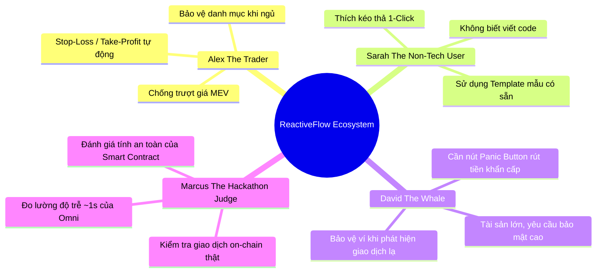
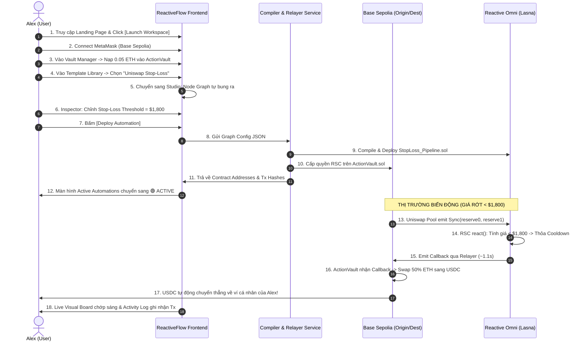

# TÀI LIỆU YÊU CẦU NGHIỆP VỤ & ĐẶC TẢ KỸ THUẬT (BRD / FSD)
## DỰ ÁN: REACTIVEFLOW — THE ZAPIER OF WEB3
### No-Code Cross-Chain Automation Powered by Reactive Network Omni

---

| **Thuộc tính** | **Chi tiết** |
| :--- | :--- |
| **Dự án** | ReactiveFlow |
| **Vai trò soạn thảo** | Lead Business Analyst & Web3 Solutions Architect |
| **Mã tài liệu** | `RF-BRD-FSD-V1.0` |
| **Phiên bản** | `1.0 (Master Release)` |
| **Ngày lập** | 14/11/2026 |
| **Hackathon Target** | Reactive Omni Buildathon — Track: *Set It and Forget It* |
| **Trạng thái** | Sẵn sàng triển khai (Approved for Engineering) |

---

## MỤC LỤC

1. [TỔNG QUAN DỰ ÁN & BẢNG PHÂN TÍCH (WHY & WHO)](#1-tổng-quan-dự-án--bảng-phân-tích-why--who)
2. [CẨM NANG NGHIỆP VỤ DEFI THỰC TẾ DÀNH CHO BUILDER](#2-cẩm-nang-nghiệp-vụ-defi-thực-tế-dành-cho-builder)
3. [PHẠM VI HỆ THỐNG & NĂNG LỰC CỦA SẢN PHẨM (SCOPE & CAPABILITIES)](#3-phạm-vi-hệ-thống--năng-lực-của-sản-phẩm-scope--capabilities)
4. [ĐẶC TẢ CHỨC NĂNG 5 MÀN HÌNH WORKSPACE (FUNCTIONAL BREAKDOWN)](#4-đặc-tả-chức-năng-5-màn-hình-workspace-functional-breakdown)
   * [4.7 Phiên Workspace và quyền thao tác](#47-phiên-workspace-và-quyền-thao-tác)
   * [4.8 Quản lý nhiều pipeline và vận hành liên tục](#48-quản-lý-nhiều-pipeline-và-vận-hành-liên-tục)
5. [LUỒNG THAO TÁC END-TO-END CHI TIẾT (STEP-BY-STEP USER JOURNEY)](#5-luồng-thao-tác-end-to-end-chi-tiết-step-by-step-user-journey)
6. [YÊU CẦU PHI CHỨC NĂNG (NON-FUNCTIONAL REQUIREMENTS - NFR)](#6-yêu-cầu-phi-chức-năng-non-functional-requirements---nfr)
7. [TỪ ĐIỂN DỮ LIỆU & THUẬT NGỮ CHUYÊN MÔN (GLOSSARY)](#7-từ-điển-dữ-liệu--thuật-ngữ-chuyên-môn-glossary)

---

# 1. TỔNG QUAN DỰ ÁN & BẢNG PHÂN TÍCH (WHY & WHO)

### 1.1 Bảng Phân Tích "WHY" — Tại sao ReactiveFlow phải tồn tại?

| Vấn Đề Thực Tế Của Thị Trường (Pain Points) | Giải Pháp Cũ (Legacy / Off-chain) | Nhược Điểm Giải Pháp Cũ | Giải Pháp Đột Phá Của ReactiveFlow (Why It Wins) |
| :--- | :--- | :--- | :--- |
| **Flash Crash Trong Đêm:** Giá crypto biến động 20-30% khi trader đang ngủ, dẫn đến cháy tài khoản hoặc thanh lý vị thế. | Giữ tiền trên sàn CEX để đặt lệnh Stop-Loss / Limit. | Rủi ro sập sàn CEX (như FTX), mất quyền tự lưu ký (not your keys, not your coins). | **100% On-chain Non-Custodial:** Tài sản nằm trong `ActionVault` của chính user trên L2, bảo vệ vốn tự động 24/7. |
| **Bot Keeper Tập Trung Dễ Sập:** Các bot tự động hóa off-chain (như Gelato, OpenZeppelin Defender, Custom Python Scripts). | Server Node.js / Python chạy cronjob lắng nghe RPC. | Server chết, nghẽn mạng, bot hết tiền gas, hoặc RPC bị rate-limit làm lệnh không chạy. | **Native Event-Driven On-Chain:** Sử dụng Reactive Omni (CometBFT) bắt event trực tiếp tại tầng đồng thuận blockchain, không cần bất kỳ server trung gian nào. |
| **Rào Cản Lập Trình Quá Lớn:** 99% nhà đầu tư Web3 không biết viết Solidity, không biết cấu hình Foundry, hay decode `LogRecord`. | Thuê dev viết smart contract hoặc dùng tool CLI phức tạp. | Tốn hàng nghìn USD, dễ dính backdoor, thời gian triển khai lâu. | **No-Code Visual Drag & Drop:** Kéo thả trực quan như Zapier, hệ thống tự động sinh contract và deploy trong 1 click. |
| **Tốc Độ Phản Ứng Chậm:** Các giải pháp cross-chain cũ mất từ 15 giây đến vài phút để xác nhận bridge. | Reactive Legacy (block 7s) hoặc Cross-chain Messaging cũ. | Trượt giá nghiêm trọng, bị bot MEV cuỗm hết cơ hội chênh lệch giá. | **Reactive Omni ~1s Block Time:** Tốc độ phản ứng tức thì với Instant Finality, bảo vệ trượt giá tối ưu. |

---

### 1.2 Bảng Chân Dung Người Dùng "WHO" — Ai sẽ sử dụng hệ thống?



| Người Dùng (Persona) | Đặc Điểm & Hành Vi | Mục Tiêu Chính (Goals) | Tính Năng ReactiveFlow Giải Quyết |
| :--- | :--- | :--- | :--- |
| **Alex — The DeFi Trader** *(Người dùng năng động)* | Giao dịch thường xuyên trên Base Sepolia/Unichain; nắm giữ ETH, memecoin; sợ thị trường sập bất ngờ khi không online. | Tự động hóa cắt lỗ (Stop-Loss) khi giá thủng hỗ trợ; chốt lời (Take-Profit) tự động; chống trượt giá. | • Node **Watch Token Price**<br>• Node **Price Threshold Guard**<br>• Node **DEX Swap (Protected)** |
| **Sarah — The Non-Tech Investor** *(Người dùng phổ thông)* | Thích đầu tư crypto nhưng sợ dòng lệnh CLI; không biết Solidity; muốn sử dụng các quy trình có sẵn. | Thiết lập quy trình tự động trong vòng dưới 1 phút mà không cần hiểu kỹ thuật sâu. | • **Template Library (1-Click Recipes)**<br>• Giao diện kéo thả trực quan<br>• Bảng cấu hình Inspector thân thiện |
| **David — The Crypto Whale** *(Nhà đầu tư cẩn trọng)* | Sở hữu danh mục giá trị cao; cực kỳ nhạy cảm với rủi ro bảo mật; không chấp nhận bị giam vốn. | Tuyệt đối không bị khóa tiền (non-custodial); có quyền rút tiền khẩn cấp mọi lúc; tự động rút về ví lạnh nếu ví nóng bị hack. | • **Panic Button (Emergency Withdraw)**<br>• Node **Watch Wallet Activity**<br>• Node **Emergency Safe Sweep** |
| **Marcus — The Hackathon Judge** *(Ban giám khảo kỹ thuật)* | Kỹ sư trưởng hệ sinh thái Reactive; soi kỹ code Solidity; đòi hỏi tx hash thật chứng minh vòng lặp đầy đủ. | Đánh giá xem dự án có chạy thật không, có tận dụng block 1s của Omni không, hay chỉ là giao diện vẽ vời. | • **Live Execution Visualizer**<br>• Màn hình **Activity Logs & Explorer**<br>• Tx hash đầy đủ Origin $\rightarrow$ Reactive $\rightarrow$ Callback |

---

# 2. CẨM NANG NGHIỆP VỤ DEFI THỰC TẾ DÀNH CHO BUILDER

> ⚠️ **Dành riêng cho Developer / Builder mới tiếp cận Blockchain & DeFi:**  
> Rất nhiều dev kỹ thuật làm ứng dụng Web3 bị "lạc đề" hoặc "ngô nghê" trong mắt người dùng vì không hiểu hành vi và nỗi sợ của một nhà đầu tư crypto thật. Phần này giải thích cặn kẽ bản chất nghiệp vụ để **đảm bảo bạn không code sai luồng người dùng mong đợi.**

---

### 2.1 Bản Chất Quyền Kiểm Soát Tiền: Tại Sao Phải Có `ActionVault`?
* **Hiểu lầm tai hại của newbie:** *"Tại sao hệ thống không tự rút tiền từ ví MetaMask của user để swap khi giá giảm?"*
* **SỰ THẬT BẤT DI BẤT DỊCH CỦA BLOCKCHAIN:**  
  Không có bất kỳ smart contract hay backend nào có quyền tự ý chạm vào 1 xu trong ví MetaMask cá nhân của người dùng nếu người dùng không trực tiếp ký xác nhận giao dịch trên thiết bị của họ tại thời điểm đó!
* **Nỗi đau thực tế:**  
  Lúc thị trường flash crash là **3 giờ sáng**, người dùng đang ngủ say, làm sao họ thức dậy bấm "Confirm" trên MetaMask để cắt lỗ?
* **GIẢI PHÁP NGHIỆP VỤ (VÌ SAO CẦN VAULT):**  
  Người dùng chủ động nạp một khoản tiền (ví dụ: `0.05 ETH`) vào hợp đồng két an toàn cá nhân của họ gọi là `ActionVault.sol`.  
  * `ActionVault` hoạt động như một "két sắt có điều kiện": Người dùng vẫn là Chủ sở hữu (Owner) duy nhất của két.  
  * Người dùng cấp quyền cho hợp đồng Reactive Smart Contract (RSC): *"Nếu mày thấy giá ETH rớt dưới $1,800, mày được quyền giật chốt két này để bán số ETH đó sang USDC."*
  * **ĐIỂM CHẠM NGHIỆP VỤ CỰC QUAN TRỌNG:** Sau khi swap ETH sang USDC thành công, số tiền USDC thu được **PHẢI ĐƯỢC CHUYỂN THẲNG VỀ VÍ CÁ NHÂN CỦA USER**, không được giữ lại trong Vault! (Giúp người dùng an tâm tiền đã về túi an toàn).

---

### 2.2 Nghiệp Vụ Cắt Lỗ (Stop-Loss) Trong DeFi Diễn Ra Thế Nào?
* **Tại sao lại bán ETH sang USDC?**  
  * `ETH` là tài sản biến động (Volatile Asset): Giá có thể biến động từ $3,000 xuống $1,000 trong vài tiếng.  
  * `USDC` là Tiền Ổn Định (Stablecoin): Được bảo chứng bằng USD thật, luôn có giá trị cố định $1.00 USD.  
  * Cắt lỗ trong DeFi nghĩa là: *"Khi tài sản biến động mất giá đến một mức chịu đựng tối đa (ví dụ $1,800), hãy tự động bán tháo sang USDC để bảo toàn giá trị tiền mặt (Cash Out), chờ thị trường bình ổn rồi mua lại sau."*

* **Cách sàn DEX (Uniswap) xác định giá — Không có bảng giá trung tâm:**  
  Khác với sàn chứng khoán hay sàn CEX (Binance) có sổ lệnh (Orderbook), sàn phi tập trung Uniswap V2 định giá dựa trên tỷ lệ token trong Bể thanh khoản (Liquidity Pool):
  $$\text{Price of ETH} = \frac{\text{Reserve of USDC}}{\text{Reserve of ETH}}$$
  Mỗi khi có bất kỳ ai mua hoặc bán trên Uniswap, pool sẽ phát ra một sự kiện on-chain gọi là `Sync(uint112 reserve0, uint112 reserve1)`.  
  $\rightarrow$ Hợp đồng RSC của ReactiveFlow lắng nghe sự kiện `Sync` này để tính toán tỷ giá tức thời mà không cần gọi API ngoài.

* **Hiểm họa "Trượt giá" (Slippage) & Bot MEV Kẹp Lệnh (Sandwich Attack):**  
  * **Trượt giá:** Khi lệnh cắt lỗ được kích hoạt ở giá $1,800, nhưng trong 1 giây giao dịch đang chờ xử lý, có người khác xả mạnh làm giá tụt xuống $1,780. Độ lệch $20 đó là trượt giá.  
  * **Hiểm họa:** Nếu code Solidity không quy định số tiền tối thiểu chấp nhận nhận về (`minAmountOut`), các bot độc hại (MEV Bot) sẽ cố tình giao dịch chèn trước và chèn sau (Sandwich Attack) để ép lệnh của user khớp ở giá đáy (ví dụ $1,500), cướp trắng phần chênh lệch!  
  * **QUY TẮC BẮT BUỘC TRONG CODE:** Phải tính:
    $$\text{minAmountOut} = \text{expectedAmountOut} \times \frac{100 - \text{maxSlippage}\%}{100}$$
    Nếu số USDC nhận về thấp hơn con số này, giao dịch swap sẽ **tự động Revert an toàn**, thà giữ nguyên ETH còn hơn bán tháo ở giá rác!

---

### 2.3 Nghiệp Vụ Đa Chuỗi (Multi-chain Workflow) Dưới Mắt Người Dùng
* **Tâm lý người dùng thông thường:**  
  Họ chỉ biết họ có tiền trên **Base Sepolia**. Họ **không hiểu và không muốn hiểu** Reactive Network là gì, CometBFT là gì, hay `lREACT` là token gì.
* **Quy tắc trải nghiệm:**  
  * Không bắt người dùng phải tự đi xin vòi faucet `lREACT` hay đổi mạng qua lại để deploy.  
  * Hệ thống Backend/Relayer của chúng ta sẽ **tự động tài trợ gas (Gas Sponsorship)** một lượng nhỏ `lREACT` vào hợp đồng RSC của user ngay khi deploy.  
  * Người dùng chỉ việc kết nối ví trên **Base Sepolia**, bấm Deploy, và hệ thống tự động hoàn tất toàn bộ chu trình cross-chain ở hậu trường.

---

### 2.4 Bảng So Sánh Các "Bẫy" Sai Lầm Của Newbie vs Chuẩn Nghiệp Vụ Web3

| Thành phần | Bẫy Sai Lầm Của Dev Mới (Tránh Tuyệt Đối!) | Cách Làm Đúng Chuẩn Nghiệp Vụ Web3 |
| :--- | :--- | :--- |
| **Nhập Địa Chỉ Token** | Bắt người dùng tự đi tìm và dán địa chỉ contract hex `0x4200000000000000000000000000000000000006`. | Hiển thị Dropdown thân thiện có logo: `ETH`, `USDC`, `WBTC`. Hệ thống tự map sang địa chỉ contract. |
| **Đơn Vị Tiền Tệ** | Bắt người dùng nhập số Wei có 18 số 0 (`1000000000000000000`). | Người dùng nhập số thực bình thường: `1.0 ETH`, `1800 USD`. Code tự động quy đổi `parseEther()` ở tầng logic. |
| **Tiền Sau Khi Swap** | Lưu lại USDC trong hợp đồng `ActionVault`. | Tham số `to` trong hàm Uniswap Router được gán là `owner` $\rightarrow$ USDC chuyển thẳng về ví cá nhân của user. |
| **Quyền Rút Tiền** | Không làm nút rút tiền khẩn cấp vì nghĩ *"chỉ cần RSC gọi là được"*. | **BẮT BUỘC CÓ PANIC BUTTON:** Người dùng phải có quyền bấm 1 nút rút 100% tiền về ví bất kỳ lúc nào, kể cả khi mạng Reactive bị đứng. |
| **Quản Lý Gas RSC** | Kệ hợp đồng RSC hết gas giữa chừng mà không báo gì cho user. | Hiển thị đồng hồ đo gas (`Gas Gauge`) trên Dashboard: Khi sắp hết gas thì đổi màu đỏ và có nút **[+ Refuel Gas]**. |

---

# 3. PHẠM VI HỆ THỐNG & NĂNG LỰC CỦA SẢN PHẨM (SCOPE & CAPABILITIES)

### 3.1 Những việc hệ thống THỰC HIỆN ĐƯỢC (In-Scope)
1. **Thiết kế Pipeline Trực Quan:** Kéo, thả, ghép nối các khối `Trigger` $\rightarrow$ `Condition` $\rightarrow$ `Action` trên đồ thị ràng buộc kiểu (Constrained Typed Graph).
2. **Template-Based Contract Compilation:** Tự động điền tham số người dùng vào các mẫu hợp đồng Solidity đã được kiểm thử và bảo mật cao.
3. **Multi-Chain Deployment Trong 1 Click:**
   * Deploy hợp đồng giám sát `RSC` lên Reactive Omni (Lasna Testnet).
   * Khởi tạo và cấp quyền `ActionVault` trên Origin/Destination chain (Base Sepolia).
   * Tự động tài trợ gas thử nghiệm `lREACT` cho RSC để nuôi các callback giao dịch.
4. **Phản Ứng Sự Kiện Thời Gian Thực (~1s):**
   * Lắng nghe trực tiếp `Sync` event từ pool Uniswap V2 hoặc `Transfer` event từ ví.
   * Tính toán logic điều kiện trong máy ảo Reactive Network.
   * Kích hoạt Callback Proxy gọi về hợp đồng `ActionVault` đích.
5. **Giám Sát & Điều Khiển 24/7:**
   * Xem trạng thái sống của pipeline, số lượng event đã quét qua.
   * Đồng hồ đo lượng gas `lREACT` còn lại kèm tính năng nạp gas (Refuel).
   * Nút Pause/Resume tạm dừng hoạt động tức thời.
6. **Bảo Vệ Tài Sản Tuyệt Đối (Panic Button):**
   * Người dùng có thể rút toàn bộ 100% token/ETH từ `ActionVault` về ví cá nhân bất kỳ lúc nào mà không cần sự can thiệp của Reactive Network.

### 3.2 Những việc KHÔNG THUỘC PHẠM VI (Out-of-Scope MVP)
* Không xây dựng trình biên dịch Solidity tổng quát tùy ý (Generic Turing-Complete Compiler) để tránh rủi ro lỗ hổng logic cho hackathon.
* Không hỗ trợ sàn giao dịch phái sinh phức tạp (Perpetuals) trong giai đoạn testnet MVP; chỉ tập trung vào DEX Spot Swap (Uniswap V2).
* Không lưu trữ Private Key của người dùng; mọi giao dịch được ký thông qua ví Web3 (MetaMask/Coinbase Wallet).

---

# 4. ĐẶC TẢ CHỨC NĂNG 5 MÀN HÌNH WORKSPACE (FUNCTIONAL BREAKDOWN)

```
┌────────────────────────────────────────────────────────────────────────┐
│                        REACTFLOW APPLICATION MAP                       │
│                                                                        │
│  [ LANDING PAGE ]                                                      │
│      │                                                                 │
│      └──► [ CONNECT WALLET ] ──► [ ENTER WORKSPACE ]                   │
│                                           │                            │
│         ┌─────────────────────────────────┴────────────────────┐       │
│         ▼                                                      ▼       │
│  [ 1. Pipeline Studio ] (Core Canvas)               [ 2. Active Flows ]│
│  [ 3. Template Library ] (1-Click)                  [ 4. Vault Mgr ]   │
│  [ 5. Activity Logs ] (Live Stream)                                    │
└────────────────────────────────────────────────────────────────────────┘
```

### 4.1 Màn hình Cửa Ngõ: Landing Page (Public Intro)
* **Hero Banner:** Slogan nổi bật: *"The Zapier of Web3 — No-Code Cross-Chain Automation Powered by Reactive Omni"*.
* **CTA Button:** **[ Launch Workspace ]** chuyển thẳng người dùng vào không gian làm việc.
* **Network Live Bar:** Hiển thị trạng thái kết nối real-time của Reactive Lasna (Block Time: ~1.05s) và Base Sepolia (Denim 200ms).
* **Interactive Mini-Graph:** Khung canvas demo nhỏ cho phép người dùng click tương tác xem hạt sáng truyền tín hiệu.

---

### 4.2 Màn hình 1: 🎨 Pipeline Studio (Core Hero Screen)
* **Node Palette (Sidebar trái của Studio):**
  * `Trigger Nodes`: Watch Token Price (Uniswap), Watch Wallet Activity (Transfer), Periodic Cron Timer.
  * `Condition Nodes`: Price Threshold Guard (Above/Below), Cooldown Timer, Balance Filter.
  * `Action Nodes`: DEX Swap (Stop-Loss/Take-Profit), Emergency Safe Sweep, Event Notification.
* **Graph Canvas (Khu vực trung tâm):**
  * Sử dụng `@xyflow/react` với grid nền chấm bi, hỗ trợ Zoom, Pan, MiniMap.
  * **Cơ chế Type-Safe Ports:** Trigger chỉ có cổng ra; Condition có cổng vào và cổng ra; Action chỉ có cổng vào. Tuyệt đối chặn hành vi nối sai logic.
* **Inspector Panel (Sidebar phải của Studio):**
  * Hiển thị form cấu hình riêng cho từng node được chọn (chọn cặp ETH/USDC qua dropdown, nhập ngưỡng $1,800, trượt giá 1%).
* **Action Toolbar:** Nút **[ Deploy Automation ]**, nút **[ Clear Board ]**, nút **[ Export Graph JSON ]**.

---

### 4.3 Màn hình 2: ⚡ Active Automations (Giám sát "Set It and Forget It")
* **Pipeline Cards Grid:**
  * Hiển thị mỗi pipeline là một thẻ quản lý với các thông số:
    * *Tên Pipeline:* ví dụ `ETH Crash Guard 50%`.
    * *Trạng thái:* `ACTIVE` (Xanh lá) | `PAUSED` (Vàng) | `TRIGGERED` (Cam).
    * *Event Counter:* Đếm số lượng event `Sync` đã quét qua (cập nhật nhảy số real-time).
    * *Last Evaluated Price:* Giá thị trường gần nhất mà hợp đồng vừa ghi nhận.
* **Gas Balance Gauge (Đo lường Gas lREACT):**
  * Hiển thị thanh tiến trình lượng gas `lREACT` nạp sẵn trong RSC.
  * Khi gas < 0.2 lREACT, thanh hiển thị cảnh báo đỏ kèm nút **[ + Refuel Gas ]** cho phép nạp thêm trong 1 click.
* **Control Actions:** Tạm dừng, tiếp tục và dừng vĩnh viễn theo khả năng của deployment. Hoàn quỹ phí chỉ áp dụng khi hợp đồng hỗ trợ.

---

### 4.4 Màn hình 3: 📚 Template Library (Recipe Store)
* **Bộ sưu tập công thức dựng sẵn:**
  1. 🛡️ **Uniswap Stop-Loss (ETH/USDC):** Tự động swap 50% ETH sang USDC khi giá rớt dưới $1,800 kèm Cooldown 5 phút.
  2. 💰 **Take-Profit Scalper:** Tự động bán 25% token khi giá tăng vượt ngưỡng kháng cự $2,500.
  3. 🚨 **Compromised Wallet Guard:** Tự động chuyển sạch ETH về ví lạnh khi có phát sinh giao dịch rút tiền bất thường.
  4. ⏰ **Periodic Portfolio Rebalancer:** Tự động cân bằng tỷ lệ danh mục mỗi 24 giờ.
* **Nút bấm 1-Click [ Use Recipe ]:** Bấm vào sẽ tự động nạp cấu trúc sơ đồ node lên màn hình Pipeline Studio, người dùng chỉ cần kiểm tra lại tham số và bấm Deploy.

---

### 4.5 Màn hình 4: 🏦 Vault Manager & Security (Két An Toàn & Panic Button)
* **Thông tin Vault Cá Nhân:**
  * Hiển thị địa chỉ hợp đồng `ActionVault.sol` của người dùng trên Base Sepolia.
  * Số dư tài sản hiện tại: `ETH Balance` và `USDC Balance`.
* **Nạp / Rút Thường (Deposit / Withdraw):**
  * Cho phép user nạp ETH vào vault để phục vụ cho các lệnh swap tự động. Rút một phần là khả năng cần bổ sung vào Vault trước khi mở trên giao diện.
* **Danh sách RSC được cấp quyền (Authorized Policies):**
  * Bảng hiển thị các địa chỉ hợp đồng RSC trên Reactive Network đang được phép ra lệnh cho Vault.
* **🚨 NÚT KHẨN CẤP (PANIC BUTTON — Emergency Withdraw):**
  * Nút bấm màu đỏ cảnh báo ở vị trí trang trọng nhất.
  * **Hành vi nghiệp vụ:** Chủ Vault có thể ký gọi `emergencyWithdraw()` để chuyển toàn bộ ETH trong ActionVault hiện tại về ví chủ. Rút ERC-20 cần khả năng riêng của Vault.

---

### 4.6 Màn hình 5: 📜 Activity Logs & Explorer (Minh Chứng On-Chain)
* **Bảng Dòng Chảy Sự Kiện (Live Event Stream):**
  * Bảng cập nhật tự động qua WebSocket mỗi khi có block mới:
    * `Cột 1 (Timestamp):` Thời gian xảy ra sự kiện.
    * `Cột 2 (Origin Chain):` Event `Sync` tại block Base Sepolia (ví dụ `#1894021`).
    * `Cột 3 (Reactive Network):` Giao dịch xử lý `react()` trên Reactive Omni (Block time ~1.02s) kèm link mở trên **Lasna Reactscan**.
    * `Cột 4 (Destination Callback):` Giao dịch thực thi `executeStopLoss()` trên Base Sepolia kèm link mở trên **Base Sepolia Blockscout**.
    * `Cột 5 (Trạng thái):` `SUCCESS` / `SKIPPED (Condition Not Met)` / `REVERTED`.

---

### 4.7 Phiên Workspace và quyền thao tác

Người dùng được vào Workspace trước khi kết nối ví. Pipeline Studio và Template Library cho phép thiết kế, kiểm tra graph, dùng recipe, lưu nháp trên trình duyệt và export JSON. Active Automations, Vault Manager và Activity Logs hiển thị lời mời kết nối và mô tả chức năng. Proof demo công khai mở qua liên kết riêng.

Sau khi ví được kết nối và xác thực, Workspace hiển thị canvas, deployment, Vault và lịch sử thuộc đúng địa chỉ đó. Người dùng có thể nhập nháp khách theo lựa chọn. Khi đổi ví hoặc ngắt kết nối, Workspace phải chuyển phạm vi dữ liệu ngay. Chỉ cho thao tác on-chain khi ví có quyền, chain phù hợp và hợp đồng hỗ trợ. Giao dịch quản lý tài sản do chủ Vault ký.

Mỗi màn hình phân biệt chưa kết nối, chờ xác thực, đang tải, rỗng và lỗi đọc. Địa chỉ, quyền, trạng thái và số dư cá nhân dựa trên dữ liệu có nguồn xác minh. Số 0 biểu thị kết quả đọc thành công.

### 4.8 Quản lý nhiều pipeline và vận hành liên tục

Một ví quản lý được nhiều pipeline. Mỗi pipeline có thể có bản nháp và một hoặc nhiều phiên bản đã triển khai. Người dùng có thể soạn phiên bản mới trong khi phiên bản đã deploy tiếp tục chạy.

- Trạng thái quản lý gồm bản nháp, đang triển khai, chờ thiết lập, đang chạy, tạm dừng, đã dừng và lỗi triển khai. Đã dừng và lưu trữ lịch sử là hai thao tác riêng. Kết quả kích hoạt và sức khỏe phí được trình bày riêng với trạng thái quản lý.
- Workspace lưu graph, phiên bản và địa chỉ deployment theo ví để tải lại sau đăng nhập hoặc restart. Lịch sử giữ được kể cả khi pipeline đã dừng.
- Pipeline on-chain tiếp tục hoạt động khi người dùng đóng Workspace hoặc backend bảo trì nếu còn subscription, quyền thực thi và quỹ phí. Sau khi mở lại, Workspace khôi phục danh sách và đọc bù lịch sử.
- Tạm dừng, tiếp tục, hoàn phí và rút tài sản được cung cấp theo khả năng của deployment. Với ActionVault hiện tại, thu hồi quyền RSC chặn hành động đích. RSC vẫn có thể phát sinh phí trên Lasna. Rút khẩn cấp hiện áp dụng cho ETH.

Xem ma trận thao tác và tiêu chí kỹ thuật trong [FRS mục 8](REACTIVEFLOW_DETAILED_FRS.md#8-vận-hành-workspace-theo-ví) và kế hoạch trong [Phân tích vận hành Workspace](WORKSPACE_OPERATIONS_ANALYSIS.md).

# 5. LUỒNG THAO TÁC END-TO-END CHI TIẾT (STEP-BY-STEP USER JOURNEY)

Kịch bản dưới đây mô tả hành trình thực tế của **Alex (Trader)** sử dụng ReactiveFlow từ lúc truy cập web cho đến khi bảo vệ thành công tài sản:



---

### Bảng Mô Tả Chi Tiết Từng Bước (12 Giai Đoạn Thao Tác)

| Bước | Giai Đoạn Thao Tác | Hành Động Của Người Dùng | Phản Hồi Của Hệ Thống (Frontend / On-Chain) | Điểm Chạm Kỹ Thuật (Touchpoint) |
| :---: | :--- | :--- | :--- | :--- |
| **01** | **Khám Phá Dự Án** | Truy cập trang chủ Landing Page, xem video giới thiệu 2 phút, kiểm tra thông số mạng Reactive Omni. | Màn hình hiển thị live metrics: *Omni Latency: 1.05s*, *Active Nodes: 128*. Bấm nút **[ Launch Workspace ]**. | Landing Page React Component |
| **02** | **Kết Nối Ví** | Bấm **[ Connect Wallet ]** ở góc phải màn hình. | Hộp thoại MetaMask xuất hiện yêu cầu kết nối mạng Base Sepolia và bổ sung mạng Reactive Lasna Testnet. | Ethers.js / Wagmi Multi-chain Provider |
| **03** | **Kiểm Tra Minh Chứng** | Người dùng bấm vào tab **Activity Logs** trên Sidebar để xem hệ thống có đang chạy thật không. | Hiển thị bảng stream các sự kiện gần nhất đang diễn ra trên Base và Lasna, bấm vào link explorer xem giao dịch thật. | WebSocket Event Listener |
| **04** | **Khởi Tạo Két An Toàn** | Bấm vào tab **Vault Manager**, bấm **[ Deploy My Vault ]** (nếu là ví mới), sau đó nạp `0.05 Sepolia ETH` vào Vault. | Giao dịch khởi tạo `ActionVault.sol` được xác nhận trên Base Sepolia. Số dư hiển thị: `0.05 ETH`. | Base Sepolia Blockscout Tx Hash |
| **05** | **Chọn Công Thức Mẫu** | Chuyển sang tab **Template Library**, duyệt qua thẻ card và bấm **[ Use Recipe ]** tại mẫu *Uniswap Stop-Loss ETH/USDC*. | Hệ thống tự động chuyển vùng nhìn sang tab **Pipeline Studio**, sơ đồ gồm 4 node được tự động xếp gọn trên Canvas. | Template-to-Graph Hydrator |
| **06** | **Tùy Biến Tham Số** | Alex click vào node **If Price Below** và node **DEX Swap** để tinh chỉnh: Threshold = `$1,800`, Cooldown = `300s`, Bán = `50%`, Trượt giá = `1%`. | Inspector Panel cập nhật giá trị trực quan. Các handle kết nối đổi màu xanh xác thực đồ thị hợp lệ (Valid Graph). | XYFlow Node State Engine |
| **07** | **Kích Hoạt Triển Khai** | Alex bấm nút lớn **[ Deploy Automation ]** trên thanh công cụ. | Hiển thị modal tiến trình 4 bước: (1) Compile Solidity $\rightarrow$ (2) Deploy RSC lên Lasna $\rightarrow$ (3) Cấp quyền RSC tại Vault $\rightarrow$ (4) Nạp gas lREACT. | Foundry Toolchain + Relayer Gas Sponsor |
| **08** | **Giám Sát Tự Động Hóa** | Hệ thống tự chuyển sang tab **Active Automations**. | Thẻ `ETH Stop-Loss @ $1800` xuất hiện ở trạng thái 🟢 **ACTIVE**. Counter hiển thị: *0 Events*. Gas Gauge hiển thị: `2.0 lREACT`. | Dashboard Polling & Contract State |
| **09** | **Mô Phỏng Biến Động** | Alex (hoặc Tester) thực hiện một giao dịch bán ETH lớn trên Uniswap V2 Base Sepolia làm giá tụt xuống `$1,750`. | Uniswap Pair contract phát ra event `Sync(reserve0, reserve1)`. | Uniswap V2 Pair on Base Sepolia |
| **10** | **Phản Ứng Tức Thì (~1s)** | Alex quay lại màn hình **Pipeline Studio** để quan sát Live Execution Visualizer. | • Node Trigger chớp xanh.<br>• Hạt sáng chạy qua dây nối.<br>• Node Condition sáng vàng: *"Price $1,750 < $1,800 - Condition Met"*. | Live Reactive State Visualizer |
| **11** | **Thực Thi Callback** | RSC trên Reactive Omni phát ra `Callback` sang Base Sepolia trong vòng ~1.1 giây. | `ActionVault` nhận lệnh từ Callback Proxy $\rightarrow$ Hoán đổi 0.025 ETH sang USDC trên Uniswap $\rightarrow$ USDC được chuyển thẳng về ví cá nhân của Alex. | Reactive Callback Proxy Execution |
| **12** | **Xác Nhận & Kiểm Tra** | Alex kiểm tra lại ví cá nhân và màn hình **Vault Manager**. | • Số dư ví cá nhân tăng thêm ~43.5 USDC.<br>• Số dư Vault giảm còn 0.025 ETH.<br>• Activity Logs xuất hiện dòng xanh `SUCCESS` kèm tx hash. | Full Loop Verification Completed |

---

# 6. YÊU CẦU PHI CHỨC NĂNG (NON-FUNCTIONAL REQUIREMENTS - NFR)

### 6.1 Bảo Mật & Toàn Vẹn Tài Sản (Security & Integrity)
* **Xác Thực Nguồn Gốc Callback:** Hợp đồng `ActionVault.sol` bắt buộc phải kiểm tra `msg.sender == callback_proxy` và đối chiếu `rscCaller == authorizedRSC`. Tuyệt đối không cho phép bất kỳ địa chỉ lạ nào ra lệnh rút tiền/swap tiền.
* **Non-Custodial Guarantee:** Khóa `owner` của `ActionVault` thuộc về Private Key của người dùng. Quyền gọi hàm `emergencyWithdraw()` là tối cao và không bị chặn bởi bất kỳ điều kiện nào.
* **Chống Tấn Công Trượt Giá (Anti-Sandwich / MEV):** Hàm swap bắt buộc phải có giá trị chặn dưới `minAmountOut`, tính toán dựa trên `currentPrice * (100 - slippage)%`. Nếu giá thực tế bị ép xuống sâu hơn mức này, giao dịch sẽ revert an toàn thay vì bán tháo.

### 6.2 Hiệu Năng & Độ Trễ (Performance & Latency)
* **Độ trễ toàn chu trình (Full-Loop Latency):** Thời gian tính từ lúc origin event phát sinh đến khi destination callback hoàn tất phải đạt trung bình từ **1.2s đến 2.5s**, chứng minh được ưu thế vượt trội của CometBFT block 1s trên Reactive Omni so với 7s của bản legacy.
* **Hiệu Năng Giao Diện (UI Rendering):** Canvas đồ thị `@xyflow/react` phải duy trì tốc độ khung hình ổn định ở mức **60 FPS** ngay cả khi đang render các hạt hiệu ứng ánh sáng (pulse animations) và nhận dữ liệu WebSocket liên tục.

### 6.3 Tính Khả Dụng & Trải Nghiệm (Usability & UX)
* **Bảo vệ người dùng khỏi lỗi sơ đẳng:** Hệ thống tự động kiểm tra số dư ETH trong ví và số dư gas `lREACT` trước khi cho phép bấm Deploy.
* **Responsive & Adaptive:** Giao diện Workspace tối ưu hoàn hảo trên màn hình Desktop (tối thiểu 1280x720) để đảm bảo không gian thao tác kéo thả node thoải mái nhất.

---

# 7. TỪ ĐIỂN DỮ LIỆU & THUẬT NGỮ CHUYÊN MÔN (GLOSSARY)

| Thuật Ngữ | Tên Đầy Đủ | Định Nghĩa Trong Hệ Thống ReactiveFlow |
| :--- | :--- | :--- |
| **RSC** | *Reactive Smart Contract* | Hợp đồng thông minh chạy trên mạng Reactive Network, đóng vai trò là "bộ não" tự động lắng nghe sự kiện và phát sinh phản ứng. |
| **Origin Chain** | *Origin Blockchain* | Chuỗi khối nơi sự kiện ban đầu phát sinh (trong dự án là **Base Sepolia**, Chain ID: `84532`). |
| **Destination Chain** | *Destination Blockchain* | Chuỗi khối nơi hành động tài chính được thực thi thông qua callback (trong dự án cũng là **Base Sepolia**). |
| **Omni Upgrade** | *Reactive Omni Upgrade* | Bản nâng cấp mạng sử dụng đồng thuận CometBFT, đưa thời gian tạo block xuống ~1s với instant finality (không lo bị reorg). |
| **ActionVault** | *User Action Vault Contract* | Hợp đồng két an toàn phi lưu ký được triển khai trên Base Sepolia, do chính người dùng sở hữu, dùng để chứa vốn và thực thi swap. |
| **Callback Proxy** | *Reactive Callback Proxy* | Hợp đồng cầu nối chính thức của Reactive Network trên L2, chịu trách nhiệm chuyển tiếp lời gọi hàm từ Reactive Omni sang ActionVault. |
| **Panic Button** | *Emergency Exit Function* | Cơ chế rút vốn khẩn cấp 1-click giúp người dùng lấy lại 100% tài sản về ví cá nhân mà không cần phụ thuộc vào mạng Reactive. |
| **Constrained Graph**| *Đồ thị có ràng buộc kiểu* | Quy tắc thiết kế UI chỉ cho phép nối cổng theo chiều: `Trigger (Out)` $\rightarrow$ `Condition (In/Out)` $\rightarrow$ `Action (In)`. |
| **lREACT** | *Lasna REACT Testnet Token* | Token mạng dùng để trả phí gas cho các giao dịch và callback trên Reactive Lasna Testnet. |
| **Sync Event** | *Uniswap Pair Sync Log* | Sự kiện on-chain phát ra sau mỗi giao dịch trên Uniswap V2, chứa tỷ lệ dự trữ `reserve0` và `reserve1` dùng để tính giá spot. |

---

> 📌 **Tài liệu tham chiếu liên quan:**
> - Bản đặc tả kỹ thuật chuyên sâu (FRS): [REACTIVEFLOW_DETAILED_FRS.md](file:///D:/Coding/New%20folder/docs/REACTIVEFLOW_DETAILED_FRS.md)
> - Báo cáo phân tích kiến trúc hackathon: [REACTIVEFLOW_ANALYSIS.md](file:///D:/Coding/New%20folder/REACTIVEFLOW_ANALYSIS.md)
> - Đề bài chính thức từ BTC: [hackathon_details_Reactive.md](file:///D:/Coding/New%20folder/hackathon_details_Reactive.md)
