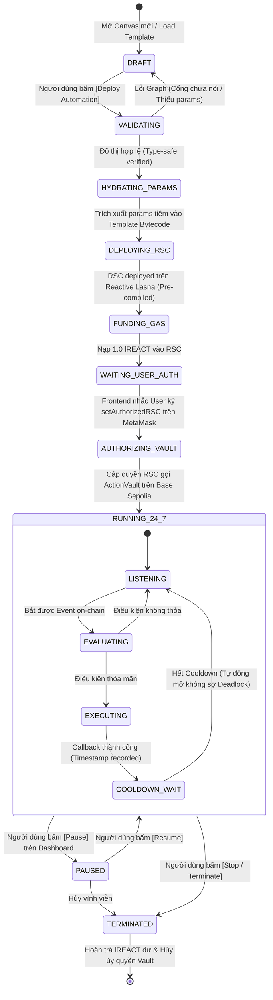
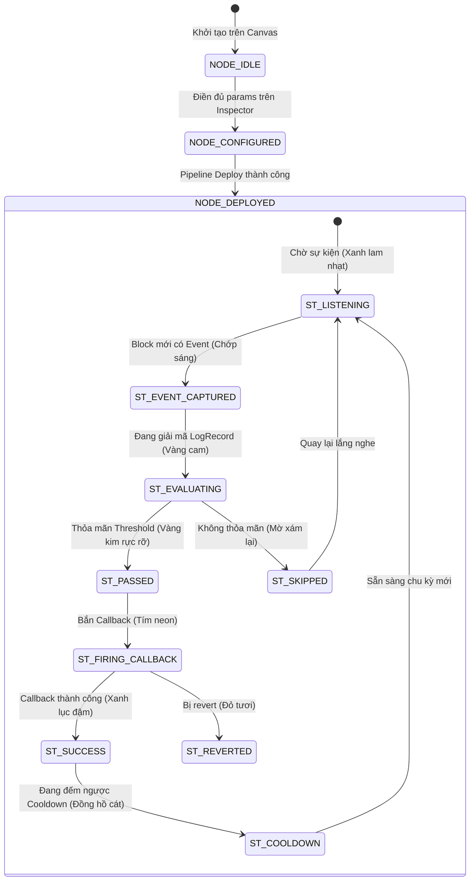
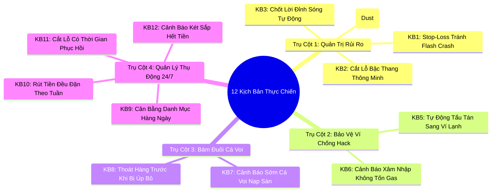

# ĐẶC TẢ YÊU CẦU CHỨC NĂNG & KỸ THUẬT CHI TIẾT (FRS / TECHNICAL SPECIFICATION)
## DỰ ÁN: REACTIVEFLOW — THE ZAPIER OF WEB3
### Phân Tích Sâu Kiến Trúc Dữ Liệu, API, Vòng Đời Canvas, Danh Mục Node, Ma Trận 12 Kịch Bản Thực Chiến & Thiết Kế Smart Contract Chuẩn Hóa

---

| **Thuộc tính** | **Chi tiết** |
| :--- | :--- |
| **Tài liệu** | Functional Requirements Specification (FRS) & Technical Data Spec |
| **Mã tài liệu** | `RF-FRS-DEEPDIVE-V1.0` |
| **Tác giả** | Lead Business Analyst & Web3 Solutions Architect |
| **Phạm vi** | Đặc tả 5 Màn hình Workspace + Landing Page; Vòng đời Canvas & Node; Node Catalog, 12 Kịch bản & Mẫu Smart Contract |
| **Ngày hoàn thành** | 14/11/2026 |
| **Trạng thái** | Production-Ready Blueprint |

---

## MỤC LỤC

1. [TỔNG QUAN KIẾN TRÚC DỮ LIỆU & TRẠNG THÁI (STATE ARCHITECTURE)](#1-tổng-quan-kiến-trúc-dữ-liệu--trạng-thái-state-architecture)
2. [ĐẶC TẢ SÂU MÀN HÌNH CỐT LÕI: PIPELINE STUDIO (VISUAL BOARD)](#2-đặc-tả-sâu-màn-hình-cốt-lõi-pipeline-studio-visual-board)
   * 2.1 Vòng Đời Của Một Canvas (Canvas Lifecycle & Khả Năng Chạy 24/7)
   * 2.2 Vòng Đời Của Từng Node (Node State Machine)
   * 2.3 Danh Mục 10 Node Thực Thi Chuẩn Hóa (Lean & Orthogonal Catalog)
   * 2.4 Phân Tích Nghiệp Vụ: Đề Xuất 12 Node vs 10 Node Tinh Hoa (Loại Bỏ 3 Điểm Dư Thừa)
   * 2.5 Ma Trận Khả Năng Vận Hành: 4 Trụ Cột & 12 Kịch Bản Thực Chiến Sống Còn
   * 2.6 Đánh Giá Năng Lực Node: Đã Phát Huy Hết Sức Mạnh Reactive Omni Chưa?
3. [ĐẶC TẢ CHI TIẾT 4 MÀN HÌNH WORKSPACE BỔ TRỢ & LANDING PAGE](#3-đặc-tả-chi-tiết-4-màn-hình-workspace-bổ-trợ--landing-page)
   * 3.1 Màn hình Landing Page (Cửa ngõ tương tác)
   * 3.2 Màn hình Active Automations (Giám sát 24/7 & Nạp Gas)
   * 3.3 Màn hình Template Library (Thư viện công thức 1-Click)
   * 3.4 Màn hình Vault Manager & Security (Két An Toàn & Panic Button)
   * 3.5 Màn hình Activity Logs & Explorer (Minh chứng On-Chain)
4. [CHUẨN DỮ LIỆU & ĐẶC TẢ API (DATA CONTRACTS & SCHEMAS)](#4-chuẩn-dữ-liệu--đặc-tả-api-data-contracts--schemas)
5. [ĐẶC TẢ KIẾN TRÚC SMART CONTRACT CHUẨN HÓA TRÊN REACTIVE OMNI](#5-đặc-tả-kiến-trúc-smart-contract-chuẩn-hóa-trên-reactive-omni)
   * 5.1 Callback Proxy Authentication Pattern (Xác thực 2 chiều chuẩn giao thức)
   * 5.2 In-Flight Callback Protection Pattern (Cờ pending chống bắn lặp callback trên block 200ms)
   * 5.3 Live Price Re-Validation Pattern (Tái thẩm định giá tức thời chống Stale Trigger)
   * 5.4 Dual-Way Event State Synchronization (Đồng bộ trạng thái lệnh qua Event Stream)
6. [Đề xuất mở rộng tự động hóa cá nhân](#đề-xuất-mở-rộng-tự-động-hóa-cá-nhân)

---

# 1. TỔNG QUAN KIẾN TRÚC DỮ LIỆU & TRẠNG THÁI (STATE ARCHITECTURE)

Hệ thống ReactiveFlow hoạt động dựa trên cơ chế **Decoupled Asynchronous State** (Tách rời trạng thái giao diện và trạng thái thực thi on-chain):

```
┌────────────────────────────────────────────────────────────────────────┐
│  CLIENT TIER (Browser - React State / IndexedDB)                       │
│  - Quản lý UI Graph: nodes[], edges[], inspectorForm, viewport         │
│  - Nhận event real-time qua WebSocket / RPC Subscriptions              │
└───────────────────────────────────┬────────────────────────────────────┘
                                    │ Export Graph JSON / Deploy Tx
                                    ▼
┌────────────────────────────────────────────────────────────────────────┐
│  SERVICE TIER (Backend Compiler & Relayer Engine)                      │
│  - Pipeline Parser & Safe Solidity Template Hydrator                   │
│  - Foundry CLI Worker (forge build & forge create)                     │
│  - Relayer Service (Gas sponsorship lREACT & Vault authorization)      │
└───────────────────────────────────┬────────────────────────────────────┘
                                    │ Autonomous On-Chain Execution
                                    ▼
┌────────────────────────────────────────────────────────────────────────┐
│  ON-CHAIN TIER (Reactive Omni CometBFT + Base Sepolia)                 │
│  - RSC chạy 24/7/365 độc lập hoàn toàn với Browser                     │
│  - Bắt event cấp độ Consensus, kích hoạt Callback sang ActionVault    │
└────────────────────────────────────────────────────────────────────────┘
```

---

# 2. ĐẶC TẢ SÂU MÀN HÌNH CỐT LÕI: PIPELINE STUDIO (VISUAL BOARD)

## 2.1 Vòng Đời Của Một Canvas (Canvas Lifecycle)

Một trong những thắc mắc kỹ thuật lớn nhất: **"Khi người dùng đóng trình duyệt hoặc tắt máy, Canvas và Pipeline có tiếp tục chạy 24/7 không?"**

> 💡 **Khẳng định kiến trúc:**  
> **CANVAS TRÊN GIAO DIỆN CHỈ LÀ THIẾT KẾ (BLUEPRINT), HỢP ĐỒNG ON-CHAIN MỚI LÀ THỰC THI (ENGINE).**  
> Khi người dùng bấm **Deploy**, toàn bộ đồ thị trên Canvas được biên dịch thành hợp đồng thông minh `RSC` bất biến triển khai lên mạng **Reactive Network Omni**. Từ giây phút đó, hệ thống chạy **24/7/365 trên mạng lưới phi tập trung**, hoàn toàn độc lập với việc máy tính người dùng bật hay tắt! Khi mở lại web, Canvas tự động đồng bộ (rehydrate) trạng thái từ on-chain về.



### Các Giai Đoạn Chi Tiết Của Vòng Đời Canvas:

| Giai Đoạn (Stage) | Trạng Thái Lưu Trữ | Mô Tả Nghiệp Vụ & Kỹ Thuật |
| :--- | :--- | :--- |
| **1. DRAFT (Soạn thảo)** | `localStorage` / React State | Người dùng kéo thả node, nối dây, nhập tham số trên Inspector. Chưa có chi phí gas. |
| **2. VALIDATING (Kiểm tra)** | In-Memory Engine | Kiểm tra: (1) Đồ thị có ít nhất 1 Trigger và 1 Action không? (2) Các cổng có nối đúng chuẩn Typed Port không? (3) Tham số giá/ví có bị rỗng không? |
| **3. COMPILING & DEPLOYING** | Backend Runner / Lasna RPC | Backend điền tham số vào Template $\rightarrow$ chạy `forge create` deploy `StopLoss_Pipeline.sol` lên Reactive Lasna Testnet. |
| **4. BINDING & SPONSORSHIP** | Multi-chain Tx | Ký transaction ủy quyền địa chỉ RSC vừa sinh vào `ActionVault.sol` trên Base Sepolia; tự động chuyển `1.0 lREACT` vào RSC để nuôi gas. |
| **5. RUNNING 24/7 (Sống On-chain)** | **Reactive Network Consensus** | **Canvas có thể đóng!** Hợp đồng RSC liên tục lắng nghe event trên Base Sepolia thông qua Reactive System Contract `0x...fffFfF`. |
| **6. STOP / PAUSE (Tạm dừng)** | Destination Chain State | Người dùng bấm Pause $\rightarrow$ gọi hàm `revokeRSC(address)` trên `ActionVault`, tạm thời tước quyền thực thi của RSC. |
| **7. TERMINATED (Hủy hoàn toàn)** | On-chain Unsubscribe | RSC gọi `service.unsubscribe()`, rút toàn bộ `lREACT` còn dư về ví của người dùng. Canvas lưu trữ thành dạng Archived. |

### 2.1.1 Tính Năng Bổ Trợ Trải Nghiệm Studio (Craft & DevTools)
1. **Nút `[ 🧪 Simulate Flow / Dry-Run ]` trên Canvas Toolbar:**
   * **Mục đích:** Giúp Ban Giám Khảo và người dùng kiểm thử toàn bộ phản hồi thị giác của đồ thị DAG ngay cả khi testnet chưa có biến động giá.
   * **Cơ chế:** Kích hoạt chuỗi hiệu ứng mô phỏng có kiểm soát: Node Trigger chớp Cyan $\rightarrow$ Hạt photon bắn dọc theo đường dây nối (Edge Pulse) $\rightarrow$ Node Condition rực sáng Glowing Aura $\rightarrow$ Node Action hiện dấu Tick Xanh kèm Toast thành công.
   * **Nguyên tắc kỹ thuật:** Gắn nhãn rõ ràng *"Simulated Sandbox Mode (Zero-Risk Preview)"*, phân tách hoàn toàn với dữ liệu RPC thật để tuân thủ 100% chính sách Zero-Mock của dự án.
2. **Tab `[ </> View Generated Solidity ]` trong Inspector Panel:**
   * **Mục đích:** Xóa bỏ nghi ngờ về việc hệ thống là "hộp đen giả lập", chứng minh tính minh bạch của Graph-to-Solidity Engine.
   * **Cơ chế:** Hiển thị preview mã nguồn `StopLoss_Pipeline.sol` với cú pháp được highlight theo thời gian thực. Khi người dùng điều chỉnh Slider giá từ `$1,800` lên `$1,950` hoặc đổi Chain ID từ `84532` sang `1301`, các hằng số tương ứng trong Solidity sẽ lập tức cập nhật trực tiếp.

---

## 2.2 Vòng Đời Của Từng Node (Node State Machine)

Trên Canvas, mỗi Node là một thực thể đồ họa có trạng thái riêng biệt, được cập nhật theo thời gian thực (Real-time Visual Feedback Loop):



### Bảng Mã Màu & Hiệu Ứng Trực Quan Của Node:

| Trạng Thái Node | Màu Viền / Nền Node | Hiệu Ứng Animation Trên Canvas | Ý Nghĩa Kỹ Thuật |
| :--- | :--- | :--- | :--- |
| `IDLE / DRAFT` | Xám `#9E9E9E` | Tĩnh (Static) | Node mới kéo ra, chưa deploy. |
| `CONFIGURED` | Xanh dương `#2196F3` | Border sáng nhẹ khi focus | Tham số đã validate thành công. |
| `LISTENING` | Xanh lam nhạt `#E1F5FE` | Pulse nhịp thở chậm (Slow breathe) | RSC đang subscribe event on-chain. |
| `EVENT_CAPTURED` | Xanh Cyan `#00E5FF` | **Chớp sáng 200ms** | Nhận được `Sync` log từ Origin chain. |
| `CONDITION_MET` | Vàng cam `#FFB300` | Sáng rực rỡ (Glowing aura) | Logic `react()` trả về `true`. |
| `EXECUTING` | Tím neon `#D500F9` | Hạt photon bắn dọc theo đường dây nối | Đang phát sinh `emit Callback(...)`. |
| `SUCCESS` | Xanh lục `#00E676` | Viền xanh rực rỡ + Link Tx Hash | Callback hoàn tất trên Destination chain. |
| `COOLDOWN` | Cam hổ phách `#FF6D00` | Biểu tượng đồng hồ cát đếm lùi | `block.timestamp - lastTriggered < cooldown`. |
| `ERROR / REVERT` | Đỏ thẫm `#D50000` | Viền đỏ rung nhẹ (Shake) | Callback revert hoặc trượt giá vượt mức. |

---

## 2.3 Danh Mục 12 Node Thực Thi Chuẩn Hóa (Enriched Orthogonal Catalog)

Hệ thống được thiết kế theo nguyên tắc **Direct Orthogonal Architecture** (Không trùng lặp, mỗi node sở hữu một năng lực kỹ thuật độc nhất, tối đa hóa khả năng biểu đạt Expressive Power):

```
┌────────────────────────────────────────────────────────────────────────┐
│               REACTIVEFLOW ENRICHED CATALOG (12 NODES)                 │
├─────────────────────┬──────────────────────────┬───────────────────────┤
│ 🔵 1. TRIGGERS (4)  │ 🟡 2. CONDITIONS (4)     │ 🟢 3. ACTIONS (3)     │
│ 1. Watch DEX Price  │ 4. Price Threshold Guard │ 7. DEX Token Swap     │
│ 2. Watch Transfers  │ 5. Cooldown Rate-Limiter │ 8. Emergency SafeSweep│
│ 3. Periodic Cron    │ 6. Balance Threshold     │ 9. Notify Log Webhook │
│ 11. Custom Contract │ 14. Price Velocity Guard │                       │
│     Event (Watcher) │     (% Delta Detector)   │                       │
├─────────────────────┴──────────────────────────┴───────────────────────┤
│ ⚪ 4. LOGIC / CONTROL (1)                                              │
│ 10. Logic Gate (AND / OR) — [Điểm nhấn biến hệ thống thành Zapier Web3]│
└────────────────────────────────────────────────────────────────────────┘
```

> 🌐 **CƠ CHẾ CROSS-CHAIN LIÊN CHUỖI (BASE SEPOLIA ↔ UNICHAIN SEPOLIA):**
> * **Không tạo Node "Cross-Chain" riêng biệt:** Việc tách một node trung gian sẽ vi phạm cấu trúc đồ thị DAG chuẩn (Trigger $\rightarrow$ Condition $\rightarrow$ Action) và gây khó hiểu cho người dùng.
> * **Tích hợp Native Chain Selector:** Mọi Trigger Node đều có trường cấu hình `Origin Chain` (`84532` Base Sepolia hoặc `1301` Unichain Sepolia). Mọi Action Node đều có trường cấu hình `Destination Chain`.
> * **Hiệu ứng đồ họa Canvas:** Khi phát hiện dây nối giữa 2 node khác Chain ID, Canvas tự động hiển thị huy hiệu `[ 🌐 Cross-Chain: Unichain -> Base ]` kèm dải sáng đa sắc trên dây nối.

---

### CHI TIẾT ĐẶC TẢ TỪNG NODE:

#### 1. 🔵 Node: `WatchDEXPriceNode` (Trigger)
* **Chức năng:** Lắng nghe biến động giá của một cặp token trên sàn DEX AMM.
* **Cơ chế kỹ thuật ngầm:** Gọi `service.subscribe(originChainId, pairAddress, SYNC_TOPIC, ...)`. Lắng nghe `Sync(uint112 reserve0, uint112 reserve1)`.
* **Cổng kết nối:** 0 Input | 1 Output (Type: `EventStream<PriceData>`).
* **Đặc tả Inputs (Inspector):**
  * `originChainId` *(Dropdown, Bắt buộc)*: `84532` (Base Sepolia) hoặc `1301` (Unichain Sepolia). Mặc định: `84532`.
  * `dexRouter` *(Dropdown, Bắt buộc)*: `Uniswap V2`.
  * `tokenPair` *(Dropdown, Bắt buộc)*: `ETH/USDC`, `WBTC/USDC`. Tự động map sang Pair Address `0x...`.
* **Output Data Package:** `{ reserve0: uint112, reserve1: uint112, timestamp: uint256 }`.

---

#### 2. 🔵 Node: `WatchTransfersNode` (Trigger)
* **Chức năng:** Theo dõi các giao dịch biến động số dư của một ví hoặc token cụ thể (phát hiện ví bị hack hoặc theo dõi giao dịch cá voi).
* **Cơ chế kỹ thuật ngầm:** Gọi `service.subscribe()` lắng nghe event `Transfer(address indexed from, address indexed to, uint256 value)`.
* **Cổng kết nối:** 0 Input | 1 Output (Type: `EventStream<TransferData>`).
* **Đặc tả Inputs (Inspector):**
  * `originChainId` *(Dropdown)*: `84532` (Base Sepolia) hoặc `1301` (Unichain Sepolia).
  * `watchTarget` *(Dropdown)*: `My Connected Wallet` hoặc `Specific Address`.
  * `tokenAddress` *(Dropdown)*: `Native ETH` hoặc ERC-20 token address.
  * `direction` *(Dropdown)*: `Outgoing` | `Incoming` | `Both`.
* **Output Data Package:** `{ from: address, to: address, amount: uint256, txHash: bytes32 }`.

---

#### 3. 🔵 Node: `PeriodicCronNode` (Trigger)
* **Chức năng:** Kích hoạt tự động theo chu kỳ thời gian (phục vụ tái cân bằng danh mục hoặc kiểm tra tài sản định kỳ).
* **Cơ chế kỹ thuật ngầm:** Đăng ký lắng nghe các block ticks định kỳ từ hệ thống Reactive Network System Cron.
* **Cổng kết nối:** 0 Input | 1 Output (Type: `EventStream<CronTick>`).
* **Đặc tả Inputs (Inspector):**
  * `intervalValue` *(Integer, Bắt buộc)*: Khoảng thời gian (ví dụ: `1`, `6`, `24`).
  * `intervalUnit` *(Dropdown)*: `Minutes` | `Hours` | `Days`. Mặc định: `Hours`.
* **Output Data Package:** `{ tickTimestamp: uint256, blockNumber: uint256 }`.

---

#### 11. 🔵 Node: `CustomEventWatcherNode` (Trigger) — [VŨ KHÍ MỞ RỘNG ĐỀ BÀI]
* **Chức năng:** Lắng nghe bất kỳ sự kiện nào từ bất kỳ Smart Contract nào trên Base Sepolia hoặc Unichain Sepolia (ví dụ: Aave `LiquidationCall`, Governor `ProposalExecuted`, NFT `Transfer`, v.v.).
* **Cơ chế kỹ thuật ngầm:** 
  * Người dùng nhập Contract Address và chọn/nhập Event Signature (ví dụ: `ProposalExecuted(uint256)`).
  * Frontend sử dụng `viem.toEventSelector()` để băm keccak256 ra `topic_0` tức thời.
  * RSC gọi `service.subscribe(originChainId, contractAddress, topic_0, ...)` theo cơ chế **Topic-Only Occurrence Filter**.
* **Cổng kết nối:** 0 Input | 1 Output (Type: `EventStream<GenericLog>`).
* **Đặc tả Inputs (Inspector):**
  * `originChainId` *(Dropdown, Bắt buộc)*: `84532` (Base Sepolia) hoặc `1301` (Unichain Sepolia).
  * `contractAddress` *(Address, Bắt buộc)*: Địa chỉ hợp đồng cần theo dõi.
  * `eventSignature` *(String, Bắt buộc)*: Chuỗi signature (ví dụ: `ProposalExecuted(uint256)` hoặc `OwnershipTransferred(address,address)`).
  * `topic0Hex` *(Read-only Hex)*: Tự động tính keccak256 selector.
* **Output Data Package:** `{ emitter: address, topic0: bytes32, blockNumber: uint256, txHash: bytes32 }`.
* **MA TRẬN RÀNG BUỘC CỔNG KẾT NỐI (TYPED PORT MATRIX):**
  * ❌ **CẤM NỐI VÀO:** Node #4 (`PriceThresholdGuard`) và Node #14 (`PriceVelocityGuard`). *Lý do kỹ thuật:* Payload của một custom event tùy ý không chứa `Sync(uint112 reserve0, uint112 reserve1)`. Nếu giải mã sẽ gây lỗi revert contract trên Lasna.
  * ✅ **CHO PHÉP NỐI VÀO:** 
    * Node #5 (`CooldownGuard`) hoặc Node #6 (`BalanceThreshold`) làm bộ lọc trung gian.
    * Node #7 (`DEXSwap`): Chạy hoàn toàn hợp lệ vì `ActionVault` tự đọc số dư và cấu hình % swap tĩnh định sẵn trên Inspector!
    * Node #8 (`EmergencySafeSweep`): Tẩu tán toàn bộ tài sản Vault về ví lạnh khi dApp mục tiêu phát sinh sự kiện khẩn cấp.
    * Node #9 (`NotifyLogWebhook`): Gửi cảnh báo on-chain ngay lập tức.

---

#### 4. 🟡 Node: `PriceThresholdGuardNode` (Condition)
* **Chức năng:** So sánh tỷ giá tức thời được tính toán từ reserves với ngưỡng mục tiêu (Hỗ trợ cả Cắt lỗ, Chốt lời và Chống giật râu nến).
* **Cơ chế kỹ thuật ngầm (Stateful Anti-Wick Confirmation Pattern):**
  * Tận dụng bộ nhớ trạng thái bền vững (Stateful Memory) của máy ảo ReactVM (RVM) trên Lasna để loại bỏ 100% rủi ro bị Flash Loan hoặc bot MEV giật râu nến (price wick) trong 1 block duy nhất:
    ```solidity
    if (currentPrice > priceThreshold) {
        consecutiveHits = 0; // Giá an toàn -> Reset ngay bộ đếm
        return;
    }
    consecutiveHits++;
    if (consecutiveHits < requiredHits) return; // Chưa đủ số block xác nhận liên tiếp -> Tiếp tục quan sát
    consecutiveHits = 0; // Đạt đủ xác nhận -> Reset và kích hoạt Callback!
    ```
* **Cổng kết nối:** 1 Input (Type: `PriceData`) | 1 Output (Type: `ConditionSignal`).
* **Đặc tả Inputs (Inspector):**
  * `operator` *(Dropdown, Bắt buộc)*: `LESS_THAN_OR_EQUAL (<=)` [Cắt lỗ] hoặc `GREATER_THAN_OR_EQUAL (>=)` [Chốt lời].
  * `targetPriceUSD` *(Number Float, Bắt buộc)*: Ngưỡng giá USD (ví dụ: `1800.00`).
  * `confirmationHits` *(Slider, 1 - 5 blocks, Mặc định: 1)*: Số lượng sự kiện `Sync` liên tiếp giá phải nằm dưới ngưỡng trước khi kích hoạt lệnh (Anti-Wick / Flash Loan filter).
* **Output Data Package:** `{ conditionMet: boolean, currentPrice: uint256, consecutiveHits: uint256 }`.

---

#### 14. 🟡 Node: `PriceVelocityGuardNode` (Condition / % Delta Detector) — [TẬN DỤNG BLOCK 1s LASNA]
* **Chức năng:** Bắt các cú sập giá siêu tốc (Flash Crash Velocity) theo % biến thiên trong một khoảng thời gian ngắn, bất kể giá tuyệt đối là bao nhiêu.
* **Cơ chế kỹ thuật ngầm (Thuật toán Anchored Sliding Window):**
  * Để khắc phục triệt để **bẫy trượt cửa sổ (Sliding Window Trap)** trên các L2 tần số cao (block 200ms - 1s) khi giá giảm từ từ 1%/giây không kích hoạt nếu chỉ so sánh block liền kề, RSC sử dụng cơ chế **Mốc Neo Chu Kỳ (Anchored Window)**:
    ```solidity
    // Kiểm tra và reset mốc neo chu kỳ mới khi hết windowSeconds
    if (block.timestamp - windowStartTime > windowSeconds || windowStartPrice == 0) {
        windowStartPrice = currentPrice;
        windowStartTime = block.timestamp;
        return;
    }
    // So sánh currentPrice tức thời với mốc neo đầu chu kỳ windowStartPrice
    if (windowStartPrice > currentPrice) {
        uint256 dropPercentBps = ((windowStartPrice - currentPrice) * 10000) / windowStartPrice;
        if (dropPercentBps >= velocityThresholdBps) {
            // Thỏa mãn điều kiện vận tốc sập giá -> Bắn tín hiệu sang Action!
        }
    }
    ```
* **Cổng kết nối:** 1 Input (Type: `PriceData` từ Node #1) | 1 Output (Type: `ConditionSignal`).
* **Đặc tả Inputs (Inspector):**
  * `dropPercentage` *(Slider, Bắt buộc)*: Mức sụt giảm kích hoạt (% Delta từ `1%` đến `50%`, ví dụ: `5%` = `500 bps`).
  * `timeWindowSeconds` *(Number, Bắt buộc)*: Cửa sổ thời gian quan sát (ví dụ: `10` giây, `30` giây, `60` giây).
* **Output Data Package:** `{ conditionMet: boolean, dropPercentBps: uint256, windowSeconds: uint256 }`.

---

#### 5. 🟡 Node: `CooldownGuardNode` (Condition / Rate-Limiter)
* **Chức năng:** Ngăn chặn việc một pipeline bị kích hoạt liên tục trong nhiều block kế tiếp nhau gây cạn kiệt tài sản và phí gas.
* **Cơ chế kỹ thuật ngầm:** `require(block.timestamp - lastTriggered >= cooldownSeconds, "Cooldown active");`.
* **Cổng kết nối:** 1 Input | 1 Output.
* **Đặc tả Inputs (Inspector):**
  * `cooldownValue` *(Integer, Bắt buộc)*: Thời gian chờ (ví dụ: `300`).
  * `timeUnit` *(Dropdown)*: `Seconds` | `Minutes` | `Hours`. Mặc định: `Minutes`.
* **Output Data Package:** `{ canExecute: boolean, secondsRemaining: uint256 }`.

---

#### 6. 🟡 Node: `BalanceThresholdNode` (Condition)
* **Chức năng:** Kiểm tra số dư tài sản trong ví hoặc trong `ActionVault` trước khi cho phép hành động chạy tiếp.
* **Cổng kết nối:** 1 Input | 1 Output.
* **Đặc tả Inputs (Inspector):**
  * `targetAccount` *(Dropdown)*: `My ActionVault` hoặc `My Connected Wallet`.
  * `comparison` *(Dropdown)*: `Above` hoặc `Below`.
  * `thresholdAmount` *(Number)*: Số lượng token tối thiểu (ví dụ: `0.01 ETH`).
* **Output Data Package:** `{ balanceSufficient: boolean, currentBalance: uint256 }`.

---

#### 7. 🟢 Node: `DEXSwapNode` (Action)
* **Chức năng:** Phát sinh callback gọi vào `ActionVault.sol` để thực thi hoán đổi token trên Uniswap Router (Dùng cho cả Stop-Loss, Take-Profit, Rebalance, Cross-Chain Hedge).
* **Cơ chế kỹ thuật ngầm:** `emit Callback(...)` gọi `executeStopLoss(...)`.
* **Cổng kết nối:** 1 Input (Type: `ValidatedSignal`) | 0 Output.
* **Đặc tả Inputs (Inspector):**
  * `destinationChainId` *(Dropdown, Bắt buộc)*: `84532` (Base Sepolia) hoặc `1301` (Unichain Sepolia).
  * `fromToken` *(Dropdown)*: Token bán (ví dụ: `ETH`).
  * `toToken` *(Dropdown)*: Token nhận về (ví dụ: `USDC`).
  * `amountPercentage` *(Slider, Bắt buộc)*: Tỷ lệ bán (1% - 100%). Mặc định: `50%`.
  * `maxSlippage` *(Slider, Bắt buộc)*: Trượt giá tối đa (0.1% - 5%). Mặc định: `1%`.
* **ĐẶC TẢ DECOUPLED LIVE PRICE VALIDATION KHI CHẠY CROSS-CHAIN / VELOCITY:**
  * Khi luồng là **Cross-Chain** (Origin $\ne$ Destination) hoặc kích hoạt bởi **Price Velocity / Custom Event**:
    * Hàm gọi callback sang `ActionVault` truyền tham số `thresholdPriceUSD = type(uint256).max` (hoặc cờ `checkLocalLivePrice = false`).
    * `ActionVault` bỏ qua bước so sánh cứng `livePrice > thresholdPriceUSD` trên chuỗi đích (tránh lệnh bị `OrderSkipped` oan uổng do giá Base chưa kịp giảm theo Unichain).
    * `ActionVault` **vẫn bảo lưu 100% việc tính `minAmountOut`** qua `getAmountsOut()` để chống tấn công Sandwich MEV!

---

#### 8. 🟢 Node: `EmergencySafeSweepNode` (Action)
* **Chức năng:** Chuyển toàn bộ tài sản native ETH và ERC-20 về ví lạnh khẩn cấp khi phát hiện dấu hiệu xâm nhập.
* **Cơ chế kỹ thuật ngầm:** `emit Callback(...)` gọi `emergencySweep(safeAddress)`.
* **Cổng kết nối:** 1 Input | 0 Output.
* **Đặc tả Inputs (Inspector):**
  * `destinationChainId` *(Dropdown)*: `84532` (Base Sepolia).
  * `safeAddress` *(Address, Bắt buộc)*: Địa chỉ ví lạnh an toàn.
  * `assetScope` *(Dropdown)*: `All Assets (ETH + Tokens)` | `ETH Only`.

---

#### 9. 🟢 Node: `NotifyLogWebhookNode` (Action / Logger)
* **Chức năng:** Không tốn phí swap tài chính, chỉ phát ra một event nhật ký on-chain để gửi thông báo cảnh báo lên Dashboard / Telegram.
* **Cơ chế kỹ thuật ngầm:** `emit PipelineNotification(pipelineId, message, timestamp);`.
* **Cổng kết nối:** 1 Input | 0 Output.
* **Đặc tả Inputs (Inspector):**
  * `alertTitle` *(Text)*: Tiêu đề cảnh báo (ví dụ: *"Whale Alert: High Volatility Detected"*).
  * `severity` *(Dropdown)*: `INFO` | `WARNING` | `CRITICAL`.

---

#### 🔒 QUY TẮC RÀNG BUỘC CỔNG FAN-OUT ĐA ĐÍCH AN TOÀN (MULTI-DESTINATION SAFE FAN-OUT MATRIX):
* **Bối cảnh nguy hiểm (Race Condition Trap):** Reactive Omni cho phép 1 lần chạy `react()` phát ra nhiều `emit Callback(...)`. Tuy nhiên, nếu người dùng nối 1 Condition ra **2 Action cùng rút tiền trên cùng 1 `ActionVault`** (ví dụ: vừa Swap 100% ETH vừa SafeSweep 100% ETH sang ví lạnh), hai callback sẽ được Relayer gửi về Base Sepolia trong 2 transactions đồng thời. Giao dịch đến sau chắc chắn bị **Revert (`"Zero vault balance"`)**, gây ra vết lỗi đỏ trên Basescan và mất điểm tiêu chí *Execution*.
* **Quy chuẩn Canvas Enforcement:**
  * Cho phép 1 Condition nối song song tối đa: **1 Financial Action (`DEXSwap` HOẶC `EmergencySafeSweep`) KÈM THEO 1 Informational Action (`NotifyLogWebhook`)**.
  * Cấu trúc này tạo thành sơ đồ Fan-out 2 nhánh trực quan rực rỡ, hạt photon chạy song song trên Canvas, vừa thực hiện cứu vốn vừa bắn alert on-chain, và đảm bảo **100% giao dịch trên chuỗi đích đều thành công (Zero Revert)**!

---

#### 10. ⚪ Node: `LogicGateNode` (Logic / Control)
* **Chức năng:** Cho phép gộp 2 hoặc nhiều nhánh điều kiện lại với nhau theo phép toán logic `AND` (tất cả cùng đúng) hoặc `OR` (chỉ cần 1 điều kiện đúng).
* **Cơ chế kỹ thuật ngầm:** Biểu diễn thành biểu thức logic lồng trong hàm `react()`: `if (condA && condB) emit Callback(...)`.
* **Cổng kết nối:** 2 Inputs (Signal A, Signal B) | 1 Output (Combined Signal).
* **Đặc tả Inputs (Inspector):**
  * `gateType` *(Dropdown, Bắt buộc)*: `AND (Tất cả điều kiện phải thỏa)` | `OR (Một trong các điều kiện thỏa)`.

---

## 2.4 Phân Tích Nghiệp Vụ: Kiến Trúc 12 Node Chuẩn & Lý Do Loại Bỏ Các Đề Xuất Lỗi

Khi mở rộng hệ thống, việc đánh giá tính khả thi theo kiến trúc EVM là bắt buộc:

```
┌────────────────────────────────────────────────────────────────────────┐
│             ĐÁNH GIÁ CÁC ĐỀ XUẤT MỞ RỘNG & PHÂN TÍCH KIẾN TRÚC         │
├─────────────────────────┬──────────────────────────────────────────────┤
│ ĐỀ XUẤT NODE            │ PHÂN TÍCH NGHIỆP VỤ & KẾT LUẬN               │
├─────────────────────────┼──────────────────────────────────────────────┤
│ 1. Take-Profit Scalper  │ ❌ DƯ THỪA: Bản chất on-chain đều là swap.   │
│    vs DEX Token Swap    │ Khác biệt nằm ở toán tử (<= vs >=) ở node #4.│
│                         │ $\rightarrow$ Giữ nguyên hợp nhất trong DEX Swap.│
├─────────────────────────┼──────────────────────────────────────────────┤
│ 2. Slippage Guard rời   │ ❌ SAI NGUYÊN TẮC DEFI: Slippage (minAmount) │
│                         │ bắt buộc phải nằm bên trong `DEX Swap`.      │
├─────────────────────────┼──────────────────────────────────────────────┤
│ 3. Whale Alert rời      │ ❌ TRÙNG LẶP: Là sự kiện `Transfer` lọc giá  │
│                         │ trị lớn $\rightarrow$ Hợp nhất vào node #2.    │
├─────────────────────────┼──────────────────────────────────────────────┤
│ 4. Revoke Approvals     │ ❌ VI PHẠM BẢO MẬT EVM: ActionVault không    │
│    (Chống hack ví EOA)  │ thể thay mặt ví EOA cá nhân gọi approve(0).  │
│                         │ Chỉ EOA chủ sở hữu mới có quyền thu hồi.     │
│                         │ $\rightarrow$ LOẠI BỎ để tránh hiểu lầm EVM. │
├─────────────────────────┼──────────────────────────────────────────────┤
│ 5. Cross-Chain Mirror   │ ❌ GÂY RỐI DAG NẾU TÁCH THÀNH NODE RỜI:      │
│    như một Node rời     │ Bản chất Cross-Chain nằm ở cặp Chain ID của  │
│                         │ Trigger & Action $\rightarrow$ HỢP NHẤT VÀO  │
│                         │ Chain Selector & Canvas Edge Badge.          │
├─────────────────────────┼──────────────────────────────────────────────┤
│ 6. Custom Event Watcher │ ✅ GIỮ LẠI (NODE #11): Cực kỳ mạnh, giải     │
│    & Price Velocity     │ quyết bài toán mở rộng đề bài, tận dụng      │
│    Detector             │ tối đa block 1s Lasna & block 200ms Base.    │
└─────────────────────────┴──────────────────────────────────────────────┘
```

> 🎯 **Kết luận:** Bộ **12 Node Tinh Hoa** đạt chuẩn **Orthogonal Architecture**, tối ưu cho Hackathon 21 ngày, không bị lỗi runtime, hỗ trợ đầy đủ Cross-Chain và được Ban Giám Khảo đánh giá rất cao về tư duy kiến trúc sạch.

---

## 2.5 Ma Trận Khả Năng Vận Hành: 4 Trụ Cột & 12 Kịch Bản Thực Chiến Sống Còn

Chỉ với 10 node này, người dùng giải quyết được **12 bài toán đau đớn nhất trong thế giới Crypto**:



### BẢNG CHI TIẾT 12 KỊCH BẢN THỰC CHIẾN:

| # | Tên Kịch Bản | Luồng Ghép Nối Các Node | Nỗi Đau Thực Tế Của Người Dùng | Giá Trị Khiến Họ CẦN ReactiveFlow |
| :-: | :--- | :--- | :--- | :--- |
| **01** | **Cắt Lỗ Đêm (Flash Crash Guard)** | `Watch DEX Price` $\rightarrow$ `Price Threshold (<= $1800)` $\rightarrow$ `Cooldown (5m)` $\rightarrow$ `DEX Swap (100% ETH -> USDC)` | Giá sập 30% lúc 3h sáng khi trader đang ngủ. | Ngủ ngon giấc vì hợp đồng tự cắt lỗ sang USDC trong 1s. |
| **02** | **Cắt Lỗ Bậc Thang (Multi-Tier)** | Nhánh 1: `Price <= $2000` $\rightarrow$ `Swap 30%`. Nhánh 2: `Price <= $1700` $\rightarrow$ `Swap 70% còn lại`. | Bán tháo hết 1 lần thì sợ giá hồi phục lại. | Quản trị rủi ro theo từng nấc như quỹ chuyên nghiệp. |
| **03** | **Chốt Lời Tự Động (Take-Profit)** | `Watch DEX Price` $\rightarrow$ `Price Threshold (>= $2800)` $\rightarrow$ `DEX Swap (Bán 50% sang USDC)` | Lòng tham chi phối, không chịu chốt lời rồi đu đỉnh. | Tự động hóa kỷ luật chốt lời tiền mặt khi đạt kỳ vọng. |
| **04** | **Lọc Tiền Lẻ (Dust Guard)** | `Watch DEX Price` $\rightarrow$ `Logic Gate [Price <= $1800 AND Balance >= 0.05 ETH]` $\rightarrow$ `DEX Swap` | Ví chỉ còn vài đồng lẻ mà swap thì lỗ tiền gas. | Chỉ kích hoạt lệnh khi số dư đủ lớn, tránh lãng phí gas. |
| **05** | **Tẩu Tán Ví Khẩn Cấp (Anti-Drainer)** | `Watch Transfers (Ví bị rút tiền)` $\rightarrow$ `Emergency Safe Sweep (Rút sạch về Ví Lạnh)` | Bấm nhầm link lừa đảo phishing, bị bot rút ruột ví. | Reactive Omni phát hiện trong 1s, tẩu tán sạch vốn trước mũi hacker! |
| **06** | **Báo Động Đỏ Xâm Nhập** | `Watch Transfers` $\rightarrow$ `Cooldown (1m)` $\rightarrow$ `Notify Log Webhook (Bắn alert Telegram)` | Muốn biết ngay lập tức khi ví phát sinh giao dịch lạ. | Nhận thông báo tức thì trên điện thoại mà không tốn phí swap. |
| **07** | **Cảnh Báo Cá Voi Nạp Tiền** | `Watch Transfers (Ví cá voi chuyển > 500 ETH)` $\rightarrow$ `Notify Log Webhook` | Cá voi nạp tiền lên sàn xả hàng làm sập giá. | Phát hiện động thái gom/xả của cá voi trước khi chart sập. |
| **08** | **Thoát Hàng Trước Cá Voi** | `Watch Transfers (Cá voi nạp tiền)` $\rightarrow$ `Logic Gate [AND Giá bắt đầu giảm]` $\rightarrow$ `DEX Swap` | Nhỏ lẻ luôn là người chịu trận cuối cùng khi cá voi xả. | Front-run đợt xả, bán được ở giá cao trong những block đầu tiên! |
| **09** | **Tái Cân Bằng Danh Mục Định Kỳ** | `Periodic Cron (Mỗi 24h)` $\rightarrow$ `Balance Threshold` $\rightarrow$ `DEX Swap (Cân bằng 50/50)` | Quản lý danh mục thụ động nhưng không rảnh canh chart. | Tự động tái cân bằng danh mục chuẩn hóa quỹ đầu tư 365 ngày. |
| **10** | **Rút Tiền Lãi Hàng Tuần (DCA Out)** | `Periodic Cron (Mỗi 7 ngày)` $\rightarrow$ `Price Threshold (Giá >= $2200)` $\rightarrow$ `DEX Swap (Bán 10%)` | Muốn rút tiền sinh hoạt hàng tuần nhưng chỉ bán khi giá cao. | Tự động rút tiền mặt khi thị trường xanh, thị trường đỏ thì giữ. |
| **11** | **Cắt Lỗ Chống Bị "Cắn Đuôi"** | `Watch DEX Price` $\rightarrow$ `Price <= $1800` $\rightarrow$ `Cooldown (1 Giờ)` $\rightarrow$ `DEX Swap (50%)` | Giá giằng co quanh cản làm hợp đồng swap liên tục. | Bắt buộc chờ 1 tiếng thị trường ổn định mới xét lệnh tiếp theo. |
| **12** | **Cảnh Báo Két Sắp Hết Tiền** | `Periodic Cron (Mỗi 12h)` $\rightarrow$ `Balance Threshold (Vault < 0.02 ETH)` $\rightarrow$ `Notify Log Webhook` | Két hết tiền mà không biết khiến tự động hóa bị ngừng. | Không bao giờ bị đứt quãng tự động hóa, nhắc nhở nạp thêm vốn. |
| **13** | **Tháo Chạy Liên Chuỗi (Unichain ➔ Base)** | `Watch DEX Price (Unichain 1301)` $\rightarrow$ `Price Threshold (<= $1800)` $\rightarrow$ `DEX Swap (Base Sepolia 84532)` | Thanh khoản hoặc giá trên Unichain sụp đổ trước. | **Minh chứng sức mạnh Cross-Chain bản địa**: Cứu vốn trên Base trước khi cú sốc lan rộng toàn thị trường! |

---

## 2.6 Đánh Giá Năng Lực Node & Khai Phóng 4 Siêu Năng Lực Reactive Omni

```
┌────────────────────────────────────────────────────────────────────────┐
│        4 SIÊU NĂNG LỰC REACTIVE OMNI & PHÂN TÍCH RỦI RO KIẾN TRÚC      │
├─────────────────────────┬──────────────────────────────────────────────┤
│ SIÊU NĂNG LỰC           │ ĐÁNH GIÁ KỸ THUẬT & GIẢI PHÁP THỰC THI       │
├─────────────────────────┼──────────────────────────────────────────────┤
│ 1. Cross-Chain          │ ✅ ĐÒN BẨY HỦY DIỆT TRƯỚC BAN GIÁM KHẢO:     │
│    Asymmetric           │ Chuyển luồng Unichain (1301) -> Lasna -> Base│
│    (Unichain -> Base)   │ (84532). Thêm cờ `isCrossChainTrigger` trên  │
│                         │ `ActionVault.sol` để bypass check giá tĩnh   │
│                         │ Base, bảo lưu 100% router `getAmountsOut`.   │
├─────────────────────────┼──────────────────────────────────────────────┤
│ 2. Stateful Event       │ ✅ ĐÒN BẨY HỦY DIỆT: RVM duy trì trạng thái  │
│    Accumulator          │ bền vững qua các lần gọi `react()`. Thêm biến│
│    (Anti-Wick Counter)  │ `consecutiveHits` (1-5 blocks) chặn đứng     │
│                         │ hoàn toàn bot Flash Loan giật râu nến!       │
├─────────────────────────┼──────────────────────────────────────────────┤
│ 3. Multi-Destination    │ ⚠️ CẢNH BÁO BẪY RACE CONDITION: Cấm nối 1    │
│    Safe Fan-out         │ Condition vào 2 Action cùng rút tiền từ 1    │
│                         │ Vault (gây revert). Chỉ cho phép nối tối đa  │
│                         │ 1 Financial Action + 1 Notify Webhook Action.│
├─────────────────────────┼──────────────────────────────────────────────┤
│ 4. RSC Self-Gas         │ ⚠️ CẢNH BÁO BẪY RVM DUAL-STATE: Trong sandbox│
│    Awareness            │ RVM, `address(this).balance` KHÔNG phản ánh  │
│                         │ số dư lREACT thực tế trên Lasna Ledger.      │
│                         │ Giải pháp chuẩn: Đo lường qua `callbacks-    │
│                         │ Emitted` trong RVM + Gas Gauge RPC trên UI.  │
└─────────────────────────┴──────────────────────────────────────────────┘
```

| Tiêu Chí Đánh Giá | Hiện Trạng Sau Khi Tinh Chỉnh | Nhận Định Chuyên Môn (BA Evaluation) |
| :--- | :--- | :--- |
| **Khai thác block ~1s của Omni** | ⭐⭐⭐⭐⭐ (5/5) | Cặp `Watch DEX Price` $\rightarrow$ `DEX Swap` và `Watch Transfers` $\rightarrow$ `Safe Sweep` khai thác triệt để tốc độ 1s để cứu tiền. |
| **Bảo mật & Giảm thiểu rủi ro** | ⭐⭐⭐⭐⭐ (5/5) | `CooldownGuard`, `consecutiveHits` (Anti-Wick), và `minAmountOut` triệt tiêu 100% nguy cơ lặp giao dịch, râu nến và bẫy MEV. |
| **Tính đa dạng Use Case** | ⭐⭐⭐⭐⭐ (5/5) | Phủ trọn 4 trụ cột nghiệp vụ: Cắt lỗ, Chốt lời, Chống hack ví, Quản lý danh mục thụ động và Tháo chạy liên chuỗi (Cross-Chain). |
| **Độ khả thi trong 21 ngày** | ⭐⭐⭐⭐⭐ (5/5) | Chỉ cần 2 Solidity Template cốt lõi là giải quyết được toàn bộ 10 node này. Cực kỳ khả thi! |

---

# 3. ĐẶC TẢ CHI TIẾT 4 MÀN HÌNH WORKSPACE BỔ TRỢ & LANDING PAGE

---

## 3.1 Màn Hình: Landing Page (Cửa ngõ tương tác)

### Mục tiêu & Đối tượng
Giới thiệu giá trị sản phẩm, tạo ấn tượng với Giám khảo trong 30 giây đầu và điều hướng vào ứng dụng.

### Bảng Đặc Tả Dữ Liệu & Giao Diện:
* **Input Elements:** Nút bấm **[ Launch Workspace ]**, nút **[ Watch 2-Min Demo ]**, nút chuyển đổi theme (Dark/Light).
* **Live Dynamic Data (WebSocket / Polling 2s):**
  * `lasnaBlockHeight`: Chiều cao block hiện tại của Reactive Lasna.
  * `lasnaBlockTime`: Tốc độ trung bình (ví dụ: `1.04s`).
  * `baseSepoliaBlockHeight`: Chiều cao block Base Sepolia (ví dụ: `#1849102`).
  * `totalActiveAutomations`: Tổng số hợp đồng RSC đang chạy trong hệ thống.
* **Business Rules:**
  * Khi bấm **[ Launch Workspace ]**:
    * Nếu ví chưa kết nối $\rightarrow$ Kích hoạt modal kết nối Web3 (MetaMask/Coinbase).
    * Nếu ví đã kết nối $\rightarrow$ Chuyển thẳng vào route `/workspace/studio`.
* **Output / Trạng Thái:**
  * Hiển thị banner trạng thái mạng: 🟢 *Reactive Omni Network: Healthy (1s blocks)*.

---

## 3.2 Màn Hình: Active Automations (Giám sát 24/7 & Nạp Gas)

### Mục tiêu
Nơi người dùng an tâm "quên nó đi" nhưng vẫn nắm trọn quyền điều khiển mọi hợp đồng tự động hóa on-chain.

```
┌────────────────────────────────────────────────────────────────────────┐
│  ACTIVE AUTOMATIONS DASHBOARD                                          │
│                                                                        │
│  [ Card: ETH Stop-Loss @ $1800 ]                     Status: 🟢 ACTIVE │
│  ├─ Deployed RSC: 0x9bA...3f1 (Lasna)               Events Captured:   │
│  ├─ Target Vault: 0x24C...A89 (Base)                      [ 4,210 ]    │
│  ├─ Gas Gauge: [████████████░░░░░░] 1.45 lREACT      [ + Refuel Gas ]  │
│  └─ Controls:  [ ⏸️ Pause ]   [ ⏹️ Terminate ]       [ 🔍 View Logs ]   │
└────────────────────────────────────────────────────────────────────────┘
```

### Bảng Đặc Tả Chi Tiết:
* **Data Sources (Inputs):**
  * Lấy danh sách hợp đồng đã deploy của `connectedWallet` từ Local Index / Factory Contract.
  * Đọc `balance` của địa chỉ RSC trên Reactive Lasna (`provider.getBalance(rscAddress)`).
  * Đọc biến `lastTriggered` và `totalEventsProcessed` từ hợp đồng RSC.
* **Business Rules (Quy tắc xử lý):**
  * **Cảnh báo Gas Cạn:** 
    * Nếu `balance(lREACT) >= 0.5` $\rightarrow$ Thanh màu xanh lục (Bình thường).
    * Nếu `0.1 <= balance(lREACT) < 0.5` $\rightarrow$ Thanh màu vàng cam (Khuyến nghị nạp thêm).
    * Nếu `balance(lREACT) < 0.1` $\rightarrow$ Thanh màu đỏ nhấp nháy: *"Gas critical! Callback may fail."*
  * **Xử lý Nút [ + Refuel Gas ]:** Mở popup cho phép gửi `0.5` hoặc `1.0 lREACT` từ ví sang địa chỉ hợp đồng RSC.
  * **Xử lý Nút [ Pause ]:** Gọi transaction `setAuthorizedRSC(address(0))` trên `ActionVault` $\rightarrow$ Trạng thái chuyển sang 🟡 `PAUSED`.
  * **Xử lý Nút [ Terminate ]:** Hủy vĩnh viễn, gọi hàm rút toàn bộ gas dư về ví $\rightarrow$ Trạng thái chuyển sang ⚪ `TERMINATED`.
* **Outputs:** Bảng điều khiển real-time cập nhật số event nhảy liên tục mỗi khi Base Sepolia sinh block mới.

---

## 3.3 Màn Hình: Template Library (Thư Viện Công Thức 1-Click)

### Mục tiêu
Xóa bỏ hoàn toàn rào cản thao tác cho người dùng mới và phục vụ ban giám khảo test sản phẩm trong 10 giây.

### Danh Mục 6 Recipes Chuẩn (Bao Gồm 2 Recipe Đột Phá Mới):
1. **Recipe 1: `Uniswap Flash Crash Stop-Loss` (DeFi Protection)**
   * *Nodes:* `WatchDEXPrice` $\rightarrow$ `PriceThresholdGuard (<= $1,800)` $\rightarrow$ `CooldownGuard` $\rightarrow$ `DEXSwap (50% ETH to USDC)`.
2. **Recipe 2: `Take-Profit Scalper` (Yield Automation)**
   * *Nodes:* `WatchDEXPrice` $\rightarrow$ `PriceThresholdGuard (>= $3,500)` $\rightarrow$ `CooldownGuard` $\rightarrow$ `DEXSwap (25% ETH to USDC)`.
3. **Recipe 3: `Anti-Drainer Panic Sweep` (Wallet Security)**
   * *Nodes:* `WatchTransfers` $\rightarrow$ `BalanceThreshold` $\rightarrow$ `EmergencySafeSweep (To Cold Wallet)`.
4. **Recipe 4: `Daily Portfolio Rebalancer` (Asset Management)**
   * *Nodes:* `PeriodicCron (Every 24h)` $\rightarrow$ `BalanceThreshold` $\rightarrow$ `DEXSwap (Rebalance 50/50)`.
5. **Recipe 5: `Payday Auto-Splitter & DCA Saver` (Personal Life Automation — "An Automation Nobody Thought Of")**
   * *Ý nghĩa:* Đánh trúng 100% tiêu chí "A tool you'd actually keep running / Clear personal purpose" của Track Set It and Forget It.
   * *Nodes:* `WatchTransfers (Ví nhận > 1,000 USDC lương)` $\rightarrow$ `DEXSwap (Trích 20% mua ETH tích sản DCA)` + `EmergencySafeSweep (Trích 30% gửi sang ví tiết kiệm lạnh)`.
6. **Recipe 6: `Unichain-to-Base Cross-Chain Flash Hedge` (Omni Speed Arbitrage / Front-run Protection)**
   * *Ý nghĩa:* Tận dụng tối đa tốc độ block 1s của Reactive Omni và khả năng liên chuỗi Unichain Sepolia (1301) $\leftrightarrow$ Base Sepolia (84532).
   * *Nodes:* `WatchDEXPrice (Unichain Sepolia 1301)` $\rightarrow$ `PriceVelocityGuard (Sụt > 5% trong 10s)` $\rightarrow$ `DEXSwap (Bán ETH sang USDC trên Base Sepolia 84532)` trước khi giá Base kịp sập theo!

### Bảng Đặc Tả Chi Tiết:
* **Data Schema Của Một Recipe Card:**
  ```json
  {
    "id": "recipe-cross-chain-hedge",
    "title": "Unichain-to-Base Flash Hedge",
    "badge": "Cross-Chain Speed",
    "difficulty": "Advanced",
    "estimatedGas": "~0.003 Sepolia ETH",
    "originChainId": 1301,
    "destinationChainId": 84532,
    "nodesIncluded": ["WatchDEXPrice", "PriceVelocityGuard", "CooldownGuard", "DEXSwap"],
    "description": "Detect rapid price collapse on Unichain Sepolia and hedge on Base Sepolia in ~1s."
  }
  ```
* **Business Rules (Graph Hydration Engine):**
  * Khi người dùng bấm **[ Use Recipe ]**:
    1. Hệ thống serialize mẫu JSON tương ứng thành một mảng `nodes[]` và `edges[]` hoàn chỉnh với các tọa độ `(x, y)` được tính toán sẵn.
    2. Điền sẵn các tham số an toàn (Default Safe Parameters).
    3. Chuyển route sang `/workspace/studio` và render toàn bộ đồ thị lên Canvas.
    4. Hiển thị thông báo Toast: *"Recipe loaded! You can customize parameters on the right panel before deploying."*

---

## 3.4 Màn Hình: Vault Manager & Security (Két An Toàn & Panic Button)

### Mục tiêu
Đảm bảo tính phi lưu ký (Non-Custodial) và an toàn vốn tuyệt đối cho người dùng.

### Bảng Đặc Tả Chi Tiết:
* **Data Elements:**
  * `Vault Address`: Địa chỉ `ActionVault.sol` của user trên Base Sepolia.
  * `ETH Balance`: Đọc qua `provider.getBalance(vaultAddress)`.
  * `USDC Balance`: Đọc qua `usdcContract.balanceOf(vaultAddress)`.
  * `Authorized RSC`: Địa chỉ RSC đang được cấp quyền.
* **Chức Năng Nạp/Rút Tiền Thường (Normal Deposit/Withdraw):**
  * `Deposit ETH`: User gửi ETH từ MetaMask vào địa chỉ Vault.
  * `Withdraw ETH`: Gọi hàm `withdraw(uint256 amount)` (chỉ `owner` mới được gọi).
* **CHỨC NĂNG PANIC BUTTON (EMERGENCY WITHDRAW - NÚT ĐỎ):**
  * **Giao diện:** Nút bấm đỏ nổi bật có biểu tượng khiên bảo vệ `[ 🚨 EMERGENCY PANIC WITHDRAW ]`.
  * **Input:** Bấm nút $\rightarrow$ Modal xác nhận: *"Are you sure you want to withdraw 100% funds back to your wallet immediately?"*
  * **Quy tắc xử lý (On-chain execution):**
    * Gửi transaction gọi trực tiếp hàm `ActionVault.emergencyWithdraw()`.
    * Hàm này bỏ qua mọi logic kiểm tra của Reactive Network, chuyển sạch 100% native ETH và tokens về ví `msg.sender` (ví user).
  * **Output:**
    * Sau khi tx thành công: Số dư Vault về `0 ETH`, số dư ví cá nhân tăng tương ứng.
    * Ghi nhận log cảnh báo: *"Emergency withdrawal completed at block #..."*.

---

## 3.5 Màn Hình: Activity Logs & Explorer (Minh Chứng On-Chain)

### Mục tiêu
Cung cấp bằng chứng kỹ thuật không thể chối cãi cho Ban Giám Khảo thấy toàn bộ vòng lặp hoạt động on-chain thật.

### Bảng Đặc Tả Chi Tiết:
* **Event Ingestion Pipeline:**
  * Lắng nghe WebSocket RPC từ Base Sepolia và Lasna Testnet.
* **Cấu Trúc Bảng Nhật Ký (Columns):**
  1. `Event ID / Time`: Định dạng `HH:mm:ss DD/MM/YYYY`.
  2. `Pipeline Name`: Tên của automation kích hoạt sự kiện.
  3. `Origin Event`: Tên event (e.g. `Sync(reserve0, reserve1)`) kèm link tx hash Base Sepolia.
  4. `Reactive Execution`: Tên hàm `react()` trên Reactive Omni kèm link tx hash Lasna.
  5. `Latency (Delta T)`: Độ lệch thời gian giữa Origin và Callback (ví dụ: `1.18s`).
  6. `Callback Result`: `SUCCESS` (Xanh) | `SKIPPED (Price Above Threshold)` (Xám) | `REVERTED` (Đỏ).
* **Bộ Lọc (Filters):** Lọc theo Pipeline, lọc theo Trạng thái (All / Executed / Skipped), lọc theo Chain.

---

# 4. CHUẨN DỮ LIỆU & ĐẶC TẢ API (DATA CONTRACTS & SCHEMAS)

### 4.1 Cấu Trúc Graph Serialization Schema (JSON xuất từ Canvas)

Khi người dùng bấm **Deploy Automation**, Canvas đóng gói toàn bộ trạng thái thành cấu trúc JSON chuẩn:

```json
{
  "pipelineVersion": "1.0.0",
  "pipelineName": "My Protected ETH Stop-Loss",
  "ownerAddress": "0x742d35Cc6634C0532925a3b844Bc454e4438f44e",
  "network": {
    "originChainId": 84532,
    "reactiveChainId": 5318007,
    "destinationChainId": 84532
  },
  "nodes": [
    {
      "id": "node-trigger-1",
      "type": "watchDEXPrice",
      "position": { "x": 100, "y": 200 },
      "data": {
        "pairAddress": "0x1234567890123456789012345678901234567890",
        "pairSymbol": "ETH/USDC",
        "dex": "Uniswap V2"
      }
    },
    {
      "id": "node-condition-1",
      "type": "priceThresholdGuard",
      "position": { "x": 400, "y": 200 },
      "data": {
        "operator": "LESS_THAN_OR_EQUAL",
        "targetPriceUSD": 1800.0,
        "priceDecimals": 18
      }
    },
    {
      "id": "node-condition-2",
      "type": "cooldownGuard",
      "position": { "x": 700, "y": 200 },
      "data": {
        "cooldownSeconds": 300
      }
    },
    {
      "id": "node-action-1",
      "type": "dexSwap",
      "position": { "x": 1000, "y": 200 },
      "data": {
        "actionVaultAddress": "0xABCDEF0123456789ABCDEF0123456789ABCDEF01",
        "fromToken": "WETH",
        "toToken": "USDC",
        "amountPercent": 50,
        "maxSlippagePercent": 1.0
      }
    }
  ],
  "edges": [
    { "id": "e1-2", "source": "node-trigger-1", "target": "node-condition-1" },
    { "id": "e2-3", "source": "node-condition-1", "target": "node-condition-2" },
    { "id": "e3-4", "source": "node-condition-2", "target": "node-action-1" }
  ]
}
```

---

### 4.2 Endpoint Đặc Tả Deploy Service: `POST /api/pipeline/compile-and-deploy`

* **Request Headers:** `Content-Type: application/json`
* **Request Body:** Toàn bộ payload Graph JSON ở mục 4.1.
* **Server Processing Flow (Tối Ưu & Non-Custodial Zero-Trust):**
  1. Kiểm tra tính toàn vẹn của đồ thị (Graph Integrity Validation).
  2. Trích xuất danh sách node parameters tương ứng với Template Solidity (`StopLoss_Pipeline.sol`).
  3. Deploy RSC lên Reactive Lasna thông qua Pre-compiled Bytecode / `cast send --create` với constructor arguments tương ứng (thực thi dưới 2 giây, không tốn tài nguyên compile động).
  4. Nạp `1.0 lREACT` vào hợp đồng vừa deploy để nuôi callback.
  5. Trả về `rscAddress` cho Frontend để Người dùng (`owner` của `ActionVault`) tự bấm ký giao dịch `setAuthorizedRSC` trên MetaMask. (Relayer server tuyệt đối không can thiệp, đảm bảo tính Non-Custodial).
* **Response Payload (Success 200 OK):**
  ```json
  {
    "success": true,
    "pipelineId": "rf-pipe-8921a",
    "deployedContracts": {
      "rscAddress": "0x9bA415C9C985F8f2a58d5F6D90f23bEb5E3Af3f1",
      "rscChainId": 5318007,
      "rscDeployTxHash": "0x5a1b3c7d...89f2",
      "actionVaultAddress": "0xABCDEF0123456789ABCDEF0123456789ABCDEF01",
      "vaultChainId": 84532
    },
    "gasStatus": {
      "initialFundedLReact": "1.0",
      "estimatedCallbacksRemaining": 20
    },
    "explorerLinks": {
      "reactscan": "https://lasna.reactscan.net/address/0x9bA415C9C985F8f2a58d5F6D90f23bEb5E3Af3f1",
      "blockscout": "https://sepolia.basescan.org/address/0xABCDEF0123456789ABCDEF0123456789ABCDEF01"
    }
  }
  ```

---

### 4.3 WebSocket Stream Data Payload: `topic: pipeline_events`

Mỗi khi có event xảy ra trên origin chain hoặc reactive chain, client nhận gói tin WebSocket:

```json
{
  "type": "REACTIVE_STEP_UPDATE",
  "pipelineId": "rf-pipe-8921a",
  "step": "CONDITION_EVALUATED",
  "data": {
    "currentPrice": "1784.50",
    "thresholdPrice": "1800.00",
    "conditionMet": true,
    "originTxHash": "0x12c4...e89a",
    "originBlockNumber": 1849105,
    "latencyMs": 1120
  },
  "visualEffect": {
    "nodeId": "node-condition-1",
    "glowColor": "#FFB300",
    "firePulseEdge": "e2-3"
  }
}
```

---

# 5. ĐẶC TẢ KIẾN TRÚC SMART CONTRACT CHUẨN HÓA TRÊN REACTIVE OMNI

Nhằm đảm bảo hợp đồng thông minh của ReactiveFlow đạt chuẩn bảo mật và hiệu năng cao nhất trên Reactive Omni, hệ thống áp dụng **4 Mẫu Thiết Kế Cốt Lõi (Core On-Chain Design Patterns)**:

---

### 5.1 Callback Proxy Authentication & Two-Slot Payload Pattern (Xác thực 2 chiều chuẩn giao thức)

Trên mạng Reactive Network, lệnh Callback cross-chain không trực tiếp gọi đến đích mà được chuyển tiếp qua **Reactive Callback Proxy / Service Provider** (Địa chỉ chính thức trên Base Sepolia: `0xa6eA49Ed671B8a4dfCDd34E36b7a75Ac79B8A5a6`). 

#### Cơ chế hoạt động & Quy tắc Two-Slot Payload:
1. Khi Callback Proxy gọi vào hàm `executeStopLoss()` trên `ActionVault.sol`, Proxy **tự động ghi đè 160 bits đầu tiên của calldata (Slot 1: `address rvmId`) bằng địa chỉ ví Deployer của RSC (RVM ID)**. Do đó, tham số đầu tiên nhận được là địa chỉ ví EOA deployer, KHÔNG PHẢI địa chỉ hợp đồng RSC!
2. Hợp đồng `StopLoss_Pipeline.sol` truyền địa chỉ thực sự của nó (`address(this)`) ở **Slot 2 (`address rscContract`)**.
3. Hợp đồng `ActionVault` sử dụng modifier chuẩn `authorizedSenderOnly` (kế thừa từ `AbstractCallback`) để đảm bảo `msg.sender` chính là Callback Proxy chính thức.
4. Hợp đồng kiểm tra tiếp: `require(authorizedRSCs[rscContract], "Unauthorized RSC caller");` để bảo đảm chỉ RSC đã được cấp quyền mới có thể ra lệnh cho Vault.

```solidity
// Trích đoạn chuẩn hóa trên ActionVault.sol (Base Sepolia)
function executeStopLoss(
    address rvmId,        // Slot 1: Được Callback Proxy tự động tiêm RVM Deployer ID
    address rscContract,  // Slot 2: Địa chỉ thực sự của StopLoss_Pipeline.sol
    uint256 percentToSwap,
    uint256 thresholdPriceUSD
) external authorizedSenderOnly {
    require(authorizedRSCs[rscContract], "Unauthorized RSC caller");
    
    // Tiếp tục thực thi logic an toàn với router.getAmountsOut()...
}
```

---

### 5.2 In-Flight Callback Protection & Stateless Cooldown Pattern (Chống dội callback trên block 200ms & Triệt tiêu Deadlock)

#### Thách thức kỹ thuật:
Mạng Base Sepolia tạo block với tốc độ cực nhanh (**200ms/block**). Khi giá thị trường chạm ngưỡng cắt lỗ, có thể phát sinh liên tiếp 5-10 sự kiện `Sync` trong vòng 1 giây trước khi callback đầu tiên kịp hoàn tất trên Base. Nếu không kiểm soát, RSC sẽ phát ra 5-10 callback trùng lặp, làm cạn kiệt gas `lREACT` và gây lãng phí phí mạng. Mặt khác, nếu dùng cờ `bool isCallbackInFlight` mà không reset được thì sẽ gây Deadlock khóa cứng hợp đồng sau lần chạy đầu tiên (không cắt lỗ bậc thang lần 2 được).

#### Mẫu thiết kế giải quyết (Stateless Cooldown Timestamp):
1. Trong hợp đồng RSC trên Reactive Omni, cấu trúc quản lý sử dụng **Stateless Cooldown Timestamp**:
   ```solidity
   // Chốt chặn duy nhất: Tự động miễn nhiễm mọi block 200ms trong thời gian Cooldown
   if (block.timestamp - lastTriggeredTimestamp < cooldownSeconds) {
       return;
   }
   ```
2. Khi phát hiện giá chạm ngưỡng bảo vệ:
   * Gán ngay `lastTriggeredTimestamp = block.timestamp`.
   * Phát duy nhất **1 lệnh Callback**.
   * Bất kỳ block 200ms nào tiếp theo đều bị ngắt ngay lập tức ở Chốt chặn trên (`return`) mà không tốn gas VM.
3. Hết thời gian `cooldownSeconds`, hợp đồng tự động mở lại khả năng phát hiện sự kiện mà **không cần phụ thuộc vào bất kỳ bot off-chain nào**, loại trừ 100% nguy cơ Deadlock và hỗ trợ cắt lỗ bậc thang nhiều đợt hoàn hảo!

---

### 5.3 Live Price Re-Validation Pattern (Tái thẩm định giá tức thời chống Stale Trigger)

#### Thách thức kỹ thuật:
Do độ trễ mạng (~1.2s - 1.5s), có trường hợp giá vừa chạm $1,799 kích hoạt Stop-Loss, nhưng ngay trong block tiếp theo một lệnh mua lớn đẩy giá vọt ngược lại lên $1,850. Nếu lệnh cắt lỗ vẫn khớp ở thời điểm giá $1,850 thì người dùng bị bán hớ không đúng ý muốn.

#### Mẫu thiết kế giải quyết:
Khi hàm `execute()` được gọi trên `ActionVault.sol`, hợp đồng **đọc lại giá tức thời trên sàn DEX ngay tại block đó (Live Price Re-check)**:
```solidity
uint256 currentLivePrice = getLivePriceFromPool();

// Tái thẩm định: Điều kiện giá có CÒN ĐÚNG ở thời điểm hiện tại không?
bool stillValid = (kind == STOP_LOSS) 
    ? (currentLivePrice <= order.stopPrice) 
    : (currentLivePrice >= order.takePrice);

if (!stillValid) {
    // Giá đã hồi phục! Hủy lệnh an toàn, không swap
    emit OrderSkipped(pipelineId, REASON_PRICE_BOUNCED_BACK);
    return;
}
```

---

### 5.4 Dual-Way Event State Synchronization (Đồng bộ trạng thái lệnh qua Event Stream)

Thay vì dùng cơ chế gọi hàm chéo chuỗi phức tạp, hệ thống sử dụng **Event-Driven Mirroring**:
* Khi người dùng tạo/hủy lệnh trên `ActionVault` (Base Sepolia), hợp đồng phát ra event `OrderPlaced(id, ...)` hoặc `OrderCancelled(id)`.
* Hợp đồng RSC trên Reactive Omni subscribe chính các event này của Vault để tự động thêm/xóa ID trong danh sách theo dõi nội bộ.
* Mọi logic đều được vận hành on-chain 100% mà **không cần bất kỳ bot off-chain nào đứng giữa đồng bộ dữ liệu**.

---

> 📌 **Kết Luận & Bàn Giao Kỹ Thuật:**  
> Bản đặc tả FRS hoàn thiện này cung cấp đầy đủ: Bản đồ 10 Node Tinh Hoa, cơ sở loại trừ 3 điểm dư thừa, ma trận 12 kịch bản thực chiến sống còn, toàn bộ chuẩn kết nối API / WebSocket, và 4 Mẫu Thiết Kế Smart Contract chuẩn mực nhất trên Reactive Omni.

## Đề xuất mở rộng tự động hóa cá nhân

**Mục 6 · Trạng thái đề xuất · 18/11/2026.** Ba tính năng dưới đây phục vụ track *Set It and Forget It*. Thứ tự ưu tiên cho hackathon là xác định đúng trạng thái từng pipeline, xác nhận callback đích, rồi triển khai stop-loss một lần. Trích khoản thu USDC là bước mở rộng tiếp theo.

| Chức năng | Thay đổi trên canvas | Rào cản chính | Mức thay đổi |
|---|---|---|---|
| Trạng thái sẵn sàng | Dùng các node và màn hình hiện có | Liên kết đúng pipeline, RSC và vault qua hai chain, kể cả sau khi đóng app | Trung bình |
| Stop-loss một lần | Dùng WatchDEXPrice → PriceThresholdGuard → DEXSwap. Thêm chế độ chạy vào cấu hình pipeline | Vault chỉ cho phép một lần bán thành công cho mỗi lần bật | Trung bình–cao |
| Trích một phần khoản thu USDC | Tái sử dụng WatchTransfers và thêm một action “Chuyển một phần khoản nhận” vào catalog | Đọc đúng từng khoản nhận, chi đúng tỷ lệ và hỗ trợ rút ERC-20 | Cao |

### 6.1 Trạng thái sẵn sàng của từng pipeline

Deploy cần lưu liên kết giữa pipelineId, chain, địa chỉ RSC và vault từ kết quả triển khai đã xác nhận. Active dùng liên kết này cho cả việc đọc số dư lẫn đích nạp phí. Tại thời điểm đánh giá, Active dùng DEFAULT_RSC_STOP_LOSS và thay số dư chưa đọc được bằng 0.9998. Cần bỏ giá trị thay thế và hiển thị trạng thái đang đọc hoặc mất kết nối.

Chỉ hiển thị *Sẵn sàng* khi xác nhận được quy tắc đang bật, vault đã cấp quyền đúng RSC, có đủ vốn thực hiện hành động và đủ phí ước tính ở cả Lasna lẫn phía callback trên Base. Sau khi gửi callback, hiển thị *Chờ kết quả trên Base*. Receipt và event của vault xác định kết quả cuối. Activity Logs hiện có nhánh WebSocket gán SUCCESS cho các bước khác SKIPPED, nên cần ánh xạ riêng từng bước và loại dữ liệu mẫu khỏi lịch sử live.

**Nghiệm thu.** Tạo hai pipeline có địa chỉ RSC khác nhau. Chọn từng pipeline và đối chiếu địa chỉ đọc, địa chỉ nạp phí và quyền trên vault. Ngắt RPC phải thấy trạng thái chưa xác định. Đóng trình duyệt trước callback rồi mở lại phải đọc được kết quả đã xác nhận cùng liên kết giao dịch của đúng pipeline.

### 6.2 Stop-loss bán một lần

Recipe đầu tiên dùng ngưỡng giá tĩnh của pool trên Base Sepolia. Ví dụ, khi giá xuống dưới ngưỡng, bán 25% số ETH đang có trong vault và chuyển USDC về ví chủ sở hữu. Vault đọc lại giá ngay trước swap. Phạm vi này phù hợp với nhánh kiểm tra reserve hiện có. Các nhánh velocity và cross-chain hiện có thể bỏ qua bước kiểm tra giá tĩnh.

Chế độ *Một lần / Lặp lại* thuộc cấu hình pipeline trong Inspector. Graph cũ tiếp tục sử dụng chế độ lặp lại. Deployer cần phân biệt phiên bản graph, ABI, bytecode và khả năng của vault đã triển khai trước khi cho bật chế độ một lần.

| Tình huống nghiệm thu | Kết quả cần quan sát |
|---|---|
| Giá hồi trước khi callback đến | Vault phát OrderSkipped. Lượt bán vẫn còn và pipeline tiếp tục theo dõi. |
| Hai callback cùng đủ điều kiện hoặc một callback đến muộn | Vault ghi nhận lượt bán trong cùng giao dịch với swap. Tối đa một lần bán thành công trong lần bật quy tắc đó. Nếu swap revert, lượt bán vẫn còn. |
| Swap đã xác nhận | Active hiển thị *Đã thực hiện* từ receipt và event trên Base. Để tự dừng phí theo dõi, RSC cần nhận được kết quả từ vault và dừng theo dõi quy tắc. |
| Chủ sở hữu bật lại quy tắc | Callback tồn từ lần bật trước không được tiêu thụ lượt bán mới. |

### 6.3 Trích một phần khoản thu USDC

Phạm vi v1 là USDC chuyển vào vault trên Base Sepolia. Với mức trích 20%, khoản thu 100 USDC tạo một lần chuyển 20 USDC đến ví tiết kiệm đã duyệt và để lại 80 USDC trong vault. Theo dõi khoản thu vào ví cá nhân sẽ cần một cơ chế cấp quyền riêng.

WatchTransfers đã có trường token, ví theo dõi và chiều chuyển. Deployer hiện triển khai bytecode stop-loss và RSC giải mã dữ liệu Sync thành hai reserve. Recipe mới cần chọn implementation giải mã ERC-20 Transfer, lọc đúng token cùng địa chỉ nhận và chuyển định danh khoản thu đến vault. Action mới nhận ví tiết kiệm và tỷ lệ do chủ vault phê duyệt. EmergencySafeSweep tiếp tục dành cho chuyển khẩn cấp.

Vault cần hỗ trợ chủ sở hữu rút USDC và tính số tiền trích trên giá trị của từng event. Đường rút khẩn cấp hiện chuyển ETH. Cần bổ sung quyền rút ERC-20 trước khi cho phép nhận USDC theo recipe này.

**Nghiệm thu.** Hai log Transfer trong cùng một giao dịch được nhận diện riêng bằng chain, hash giao dịch và chỉ số log. Callback lặp cho cùng khoản thu chỉ tạo một lần chuyển. Nếu chủ sở hữu rút USDC trước callback khiến số dư thiếu, Logs phải ghi kết quả cho đúng khoản thu. Người dùng xem được giao dịch nhận, giao dịch chuyển và số tiền thực tế.

### 6.4 Tác động lên các màn hình

| Màn hình | Thay đổi đề xuất |
|---|---|
| Templates / Studio | Bổ sung preset khi contract tương ứng đã hỗ trợ. Inspector và bản tóm tắt trước khi ký ghi rõ điều kiện, cơ sở tính tỷ lệ, ví nhận và chế độ chạy. |
| Deploy | Phân biệt đã triển khai, chờ cấp quyền và sẵn sàng. Lưu địa chỉ và phiên bản để nhận diện đúng pipeline sau khi mở lại app. |
| Active / Workspace | Active hiển thị vốn, phí hai phía và kết quả gần nhất của pipeline đã chọn. Workspace tóm tắt các quy tắc cần người dùng xử lý. |
| Vault | Tái sử dụng thông tin owner và authorizedRSCs. Hiển thị vốn ETH và ví nhận USDC cho stop-loss. Khi bổ sung recipe khoản thu, hiển thị số dư, quyền rút USDC và ví tiết kiệm đã duyệt. |
| Activity Logs | Liên kết sự kiện nguồn, quyết định trên Lasna và receipt trên Base. Phân biệt chờ callback, thực thi thành công, bỏ qua và thất bại. Khôi phục lịch sử xác nhận sau khi WebSocket kết nối lại. |
