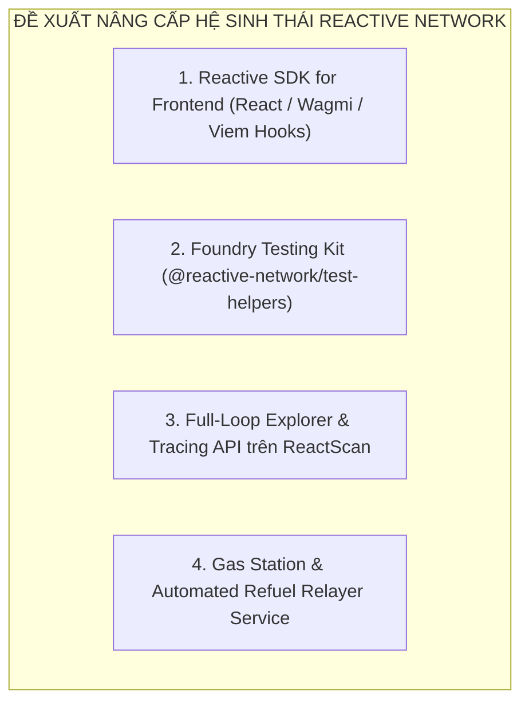

# BÁO CÁO ĐÁNH GIÁ KỸ THUẬT, TRẢI NGHIỆM PHÁT TRIỂN (DX) & KIẾN NGHỊ / BÁO LỖI CHO REACTIVE NETWORK
## Dự án: OmniFlow ("The Zapier of Web3") — Hackathon: Reactive Omni Buildathon 2026
**Mạng thử nghiệm kiểm chứng:** Reactive Omni Lasna Testnet (Chain ID: `5318007`) $\leftrightarrow$ Base Sepolia (Chain ID: `84532`) & Unichain Sepolia (Chain ID: `1301`)  
**Tác giả:** Đội ngũ Kỹ sư OmniFlow  
**Thời gian lập:** 22/11/2026  

---

## 1. TỔNG QUAN & BỐI CẢNH TRIỂN KHAI

Trong khuôn khổ cuộc thi **Reactive Omni Buildathon (Tháng 11 – Tháng 12/2026)** ở Track *Set It and Forget It*, đội ngũ OmniFlow đã xây dựng một nền tảng No-Code Cross-Chain Automation Studio đầu tiên trên hệ sinh thái Reactive Network. 

Hệ thống cho phép người dùng phổ thông thiết kế đồ thị trực quan (Visual Canvas DAG), biên dịch đồ thị thành các hợp đồng **Reactive Smart Contracts (RSC)** triển khai trên **Reactive Omni Lasna Testnet**, và điều phối thực thi các hành động bảo vệ quỹ, thanh khoản hoặc giao dịch (Take-Profit, Stop-Loss, Cross-Chain Hedge, SafeSweep) trên **Base Sepolia** thông qua cơ chế **Callback Proxy**.

Trong suốt quá trình R&D, thiết kế hợp đồng thông minh, kiểm thử fork với Foundry và thực thi vòng lặp khép kín (Full Loop Closed Cycle: Origin $\rightarrow$ Reactive $\rightarrow$ Destination Callback) trên mạng live testnet, chúng tôi đã có những trải nghiệm thực tế sâu sắc về kiến trúc, bộ công cụ `@reactive-network/reactive-lib`, trình khám phá block ReactScan cũng như các đặc tính runtime của ReactVM.

Tài liệu này tổng hợp:
1. **Đánh giá khách quan & Điểm sáng công nghệ** mà Reactive Network mang lại.
2. **Những thách thức & cạm bẫy thực chiến (Gotchas)** mà kỹ sư phải giải quyết khi làm việc với chuỗi có block time siêu tốc (như Base 200ms Denim).
3. **Báo cáo lỗi (Bug Reports), độ trễ chỉ mục & điểm nghẽn kỹ thuật**.
4. **Kiến nghị phát triển (Feature Requests & DX Proposals)** nhằm nâng tầm trải nghiệm lập trình viên Web3.

---

## 2. TRẢI NGHIỆM SỬ DỤNG & ĐIỂM SÁNG CÔNG NGHỆ (WHAT WE LOVE)

### 2.1. Đột phá mô hình thực thi tự trị (Inverted Autonomous Execution)
* **Loại bỏ hoàn toàn Relayer/Keeper tập trung:** Trước khi có Reactive Network, mọi giải pháp tự động hóa DeFi (như Gelato, Chainlink Automation, OpenZeppelin Defender) đều yêu cầu phụ thuộc vào off-chain keepers, bot runner tập trung hoặc mạng lưới validator độc lập ngoài chuỗi. Nếu server keeper sập hoặc cạn gas, giao dịch stop-loss của người dùng sẽ bị đóng băng.
* **Smart Contract lắng nghe và phản ứng trực tiếp:** Mô hình của Reactive Network đưa logic giám sát sự kiện (`service.subscribe(...)`) và phản ứng (`react(...)`) trực tiếp vào tầng EVM của Lasna Testnet. Hợp đồng trở thành một thực thể sống tự trị (Living Autonomous Agent), tự kích hoạt khi phát hiện topic mong muốn trên chuỗi nguồn.

### 2.2. Khả năng tương tác chuỗi chéo không cần cầu nối tập trung (Trustless Cross-Chain Flow)
* Khả năng bắt log sự kiện từ chuỗi EVM bất kỳ (như `Sync(uint112,uint112)` của Uniswap V2 trên Base Sepolia hoặc Unichain Sepolia) và phát lệnh gọi lại (Callback) tới hợp đồng đích thông qua `Callback Proxy` là một thiết kế vô cùng thanh thoát.
* Tính chất đồng thuận nhanh của CometBFT (~1s block time trên Lasna) giúp giảm thiểu đáng kể tổng độ trễ xuyên chuỗi từ khi biến động giá xảy ra tại sàn DEX đến khi lệnh bảo hiểm được thực thi trên chuỗi đích.

### 2.3. Thư viện chuẩn `@reactive-network/reactive-lib` được module hóa tốt
* Hai abstract contract cốt lõi `AbstractReactive` (trên Reactive chain) và `AbstractCallback` (trên Destination chain) cung cấp giao diện rõ ràng, phân định rạch ròi trách nhiệm giữa bộ não giám sát (RSC) và cánh tay hành động (Vault/Executor).
* Giao diện `IReactive` chuẩn hóa phương thức `react(...)` với chữ ký `(uint256 chain_id, address _contract, uint256 topic_0, uint256 topic_1, uint256 topic_2, uint256 topic_3, bytes calldata data, uint256 counter, uint256 block_number)`. Điều này tạo tiền đề vững chắc cho việc xây dựng các bộ biên dịch bytecode động như Universal Pipeline Engine của OmniFlow.

---

## 3. THÁCH THỨC KỸ THUẬT & BÀI HỌC THỰC CHIẾN (HANDS-ON GOTCHAS)

Trong quá trình đưa OmniFlow từ lý thuyết lên live on-chain, đội ngũ đã phát hiện 5 "điểm mù" và cạm bẫy kỹ thuật đặc thù của Reactive Network:

### 3.1. Cơn bão Callback xuyên chuỗi trên các Layer 2 có Block Time siêu tốc (200ms Denim Block Storm)
* **Bối cảnh:** Chuỗi Base Sepolia nâng cấp Denim giảm block time xuống còn xấp xỉ 200ms. Khi thị trường rung lắc mạnh, một pool DEX có thể phát sinh hàng chục sự kiện `Sync` liên tiếp trong vài giây.
* **Cạm bẫy:** Nếu hợp đồng RSC trên Lasna không có cơ chế chặn kịp thời, mỗi sự kiện `Sync` sẽ kích hoạt một lệnh `emit Callback(...)`. Các callback này sẽ dồn dập đổ vào hợp đồng Vault trên Base Sepolia, gây xung đột số dư, trượt giá nghiêm trọng hoặc nghẽn nonce/gas.
* **Giải pháp OmniFlow:** Bắt buộc áp dụng **Pattern Stateless Cooldown Timestamp** ngay tại dòng đầu tiên của hàm `react()`:
  ```solidity
  if (block.timestamp - lastTriggeredTimestamp < cooldownSeconds) {
      return; // Drop ngay trên Reactive VM, không sinh callback tốn gas!
  }
  lastTriggeredTimestamp = block.timestamp;
  ```

### 3.2. Quy ước Hai-Slot Payload & ReactVM Ghi đè Danh tính Caller (Two-Slot Callback Payload)
* **Bối cảnh:** Để bảo mật chống giả mạo lệnh gọi lại trên Destination Chain, hợp đồng đích kế thừa `AbstractCallback` cần xác định địa chỉ của RSC đã phát ra lệnh gọi.
* **Cạm bẫy:** Khi `Callback Proxy` của Reactive Network chuyển giao dịch đến chuỗi đích, cơ chế nội bộ của Proxy sẽ tự động ghi đè tham số vị trí đầu tiên bằng địa chỉ đại diện của RSC trên Lasna. Nếu nhà phát triển truyền trực tiếp địa chỉ người nhận hoặc số tiền vào Slot 1 calldata, dữ liệu đó sẽ bị Proxy xóa sạch!
* **Giải pháp OmniFlow:** Tuân thủ triệt để quy ước **Two-Slot Payload**:
  * Slot 1 (`bytes[0:32]`): Luôn để `address(0)` làm slot rỗng dự phòng cho Proxy ghi đè RVM ID.
  * Slot 2 (`bytes[32:64]`): Truyền `address(this)` (chính là địa chỉ RSC thực tế).
  * Hợp đồng đích giải mã `rscCaller` và kiểm tra quyền qua danh sách ủy quyền: `require(authorizedRSCs[rscCaller], "Unauthorized RSC")`.

### 3.3. Xung đột Môi trường Kiểm thử Foundry với ReactVM (`if (!vm)` Subscription Guard)
* **Bối cảnh:** Khi chạy unit test và fork test trên Foundry (`forge test`), máy ảo EVM tiêu chuẩn của Foundry không có precompile system của Reactive Network (`address(0x0000000000000000000000000000000000fffFfF)`).
* **Cạm bẫy:** Lệnh `service.subscribe(...)` trong constructor sẽ bị revert ngay lập tức trên Foundry test runner vì không gọi được precompile.
* **Giải pháp OmniFlow:** Sử dụng kỹ thuật phát hiện cheatcode của Foundry để bọc lệnh đăng ký:
  ```solidity
  bool isFoundryVm;
  assembly {
      isFoundryVm := extcodesize(0x7109709ECfa91a80626fF3989D68f67F5b1DD12D)
  }
  if (!isFoundryVm && address(service) != address(0)) {
      service.subscribe(chainId, emitter, topic0, topic1, topic2, topic3);
  }
  ```

### 3.4. Rủi ro trượt giá thời điểm thực thi (Stale Trigger vs Re-Validation)
* Khoảng thời gian từ khi log `Sync` phát ra trên Base $\rightarrow$ Lasna xử lý $\rightarrow$ Callback quay lại Base dao động từ 2 đến 5 giây. Trong khoảng thời gian này, giá pool có thể đã hồi phục do arbitrage bot. Nếu Vault mù quáng thực hiện swap theo giá trigger cũ, người dùng sẽ bị bán đáy hoặc chịu trượt giá nặng.
* **Giải pháp OmniFlow:** Vault đích luôn tái kiểm tra pool reserves tại thời điểm thực thi (`Live Price Re-Validation Pattern`) và so sánh với `minAmountOut` trước khi gọi router swap.

---

## 4. BÁO CÁO LỖI (BUG REPORTS) & ĐIỂM NGHẼN KỸ THUẬT

Dưới đây là các vấn đề kỹ thuật và điểm nghẽn thực tế được ghi nhận trong quá trình thử nghiệm trên **Lasna Testnet**:

### Bug / Issue #1: Trình khám phá ReactScan chậm chỉ mục và thiếu liên kết Cross-Chain Tracing
* **Mô tả:** Trình khám phá [ReactScan](https://lasna.reactscan.net) đôi khi bị trễ chỉ mục (indexing lag) từ 15 đến 45 giây sau khi giao dịch đã được xác nhận thành công bởi CometBFT RPC.
* **Hạn chế đối soát:** ReactScan hiển thị tốt các giao dịch trên chuỗi Lasna nhưng chưa có giao diện liên kết (Trace Link) trực tiếp:
  $$\text{Origin Tx (Basescan)} \xrightarrow{\text{Log Index}} \text{Reactive React Tx (ReactScan)} \xrightarrow{\text{Callback Debt}} \text{Destination Tx (Basescan)}$$
* **Hậu quả:** Kỹ sư phải tự xây dựng indexer riêng và quét qua calldata của Callback Proxy để ghép nối 3 giao dịch trong chu trình Full Loop.
* **Đề xuất khắc phục:** Cung cấp tính năng **"Cross-Chain Lifecycle View"** trên ReactScan, cho phép tìm kiếm theo `Origin Tx Hash` và tự động hiển thị cây liên kết đến React Tx và Destination Callback Tx.

### Bug / Issue #2: Socket Reset & Rate-Limit bất thường trên Public WebSocket RPC Lasna
* **Mô tả:** Endpoint WebSocket công khai của Lasna (`wss://lasna-rpc.reactive.network` hoặc qua RPC provider) thường xuyên bị ngắt kết nối (Connection Reset / EOF) khi backend duy trì kết nối theo dõi sự kiện trên 10 phút, hoặc khi gửi nhiều yêu cầu `eth_getLogs` cùng lúc.
* **Giải pháp tạm thời của OmniFlow:** Chúng tôi phải thiết lập cơ chế Ping/Pong Heartbeat 30 giây và bộ lọc tự động tái kết nối có lũy thừa lùi (Exponential Backoff Reconnect).
* **Đề xuất:** Cung cấp thêm hướng dẫn cấu hình WebSocket keep-alive tiêu chuẩn và nâng ngưỡng rate-limit cho môi trường builder hackathon.

### Bug / Issue #3: Tài liệu chưa đồng nhất về Ước tính Gas & Phí Nợ Callback (Callback Debt Accounting)
* **Mô tả:** Mô hình kinh tế của Reactive Network sử dụng `lREACT` làm native token trên Lasna, đồng thời yêu cầu trả phí callback trên chuỗi đích. Tuy nhiên, tài liệu hiện tại chưa giải thích chi tiết:
  1. Công thức chính xác quy đổi giữa gas tiêu thụ tại callback trên chuỗi đích và lượng `lREACT` bị trừ/nợ trên Lasna.
  2. Cách xử lý khi hợp đồng RSC có đủ `lREACT` nhưng tài khoản thanh toán callback trên chuỗi đích cạn kiệt gas (trường hợp Callback bị `OutOfGas` hoặc `ExecutionFailed`).
* **Đề xuất:** Bổ sung trang tài liệu chuyên sâu kèm sơ đồ mô tả luồng nợ phí (*Gas Debt & Liquidation Lifecycle*) và các sự kiện hệ thống phát ra khi callback bị thiếu gas.

### Bug / Issue #4: Hạn chế Mô phỏng ReactVM trong Môi trường Kiểm thử Cục bộ (Local Foundry Testbed)
* **Mô tả:** Hiện tại chưa có công cụ chính thức từ Reactive Network để giả lập máy ảo ReactVM cục bộ (Local ReactVM Mock Engine) bên trong Foundry hoặc Hardhat.
* **Hạn chế:** Các lập trình viên không thể viết integration test tự động kiểm chứng trọn vẹn luồng "Phát log trên chuỗi A $\rightarrow$ Kích hoạt `react()` $\rightarrow$ Gọi hàm trên chuỗi B" trong cùng một phiên test Foundry mà bắt buộc phải deploy trực tiếp lên testnet công khai.
* **Đề xuất:** Phát hành thư viện `@reactive-network/foundry-test-helpers` cung cấp cheatcode hoặc mock contract (ví dụ: `ReactiveHarness.sol`) cho phép giả lập việc chuyển phát log và callback ngay trong bộ nhớ local test.

### Bug / Issue #5: Khả năng cấu hình Reactive Cron Subscription trên Testnet
* **Mô tả:** Theo tài liệu, Reactive Network hỗ trợ đăng ký sự kiện Cron định kỳ (`Reactive Cron`). Tuy nhiên, trên Lasna Testnet, tần suất các tick hệ thống và mức phí tiêu hao cho các cron tick ngắn (ví dụ: tick mỗi 1 phút hoặc 5 phút) chưa được công bố rõ ràng về bảng biểu phí, gây khó khăn cho việc dự toán ngân sách hoạt động 24/7 của các bot Rebalancer hoặc Weekly Harvest.
* **Đề xuất:** Cung cấp dashboard tra cứu các lịch Cron khả dụng trên Lasna Testnet và mức phí `lREACT` ước tính cho từng chu kỳ tick.

---

## 5. ĐỀ XUẤT CẢI TIẾN TRẢI NGHIỆM LẬP TRÌNH VIÊN (DEVELOPER EXPERIENCE — DX)

Nhằm giúp hệ sinh thái Reactive Network bứt phá và thu hút hàng nghìn nhà phát triển Web3, chúng tôi đề xuất 4 sáng kiến nâng cấp DX:



1. **Bộ React Hooks / TypeScript SDK chính thức (`@reactive-network/hooks`):**
   * Cung cấp các React hooks tiện dụng như `useRSCSubscription(rscAddress)`, `useCallbackStatus(txHash)`, `useRSCGasBalance(rscAddress)` giúp lập trình viên frontend dễ dàng xây dựng giao diện dApp mà không cần tự cấu hình viem RPC client thủ công.
2. **Foundry Testing Harness (`ReactiveTest.sol`):**
   * Cho phép kiểm thử hàm `react(...)` cục bộ với các hàm trợ giúp như `vm.mockReactiveLog(...)` và `vm.expectCallback(...)`.
3. **Cơ chế Tài trợ Gas / Paymaster Thống nhất (Universal Gas Station):**
   * Cho phép dApp tài trợ sẵn một quỹ `lREACT` và người dùng có thể nạp trực tiếp bằng ERC-20 / Native token trên chuỗi gốc (Base Sepolia) mà không cần phải thực hiện bridge hoặc đổi ví sang mạng Lasna để nạp `lREACT`.
4. **Chuẩn hóa Error Codes cho Callback Reverts:**
   * Khi lệnh callback trên chuỗi đích bị revert, hiện tại ReactScan chỉ ghi nhận trạng thái chung chung. Cần ánh xạ cụ thể lý do revert (Revert Reason string hoặc Custom Error signature) để việc debug trở nên trực quan và nhanh chóng.

---

## 6. KẾT LUẬN & ĐÁNH GIÁ CHUNG

Reactive Network đại diện cho một bước nhảy vọt quan trọng trong tiến trình phát triển của điện toán phi tập trung. Việc chuyển dịch từ mô hình "Off-chain Bots liên tục thăm dò (Polling)" sang mô hình **"On-Chain Event-Driven Native Reactivity"** mở ra vô vàn tiềm năng ứng dụng từ DeFi tự quản, phòng vệ rủi ro cross-chain, quản trị DAO tự động đến các tác nhân AI Web3 tự hành.

Đội ngũ **OmniFlow** đánh giá rất cao sự ổn định của mạng Lasna Testnet trong các lượt kiểm thử Full Loop, tính thanh thoát của thư viện `@reactive-network/reactive-lib`, và cam kết sẽ tiếp tục đồng hành, hoàn thiện toàn bộ **16 kịch bản mở rộng** trong tương lai để đưa OmniFlow trở thành trung tâm tự động hóa số một của hệ sinh thái Reactive Network.

---
*Tài liệu này được lưu trữ chính thức trong cây thư mục dự án tại [docs/REACTIVE_NETWORK_EVALUATION_AND_FEEDBACK.md](file:///D:/Coding/OmniFlow/docs/REACTIVE_NETWORK_EVALUATION_AND_FEEDBACK.md).*
